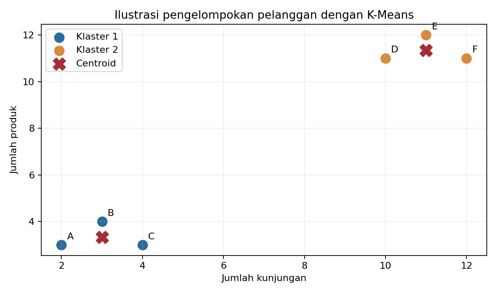
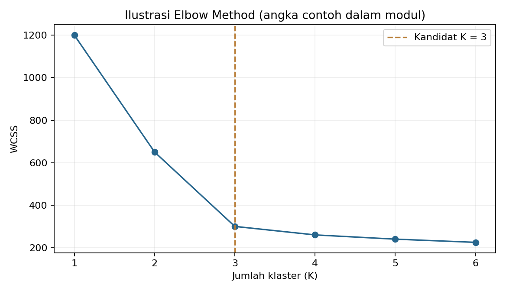
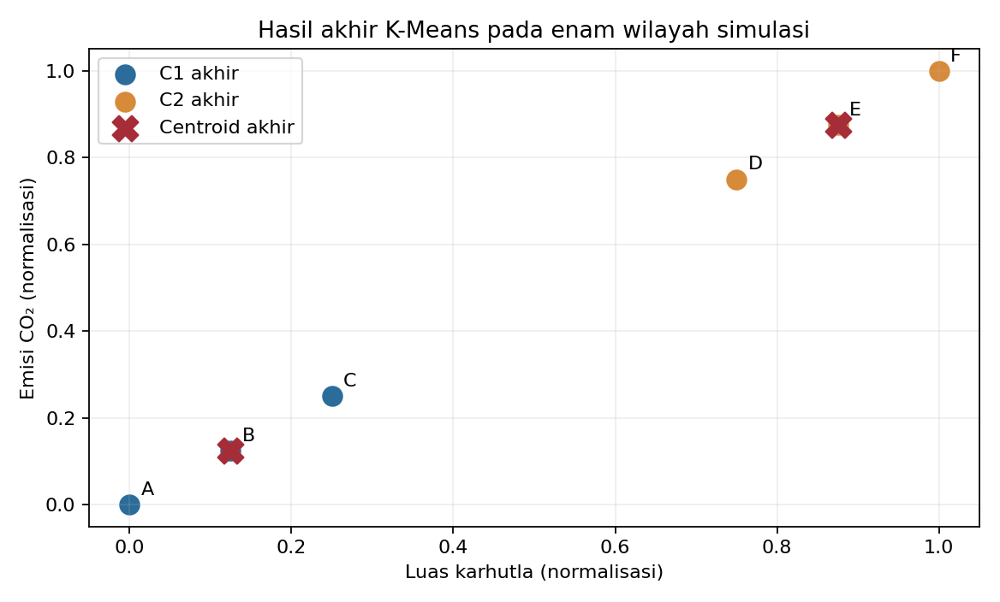
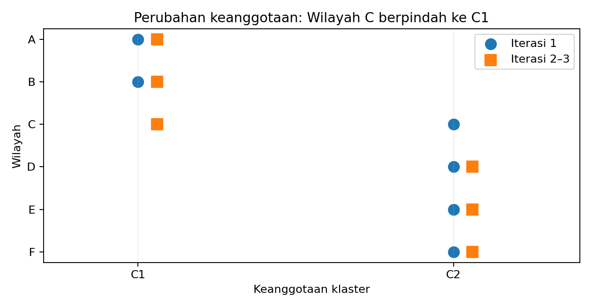
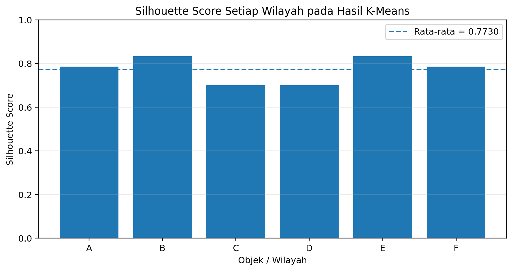
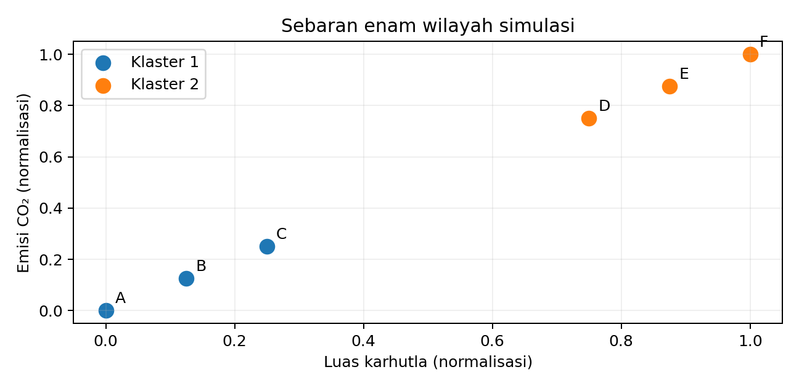
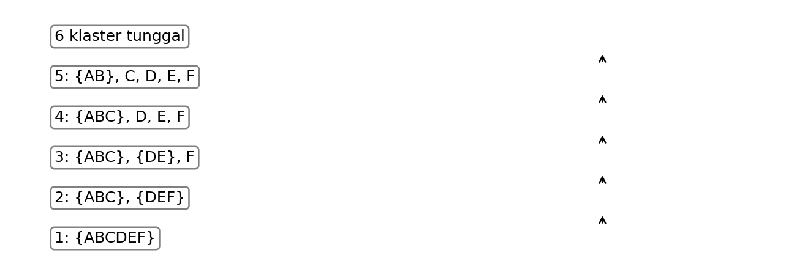
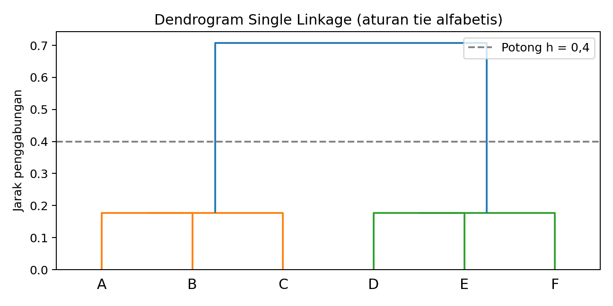
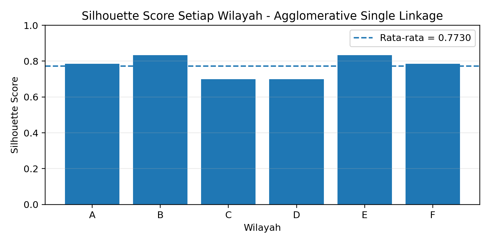

# KLASTERING (CLUSTERING)


**Konsep, Prinsip Kerja, Jenis Algoritma, Perhitungan Matematis, Evaluasi, dan Implementasi**

## 1. PENGERTIAN KLASTERING

Klastering (Clustering) adalah teknik dalam Machine Learning yang digunakan untuk mengelompokkan sejumlah objek atau data ke dalam beberapa kelompok (cluster) berdasarkan tingkat kemiripan karakteristiknya, tanpa menggunakan label kelas yang telah ditentukan sebelumnya.

Klastering merupakan salah satu metode utama dalam Unsupervised Learning (pembelajaran tanpa pengawasan).

Dalam klastering, algoritma berusaha menemukan pola, struktur, atau hubungan tersembunyi dalam suatu dataset berdasarkan karakteristik setiap objek.

Prinsip dasar klastering adalah:

- Objek dalam satu klaster memiliki karakteristik yang relatif mirip (intra-cluster similarity).

- Objek yang berada pada klaster berbeda memiliki karakteristik yang relatif tidak mirip (inter-cluster dissimilarity).

### 1.1. Contoh Sederhana

Misalkan sebuah minimarket mempunyai data enam pelanggan berdasarkan dua karakteristik: jumlah kunjungan dalam satu bulan dan total pengeluaran dalam satu bulan.

**Tabel 1. Contoh Dataset Perilaku Pelanggan Minimarket**

| Pelanggan | Jumlah Kunjungan | Total Belanja (Rp) |
| :--- | :--- | :--- |
| P1 | 2 | 100.000 |
| P2 | 3 | 150.000 |
| P3 | 4 | 200.000 |
| P4 | 12 | 800.000 |
| P5 | 14 | 900.000 |
| P6 | 15 | 1.000.000 |

Berdasarkan data tersebut, secara intuitif kita dapat melihat adanya dua kelompok pelanggan. Kelompok pertama adalah P1, P2, dan P3; kelompok kedua adalah P4, P5, dan P6.

**Tabel 2. Contoh Hasil Klastering Pelanggan Minimarket**

| Pelanggan | Jumlah Kunjungan | Total Belanja (Rp) | Klaster |
| :--- | :--- | :--- | :--- |
| P1 | 2 | 100.000 | Cluster 0 |
| P2 | 3 | 150.000 | Cluster 0 |
| P3 | 4 | 200.000 | Cluster 0 |
| P4 | 12 | 800.000 | Cluster 1 |
| P5 | 14 | 900.000 | Cluster 1 |
| P6 | 15 | 1.000.000 | Cluster 1 |

Algoritma klastering tidak mengetahui bahwa Cluster 0 merupakan pelanggan dengan aktivitas belanja rendah dan Cluster 1 merupakan pelanggan dengan aktivitas belanja tinggi. Penamaan kelompok dilakukan oleh peneliti setelah menganalisis karakteristik masing-masing klaster.

## 2. MENGAPA KLASTERING TERMASUK UNSUPERVISED LEARNING?

Klastering termasuk dalam kategori Unsupervised Learning karena proses pembelajarannya tidak memerlukan variabel target atau label kelas.

### 2.1. Supervised Learning

Dalam Supervised Learning, setiap data memiliki label yang digunakan sebagai acuan pembelajaran.

**Tabel 3. Dataset Supervised Learning**

| Pelanggan | Kunjungan | Belanja (Rp) | Kategori |
| :--- | :--- | :--- | :--- |
| P1 | 2 | 100.000 | Rendah |
| P2 | 3 | 150.000 | Rendah |
| P3 | 4 | 200.000 | Rendah |
| P4 | 12 | 800.000 | Tinggi |
| P5 | 14 | 900.000 | Tinggi |
| P6 | 15 | 1.000.000 | Tinggi |

### 2.2. Unsupervised Learning

Dalam Unsupervised Learning, dataset tidak mempunyai label kelas. Algoritma akan mencari sendiri struktur pengelompokan berdasarkan karakteristik data.

### 2.3. Perbedaan Klasifikasi dan Klastering

| Aspek | Klasifikasi | Klastering |
| :--- | :--- | :--- |
| Jenis pembelajaran | Supervised Learning | Unsupervised Learning |
| Label kelas | Diperlukan | Tidak diperlukan |
| Tujuan | Memprediksi kelas | Menemukan kelompok |
| Variabel target | Ada | Tidak ada |
| Contoh algoritma | KNN, Decision Tree, Naive Bayes | K-Means, DBSCAN, Agglomerative |
| Evaluasi | Accuracy, Precision, Recall, F1 | Silhouette Score, Davies-Bouldin Index |

## 3. TUJUAN KLASTERING DALAM MACHINE LEARNING

### 3.1. Menemukan Pola Tersembunyi

Klastering digunakan untuk menemukan pola yang tidak langsung terlihat dalam dataset.

### 3.2. Segmentasi Data

Segmentasi merupakan proses membagi sekumpulan objek menjadi beberapa kelompok berdasarkan karakteristik tertentu.

### 3.3. Mendukung Pengambilan Keputusan

Hasil klastering dapat digunakan sebagai dasar penyusunan strategi atau kebijakan.

### 3.4. Menyederhanakan Analisis Dataset

Klastering dapat membantu merangkum karakteristik data menjadi beberapa kelompok sehingga pola umum lebih mudah dipahami.

### 3.5. Mendukung Penelitian Eksploratif

Klastering sangat bermanfaat ketika peneliti belum mengetahui struktur kelompok dalam dataset.

## 4. KONSEP DASAR DALAM KLASTERING

### 4.1. Data atau Objek

Objek adalah unit yang akan dikelompokkan, misalnya pelanggan, mahasiswa, kabupaten, provinsi, produk, dan transaksi.

### 4.2. Fitur atau Variabel

Fitur merupakan karakteristik yang digunakan untuk membandingkan objek.

### 4.3. Cluster

Cluster adalah kelompok objek yang memiliki karakteristik relatif mirip berdasarkan ukuran kemiripan yang digunakan.

### 4.4. Centroid

Centroid adalah titik pusat suatu klaster yang dihitung berdasarkan rata-rata nilai fitur seluruh anggota klaster.

### 4.5. Jarak Antarobjek

Salah satu prinsip penting dalam klastering adalah mengukur kedekatan atau kemiripan antarobjek.

Xᵢ = (xᵢ₁, xᵢ₂)

μ₁ = (2 + 4 + 6)/3 = 4

μ₂ = (4 + 6 + 8)/3 = 6

μ = (4, 6)

d(A,B) = √((xₐ₁ - xᵦ₁)² + (xₐ₂ - xᵦ₂)²)

d(A,B) = √((2-5)² + (3-7)²) = √25 = 5

## 5. BAGAIMANA CARA KERJA KLASTERING?

### Tahap 1. Mengumpulkan Dataset

Peneliti mengumpulkan data berdasarkan tujuan penelitian.

### Tahap 2. Menentukan Objek

Peneliti menentukan unit yang akan dikelompokkan.

### Tahap 3. Menentukan Fitur

Peneliti memilih karakteristik yang relevan untuk pengelompokan.

### Tahap 4. Melakukan Preprocessing

Memeriksa missing value, duplikasi, outlier, transformasi, dan penskalaan.

### Tahap 5. Menentukan Algoritma

Memilih algoritma sesuai karakteristik dataset.

### Tahap 6. Melakukan Proses Klastering

Algoritma melakukan pengelompokan berdasarkan aturan matematis.

### Tahap 7. Mengevaluasi Hasil

Mengevaluasi menggunakan Silhouette Score, DBI, atau CH.

### Tahap 8. Menginterpretasikan Klaster

Menganalisis karakteristik setiap kelompok.

## 6. JENIS-JENIS ALGORITMA KLASTERING

### 6.1. Partition-Based Clustering

Partition-Based Clustering membagi dataset menjadi sejumlah kelompok. K-Means mengelompokkan objek berdasarkan kedekatannya terhadap centroid.

### 6.2. Hierarchical Clustering

Hierarchical Clustering membentuk struktur hierarki antarklaster. Agglomerative menggunakan pendekatan bottom-up, sedangkan Divisive menggunakan pendekatan top-down.

### 6.3. Density-Based Clustering

DBSCAN mengelompokkan objek berdasarkan kepadatan dan dapat mengidentifikasi noise.

### 6.4. Model-Based Clustering

Gaussian Mixture Model (GMM) menggunakan probabilitas keanggotaan suatu objek pada beberapa klaster.

J = ∑ₖ₌₁ᴷ ∑ₓᵢ∈Cₖ ‖xᵢ - μₖ‖²

ε = radius lingkungan

MinPts = minimum jumlah titik dalam lingkungan

## 7. PERBANDINGAN ALGORITMA KLASTERING

| Algoritma | Pendekatan | Menentukan K di Awal | Kelebihan Utama |
| :--- | :--- | :--- | :--- |
| K-Means | Partition-Based | Ya | Sederhana dan efisien |
| K-Medoids | Partition-Based | Ya | Lebih tahan outlier |
| Agglomerative | Hierarchical | Tidak harus | Struktur hierarki |
| DBSCAN | Density-Based | Tidak | Mengidentifikasi noise |
| OPTICS | Density-Based | Tidak | Variasi kepadatan |
| GMM | Model-Based | Ya | Probabilitas keanggotaan |
| Spectral | Graph-Based | Umumnya ya | Struktur nonlinier |

## 8. CONTOH PERHITUNGAN MATEMATIS K-MEANS SECARA MANUAL

### 8.1. Dataset

| Pelanggan | X1 | X2 |
| :--- | :--- | :--- |
| A | 2 | 3 |
| B | 3 | 4 |
| C | 4 | 3 |
| D | 10 | 11 |
| E | 11 | 12 |
| F | 12 | 11 |

### 8.2. Menentukan Centroid Awal

K = 2

C₁ = (2,3)

C₂ = (10,11)

### 8.3. Menghitung Jarak Setiap Objek terhadap Centroid

#### Objek A

Koordinat: (2,3)

d(A,C₁) = 0

d(A,C₂) = 11,314

#### Objek B

Koordinat: (3,4)

d(B,C₁) = 1,414

d(B,C₂) = 9,899

#### Objek C

Koordinat: (4,3)

d(C,C₁) = 2

d(C,C₂) = 10

#### Objek D

Koordinat: (10,11)

d(D,C₁) = 11,314

d(D,C₂) = 0

#### Objek E

Koordinat: (11,12)

d(E,C₁) = 12,728

d(E,C₂) = 1,414

#### Objek F

Koordinat: (12,11)

d(F,C₁) = 12,806

d(F,C₂) = 2

### 8.4. Hasil Pengelompokan Iterasi Pertama

| Objek | Jarak ke C1 | Jarak ke C2 | Klaster |
| :--- | :--- | :--- | :--- |
| A | 0,000 | 11,314 | 1 |
| B | 1,414 | 9,899 | 1 |
| C | 2,000 | 10,000 | 1 |
| D | 11,314 | 0,000 | 2 |
| E | 12,728 | 1,414 | 2 |
| F | 12,806 | 2,000 | 2 |

### 8.5. Menghitung Centroid Baru

μ₁₁ = (2+3+4)/3 = 3

μ₁₂ = (3+4+3)/3 = 3,333

C₁ = (3; 3,333)

μ₂₁ = (10+11+12)/3 = 11

μ₂₂ = (11+12+11)/3 = 11,333

C₂ = (11; 11,333)

### 8.6. Melakukan Iterasi Kedua

| Objek | Jarak ke C1 | Jarak ke C2 | Klaster |
| :--- | :--- | :--- | :--- |
| A | 1,054 | 12,266 | 1 |
| B | 0,667 | 10,854 | 1 |
| C | 1,054 | 10,883 | 1 |
| D | 10,381 | 1,054 | 2 |
| E | 11,795 | 0,667 | 2 |
| F | 11,823 | 1,054 | 2 |

Karena tidak ada perubahan keanggotaan, algoritma telah mencapai kondisi konvergen.

## 9. HASIL AKHIR KLASTERING



*Gambar 1. Visualisasi klaster pelanggan dan centroid.*

| Pelanggan | Kunjungan | Jumlah Produk | Klaster |
| :--- | :--- | :--- | :--- |
| A | 2 | 3 | 1 |
| B | 3 | 4 | 1 |
| C | 4 | 3 | 1 |
| D | 10 | 11 | 2 |
| E | 11 | 12 | 2 |
| F | 12 | 11 | 2 |

Cluster 1 mempunyai centroid (3; 3,333) dan dapat diinterpretasikan sebagai pelanggan dengan aktivitas pembelian relatif rendah. Cluster 2 mempunyai centroid (11; 11,333) dan dapat diinterpretasikan sebagai pelanggan dengan aktivitas pembelian relatif tinggi.

## 10. MENGAPA DATA PERLU DINORMALISASI ATAU DISTANDARDISASI?

Perbedaan skala antarfitur dapat menyebabkan fitur dengan rentang nilai lebih besar mendominasi perhitungan jarak.

### 10.1. Min-Max Normalization

X' = (X - Xₘᵢₙ)/(Xₘₐₓ - Xₘᵢₙ)

X' = (4-2)/(12-2) = 0,2

### 10.2. Standardisasi Z-Score

Z = (X - μ)/σ

## 11. BAGAIMANA MENENTUKAN JUMLAH KLASTER YANG OPTIMAL?

### 11.1. Elbow Method



*Gambar 2. Kurva Elbow Method berdasarkan data ilustrasi modul.*

WCSS = ∑ₖ₌₁ᴷ ∑ₓᵢ∈Cₖ ‖xᵢ-μₖ‖²

| K | WCSS |
| :--- | :--- |
| 1 | 1200 |
| 2 | 650 |
| 3 | 300 |
| 4 | 260 |
| 5 | 240 |
| 6 | 225 |

### 11.2. Silhouette Score

s(i) = (b(i) - a(i))/max(a(i), b(i))

-1 ≤ s(i) ≤ 1

### 11.3. Davies-Bouldin Index

DBI = (1/K) ∑ᵢ₌₁ᴷ maxⱼ≠ᵢ ((Sᵢ+Sⱼ)/Mᵢⱼ)

### 11.4. Calinski-Harabasz Index

CH = [Bₖ/(K-1)]/[Wₖ/(n-K)]

| Metrik | Tujuan | Kriteria Umum |
| :--- | :--- | :--- |
| WCSS | Kekompakan klaster | Lebih kecil |
| Silhouette Score | Kekompakan dan pemisahan | Lebih besar |
| Davies-Bouldin Index | Kemiripan relatif antarklaster | Lebih kecil |
| Calinski-Harabasz Index | Rasio pemisahan dan kekompakan | Lebih besar |

## 12. PERBEDAAN KLASTERING DENGAN REGRESI DAN KLASIFIKASI

| Aspek | Regresi | Klasifikasi | Klastering |
| :--- | :--- | :--- | :--- |
| Tujuan | Prediksi nilai | Prediksi kategori | Pengelompokan |
| Pembelajaran | Supervised | Supervised | Unsupervised |
| Target | Numerik | Kategorikal | Tidak ada |
| Evaluasi | MAE, RMSE, R² | Accuracy, F1 | Silhouette, DBI |

## 13. KARAKTERISTIK DATASET YANG BAIK UNTUK KLASTERING

### 13.1. Memiliki Objek yang Jelas

Setiap baris harus merepresentasikan objek yang dapat diidentifikasi secara konsisten.

### 13.2. Memiliki Fitur yang Relevan

Fitur harus sesuai dengan tujuan penelitian.

### 13.3. Memiliki Jumlah Observasi yang Memadai

Tidak terdapat jumlah minimum universal yang menjamin keberhasilan klastering.

### 13.4. Memiliki Variasi Data

Data harus mengandung informasi yang memungkinkan pengelompokan bermakna.

### 13.5. Memiliki Kualitas Data yang Baik

Periksa missing value, duplikasi, kesalahan pencatatan, satuan, dan outlier.

### 13.6. Mempertimbangkan Korelasi Antarfitur

Korelasi tinggi perlu dianalisis dan dijelaskan.

## 14. KESALAHAN YANG SERING TERJADI DALAM PENELITIAN KLASTERING

- Menggunakan fitur yang tidak relevan.

- Tidak melakukan penskalaan data.

- Menentukan jumlah klaster secara sembarangan.

- Menganggap nomor klaster sebagai tingkatan.

- Langsung menghapus outlier.

- Menghapus seluruh objek bernilai nol tanpa analisis.

- Menggunakan metrik klasifikasi tanpa label acuan.

- Menganggap klaster sebagai kategori objektif yang pasti.

## 15. CONTOH PENERAPAN KLASTERING DALAM PENELITIAN DI INDONESIA

| Bidang | Objek | Fitur | Algoritma |
| :--- | :--- | :--- | :--- |
| Kehutanan | Provinsi | Luas kebakaran, emisi CO₂ | K-Means |
| Pertanian | Kabupaten | Luas panen, produksi padi | K-Means |
| Pendidikan | Mahasiswa | Kehadiran, nilai, LMS | Agglomerative |
| Ekonomi | Kabupaten | Kemiskinan, pengangguran | K-Means |
| Kesehatan | Kabupaten | Prevalensi, layanan | Agglomerative |
| Pemasaran | Pelanggan | Frekuensi, transaksi, recency | K-Means |
| Lingkungan | Wilayah | Polutan | DBSCAN |

## 16. CONTOH IMPLEMENTASI K-MEANS MENGGUNAKAN PYTHON

```python
import pandas as pd
from sklearn.cluster import KMeans
from sklearn.metrics import silhouette_score, davies_bouldin_score
import matplotlib.pyplot as plt

data = {'Pelanggan':['A','B','C','D','E','F'],
'Kunjungan':[2,3,4,10,11,12],
'Jumlah_Produk':[3,4,3,11,12,11]}
df = pd.DataFrame(data)
print(df)
X = df[['Kunjungan','Jumlah_Produk']]
model = KMeans(n_clusters=2, init='k-means++', random_state=42, n_init=10)
df['Cluster'] = model.fit_predict(X)
print(df)
print(model.cluster_centers_)
print('Silhouette:', silhouette_score(X, df['Cluster']))
print('DBI:', davies_bouldin_score(X, df['Cluster']))
plt.scatter(df['Kunjungan'], df['Jumlah_Produk'], c=df['Cluster'])
plt.scatter(model.cluster_centers_[:,0], model.cluster_centers_[:,1], marker='X', s=250)
plt.xlabel('Jumlah Kunjungan')
plt.ylabel('Jumlah Produk')
plt.show()
```

## 17. BAGAIMANA MENGINTERPRETASIKAN HASIL KLASTERING DALAM ARTIKEL ILMIAH?

Peneliti perlu menjelaskan karakteristik setiap kelompok berdasarkan hasil analisis statistik.

| Klaster | Jumlah Provinsi | Rata-rata Luas Kebakaran (ha) | Rata-rata Emisi CO₂ (ton) | Interpretasi |
| :--- | :--- | :--- | :--- | :--- |
| 0 | 15 | 500 | 2500 | Dampak rendah |
| 1 | 13 | 5000 | 25000 | Dampak sedang |
| 2 | 10 | 30000 | 150000 | Dampak tinggi |

Angka tersebut merupakan ilustrasi, bukan hasil pengolahan data SiPongi.

## 18. STRUKTUR PENELITIAN KLASTERING UNTUK ARTIKEL ILMIAH

Format penulisan artikel pada Bagian Hasil dan Pembahasan

### 4.1. Deskripsi Dataset

**Tabel 1. Statistik Deskriptif Dataset**

### 4.2. Analisis Karakteristik Fitur

**Tabel 2. Matriks Korelasi Pearson Antarfitur; Gambar 1. Heatmap Korelasi Pearson**

### 4.3. Preprocessing Dataset

**Tabel 3. Hasil Pemeriksaan Kualitas dan Preprocessing Dataset**

### 4.4. Penentuan Jumlah Klaster Optimal

**Tabel 4. WCSS, Silhouette Score, dan DBI; Gambar 2. Elbow Method; Gambar 3. Silhouette Score**

### 4.5. Hasil Pemodelan K-Means

**Tabel 5. Hasil Pengelompokan; Gambar 4. Visualisasi Sebaran Objek**

### 4.6. Analisis Karakteristik Klaster

**Tabel 6. Statistik Karakteristik; Gambar 5. Perbandingan Rata-rata Fitur**

### 4.7. Evaluasi Kualitas Klaster

**Tabel 7. Evaluasi Silhouette, DBI, dan CH**

### 4.8. Pembahasan

Makna hasil, keterkaitan penelitian terdahulu, dan implikasi.

## 19. RINGKASAN KONSEP PENTING KLASTERING

| Konsep | Penjelasan |
| :--- | :--- |
| Clustering | Pengelompokan objek berdasarkan kemiripan |
| Unsupervised Learning | Pembelajaran tanpa label target |
| Cluster | Kelompok objek |
| Feature | Variabel pengelompokan |
| Centroid | Titik pusat rata-rata |
| Euclidean Distance | Jarak geometris |
| K-Means | Algoritma berbasis centroid |
| K | Jumlah klaster |
| Konvergensi | Pengelompokan stabil |
| Silhouette Score | Metrik kekompakan dan pemisahan |
| Davies-Bouldin Index | Metrik evaluasi klaster |

## 20. KESIMPULAN

Klastering merupakan salah satu teknik fundamental dalam Unsupervised Machine Learning yang bertujuan mengelompokkan objek berdasarkan kemiripan karakteristik tanpa memerlukan label kelas sebelumnya. Melalui klastering, peneliti dapat menemukan struktur tersembunyi, memahami pola dalam dataset, melakukan segmentasi, dan memperoleh informasi yang mendukung pengambilan keputusan.

Keberhasilan penelitian klastering tidak hanya ditentukan oleh algoritma yang digunakan. Kualitas dataset, relevansi fitur, preprocessing, pemilihan jumlah klaster, evaluasi, dan interpretasi hasil merupakan faktor yang sangat penting.

Dengan demikian, klastering bukan sekadar proses membagi data menjadi beberapa kelompok, melainkan metode analisis untuk menemukan dan memahami struktur yang terkandung dalam data.


---

# PERHITUNGAN MANUAL K-MEANS CLUSTERING PADA DATASET KEBAKARAN HUTAN DAN LAHAN (KARHUTLA)


Metode    :     K-Means Clustering

Studi kasus    :     Pengelompokan wilayah berdasarkan luas kebakaran hutan dan lahan serta emisi CO₂

Pendekatan    :     Perhitungan matematika manual secara bertahap dan terbimbing

Tingkat    :     Mahasiswa S1/D4

Tujuan    :     Mahasiswa mampu menghitung seluruh tahapan K-Means tanpa menggunakan Python atau aplikasi statistik.

Catatan    :     Dataset dalam praktikum ini merupakan data simulasi yang dirancang untuk pembelajaran matematika K-Means, bukan data observasi resmi SiPongi. Angkanya dibuat sederhana agar mahasiswa dapat menghitung setiap tahap secara manual.

## A. TUJUAN PEMBELAJARAN

1. Memahami struktur dataset untuk klastering.

2. Menentukan variabel yang digunakan dalam K-Means.

3. Menentukan jumlah klaster (K).

4. Menentukan centroid awal.

5. Menghitung Euclidean Distance secara manual.

6. Menentukan keanggotaan klaster berdasarkan jarak minimum.

7. Menghitung centroid baru.

8. Melakukan iterasi hingga konvergen.

9. Menghitung Within-Cluster Sum of Squares (WCSS).

10. Menginterpretasikan karakteristik setiap klaster berdasarkan data karhutla.

## B. STUDI KASUS DAN DATASET

### 1. Permasalahan Penelitian

Kebakaran hutan dan lahan (karhutla) merupakan salah satu permasalahan lingkungan yang terjadi di berbagai wilayah Indonesia.

Setiap wilayah memiliki karakteristik kebakaran yang berbeda, baik berdasarkan luas lahan terbakar maupun emisi karbon yang dihasilkan.

Untuk memahami perbedaan tersebut, peneliti ingin mengelompokkan wilayah berdasarkan dua indikator:

- Luas kebakaran hutan dan lahan.

- Emisi karbon dioksida (CO₂).

Pengelompokan dilakukan menggunakan algoritma K-Means Clustering.

Pertanyaan penelitian: Bagaimana mengelompokkan wilayah berdasarkan kemiripan luas kebakaran hutan dan lahan serta emisi CO₂ menggunakan algoritma K-Means Clustering?

### 2. Dataset Karhutla

Untuk memudahkan perhitungan manual, digunakan enam wilayah simulasi.

**Tabel 1. Dataset Karhutla untuk Praktikum K-Means**

| Kode | Wilayah | Luas Karhutla (ha) | Emisi CO₂ (ton) |
| :--- | :--- | :--- | :--- |
| A | Wilayah A | 100 | 200 |
| B | Wilayah B | 200 | 300 |
| C | Wilayah C | 300 | 400 |
| D | Wilayah D | 700 | 800 |
| E | Wilayah E | 800 | 900 |
| F | Wilayah F | 900 | 1000 |

Dataset mempunyai:

- Jumlah observasi: 6 wilayah.

- Jumlah fitur: 2.

- Jumlah label kelas: tidak ada.

Variabel yang digunakan adalah:

X₁ = Luas Karhutla (ha)

X₂ = Emisi CO₂ (ton)

Karena K-Means merupakan algoritma Unsupervised Learning, dataset tidak membutuhkan variabel target.

## C. TAHAP 1 — NORMALISASI DATASET

### 1. Mengapa Dataset Perlu Dinormalisasi?

Perhatikan rentang nilai kedua fitur.

100 ≤ X₁ ≤ 900

200 ≤ X₂ ≤ 1000

Kedua fitur memiliki satuan berbeda, yaitu hektare dan ton. Jika langsung menggunakan Euclidean Distance, hasil perhitungan dipengaruhi oleh skala numerik setiap fitur.

Oleh karena itu, pada praktikum ini digunakan Min-Max Normalization agar kedua fitur mempunyai rentang nilai yang sama.

X' = (X - Xₘᵢₙ)/(Xₘₐₓ - Xₘᵢₙ)

Keterangan:

- X′: nilai setelah normalisasi.

- X: nilai asli.

- Xₘᵢₙ: nilai minimum fitur.

- Xₘₐₓ: nilai maksimum fitur.

### 2. Normalisasi Luas Karhutla

Diketahui:

Xₘᵢₙ = 100

Xₘₐₓ = 900

X' = (X - 100)/(900 - 100)

X' = (X - 100)/800

### Wilayah A

X'A = (100 - 100)/800

= 0/800

X'A = 0

### Wilayah B

X'B = (200 - 100)/800

= 100/800

X'B = 0,125

### Wilayah C

X'C = (300 - 100)/800

= 200/800

X'C = 0,25

### Wilayah D

X'D = (700 - 100)/800

= 600/800

X'D = 0,75

### Wilayah E

X'E = (800 - 100)/800

= 700/800

X'E = 0,875

### Wilayah F

X'F = (900 - 100)/800

= 800/800

X'F = 1

### 3. Normalisasi Emisi CO₂

Diketahui:

Xₘᵢₙ = 200

Xₘₐₓ = 1000

X' = (X - 200)/(1000 - 200)

X' = (X - 200)/800

### Wilayah A

X'A = (200 - 200)/800 = 0

### Wilayah B

X'B = (300 - 200)/800 = 0,125

### Wilayah C

X'C = (400 - 200)/800 = 0,25

### Wilayah D

X'D = (800 - 200)/800 = 0,75

### Wilayah E

X'E = (900 - 200)/800 = 0,875

### Wilayah F

X'F = (1000 - 200)/800 = 1

### 4. Hasil Normalisasi

**Tabel 2. Dataset Karhutla Setelah Normalisasi Min-Max**

| Wilayah | X1 Normalisasi | X2 Normalisasi |
| :--- | :--- | :--- |
| A | 0,000 | 0,000 |
| B | 0,125 | 0,125 |
| C | 0,250 | 0,250 |
| D | 0,750 | 0,750 |
| E | 0,875 | 0,875 |
| F | 1,000 | 1,000 |

Dataset inilah yang digunakan dalam seluruh perhitungan K-Means.

Catatan pembelajaran: Kedua fitur pada dataset simulasi ini memiliki hubungan linear sempurna. Kondisi tersebut sengaja digunakan untuk mempermudah perhitungan awal. Pada dataset karhutla sebenarnya, hubungan luas kebakaran dan emisi CO₂ tidak harus linear sempurna.

## D. TAHAP 2 — MENENTUKAN JUMLAH KLASTER

### 1. Menentukan Nilai K

Pada praktikum ini ditentukan:

K = 2

Artinya, enam wilayah akan dikelompokkan menjadi dua klaster. Jumlah dua klaster dipilih untuk memudahkan pembelajaran. Dalam penelitian sebenarnya, nilai K sebaiknya dievaluasi menggunakan metode seperti Elbow Method dan Silhouette Score.

## E. TAHAP 3 — MENENTUKAN CENTROID AWAL

### 1. Pengertian Centroid

Centroid merupakan titik pusat suatu klaster. Dalam K-Means, setiap objek akan dibandingkan jaraknya terhadap seluruh centroid. Objek kemudian ditempatkan pada klaster dengan jarak centroid terdekat.

Untuk praktikum ini, centroid awal dipilih secara manual. Centroid pertama menggunakan Wilayah B:

C₁ = (0,125; 0,125)

Centroid kedua menggunakan Wilayah C:

C₂ = (0,250; 0,250)

Pemilihan dua centroid yang berdekatan ini disengaja agar mahasiswa dapat mengamati perubahan keanggotaan klaster selama beberapa iterasi.

**Tabel 3. Centroid Awal K-Means**

| Centroid | X1 | X2 |
| :--- | :--- | :--- |
| C1 | 0,125 | 0,125 |
| C2 | 0,250 | 0,250 |

## F. TAHAP 4 — ITERASI PERTAMA

### 1. Menghitung Euclidean Distance

Rumus:

d(Xᵢ,Cₖ) = √((xᵢ₁ - cₖ₁)² + (xᵢ₂ - cₖ₂)²)

Setiap wilayah harus dihitung jaraknya terhadap dua centroid. Karena terdapat enam wilayah dan dua centroid, jumlah perhitungan jarak adalah:

6 × 2 = 12

Artinya, terdapat 12 perhitungan Euclidean Distance.

### 2. Menghitung Jarak Wilayah A

Diketahui:

A = (0; 0)

### Jarak A terhadap C1

d(A,C1) = √((0 - 0,125)² + (0 - 0,125)²)

= √((-0,125)² + (-0,125)²)

= √(0,015625 + 0,015625)

= √0,03125

d(A,C1) = 0,176777

### Jarak A terhadap C2

d(A,C2) = √((0 - 0,25)² + (0 - 0,25)²)

= √((-0,25)² + (-0,25)²)

= √(0,0625 + 0,0625)

= √0,125

d(A,C2) = 0,353553

Karena jarak terhadap C1 lebih kecil, maka:

A → C1

### 3. Menghitung Jarak Wilayah B

Diketahui:

B = (0,125; 0,125)

### Jarak B terhadap C1

d(B,C1) = √((0,125 - 0,125)² + (0,125 - 0,125)²)

= √((0)² + (0)²)

= √(0 + 0)

= √0

d(B,C1) = 0,000000

### Jarak B terhadap C2

d(B,C2) = √((0,125 - 0,25)² + (0,125 - 0,25)²)

= √((-0,125)² + (-0,125)²)

= √(0,015625 + 0,015625)

= √0,03125

d(B,C2) = 0,176777

Karena jarak terhadap C1 lebih kecil, maka:

B → C1

### 4. Menghitung Jarak Wilayah C

Diketahui:

C = (0,25; 0,25)

### Jarak C terhadap C1

d(C,C1) = √((0,25 - 0,125)² + (0,25 - 0,125)²)

= √((0,125)² + (0,125)²)

= √(0,015625 + 0,015625)

= √0,03125

d(C,C1) = 0,176777

### Jarak C terhadap C2

d(C,C2) = √((0,25 - 0,25)² + (0,25 - 0,25)²)

= √((0)² + (0)²)

= √(0 + 0)

= √0

d(C,C2) = 0,000000

Karena jarak terhadap C2 lebih kecil, maka:

C → C2

### 5. Menghitung Jarak Wilayah D

Diketahui:

D = (0,75; 0,75)

### Jarak D terhadap C1

d(D,C1) = √((0,75 - 0,125)² + (0,75 - 0,125)²)

= √((0,625)² + (0,625)²)

= √(0,390625 + 0,390625)

= √0,78125

d(D,C1) = 0,883883

### Jarak D terhadap C2

d(D,C2) = √((0,75 - 0,25)² + (0,75 - 0,25)²)

= √((0,5)² + (0,5)²)

= √(0,25 + 0,25)

= √0,5

d(D,C2) = 0,707107

Karena jarak terhadap C2 lebih kecil, maka:

D → C2

### 6. Menghitung Jarak Wilayah E

Diketahui:

E = (0,875; 0,875)

### Jarak E terhadap C1

d(E,C1) = √((0,875 - 0,125)² + (0,875 - 0,125)²)

= √((0,75)² + (0,75)²)

= √(0,5625 + 0,5625)

= √1,125

d(E,C1) = 1,060660

### Jarak E terhadap C2

d(E,C2) = √((0,875 - 0,25)² + (0,875 - 0,25)²)

= √((0,625)² + (0,625)²)

= √(0,390625 + 0,390625)

= √0,78125

d(E,C2) = 0,883883

Karena jarak terhadap C2 lebih kecil, maka:

E → C2

### 7. Menghitung Jarak Wilayah F

Diketahui:

F = (1; 1)

### Jarak F terhadap C1

d(F,C1) = √((1 - 0,125)² + (1 - 0,125)²)

= √((0,875)² + (0,875)²)

= √(0,765625 + 0,765625)

= √1,53125

d(F,C1) = 1,237437

### Jarak F terhadap C2

d(F,C2) = √((1 - 0,25)² + (1 - 0,25)²)

= √((0,75)² + (0,75)²)

= √(0,5625 + 0,5625)

= √1,125

d(F,C2) = 1,060660

Karena jarak terhadap C2 lebih kecil, maka:

F → C2

## G. HASIL ITERASI PERTAMA

### 1. Menyusun Tabel Jarak

**Tabel 4. Hasil Perhitungan Euclidean Distance Iterasi Pertama**

| Wilayah | Jarak C1 | Jarak C2 | Jarak Minimum | Klaster |
| :--- | :--- | :--- | :--- | :--- |
| A | 0.176777 | 0.353553 | 0.176777 | C1 |
| B | 0.000000 | 0.176777 | 0.000000 | C1 |
| C | 0.176777 | 0.000000 | 0.000000 | C2 |
| D | 0.883883 | 0.707107 | 0.707107 | C2 |
| E | 1.060660 | 0.883883 | 0.883883 | C2 |
| F | 1.237437 | 1.060660 | 1.060660 | C2 |

Hasil pengelompokan:

C₁ = {A,B}

C₂ = {C,D,E,F}

Pertanyaan terbimbing 1: Mengapa Wilayah C masuk Cluster 2, sedangkan Wilayah B masuk Cluster 1?

Jawaban: Karena Wilayah C mempunyai jarak minimum terhadap centroid kedua, sedangkan Wilayah B mempunyai jarak minimum terhadap centroid pertama.

## H. TAHAP 5 — MENGHITUNG CENTROID BARU

### 1. Rumus Centroid

Centroid baru dihitung berdasarkan rata-rata setiap fitur dari seluruh anggota klaster.

μₖ = (1/nₖ) ∑ᵢ₌₁ⁿᵏ Xᵢ

Keterangan:

- μₖ: centroid klaster ke-k.

- nₖ: jumlah anggota klaster.

- Xᵢ: nilai fitur objek ke-i.

### 2. Centroid Baru Cluster 1

Anggota Cluster 1:

A = (0;0)

B = (0,125;0,125)

n₁ = 2

### Fitur X1

μ = (0 + 0,125)/2

= 0,125/2

μ = 0,0625

### Fitur X2

μ = (0 + 0,125)/2

= 0,125/2

μ = 0,0625

C₁ = (0,0625;0,0625)

### 3. Centroid Baru Cluster 2

Anggota Cluster 2:

C = (0,250;0,250)

D = (0,750;0,750)

E = (0,875;0,875)

F = (1;1)

n₂ = 4

### Fitur X1

μ = (0,250 + 0,750 + 0,875 + 1)/4

= 2,875/4

μ = 0,71875

### Fitur X2

μ = (0,250 + 0,750 + 0,875 + 1)/4

= 2,875/4

μ = 0,71875

C₂ = (0,71875;0,71875)

**Tabel 5. Perubahan Centroid Setelah Iterasi Pertama**

| Centroid | X1 Awal | X2 Awal | X1 Baru | X2 Baru |
| :--- | :--- | :--- | :--- | :--- |
| C1 | 0,125 | 0,125 | 0,06250 | 0,06250 |
| C2 | 0,250 | 0,250 | 0,71875 | 0,71875 |

Perhatikan bahwa kedua centroid mengalami perubahan posisi. Oleh karena itu, proses K-Means harus dilanjutkan ke iterasi kedua.

## I. TAHAP 6 — ITERASI KEDUA

### 1. Menghitung Ulang Jarak terhadap Centroid Baru

Centroid yang digunakan:

C₁ = (0,0625;0,0625)

C₂ = (0,71875;0,71875)

Kita harus menghitung kembali jarak seluruh wilayah terhadap kedua centroid.

### Wilayah A

d(A,C1) = √((0 - 0,0625)² + (0 - 0,0625)²)

= √0,0078125

d(A,C1) = 0,088388

d(A,C2) = √((0 - 0,71875)² + (0 - 0,71875)²)

= √1,033203125

d(A,C2) = 1,016466

Maka A tetap masuk C1.

### Wilayah B

d(B,C1) = √((0,125 - 0,0625)² + (0,125 - 0,0625)²)

= √0,0078125

d(B,C1) = 0,088388

d(B,C2) = √((0,125 - 0,71875)² + (0,125 - 0,71875)²)

= √0,705078125

d(B,C2) = 0,839689

Maka B tetap masuk C1.

### Wilayah C

d(C,C1) = √((0,25 - 0,0625)² + (0,25 - 0,0625)²)

= √0,0703125

d(C,C1) = 0,265165

d(C,C2) = √((0,25 - 0,71875)² + (0,25 - 0,71875)²)

= √0,439453125

d(C,C2) = 0,662913

Maka C berpindah ke C1.

### Wilayah D

d(D,C1) = √((0,75 - 0,0625)² + (0,75 - 0,0625)²)

= √0,9453125

d(D,C1) = 0,972272

d(D,C2) = √((0,75 - 0,71875)² + (0,75 - 0,71875)²)

= √0,001953125

d(D,C2) = 0,044194

Maka D tetap masuk C2.

### Wilayah E

d(E,C1) = √((0,875 - 0,0625)² + (0,875 - 0,0625)²)

= √1,3203125

d(E,C1) = 1,149049

d(E,C2) = √((0,875 - 0,71875)² + (0,875 - 0,71875)²)

= √0,048828125

d(E,C2) = 0,220971

Maka E tetap masuk C2.

### Wilayah F

d(F,C1) = √((1 - 0,0625)² + (1 - 0,0625)²)

= √1,7578125

d(F,C1) = 1,325825

d(F,C2) = √((1 - 0,71875)² + (1 - 0,71875)²)

= √0,158203125

d(F,C2) = 0,397748

Maka F tetap masuk C2.

Perhatikan bahwa Wilayah C berpindah dari Cluster 2 ke Cluster 1. Inilah salah satu alasan K-Means membutuhkan proses iterasi.

## J. HASIL ITERASI KEDUA

**Tabel 6. Hasil Perhitungan Jarak Iterasi Kedua**

| Wilayah | Jarak C1 | Jarak C2 | Klaster Iterasi 1 | Klaster Iterasi 2 |
| :--- | :--- | :--- | :--- | :--- |
| A | 0.088388 | 1.016466 | C1 | C1 |
| B | 0.088388 | 0.839689 | C1 | C1 |
| C | 0.265165 | 0.662913 | C2 | C1 |
| D | 0.972272 | 0.044194 | C2 | C2 |
| E | 1.149049 | 0.220971 | C2 | C2 |
| F | 1.325825 | 0.397748 | C2 | C2 |

Hasil pengelompokan:

C₁ = {A,B,C}

C₂ = {D,E,F}

Karena terjadi perubahan anggota klaster, centroid harus diperbarui kembali.

## K. TAHAP 7 — MENGHITUNG CENTROID ITERASI KEDUA

### 1. Centroid Cluster 1

Anggota:

A = (0;0)

B = (0,125;0,125)

C = (0,250;0,250)

Rata-rata fitur pertama:

μ = (0 + 0,125 + 0,250)/3

= 0,375/3

μ = 0,125

Rata-rata fitur kedua:

μ = (0 + 0,125 + 0,250)/3

= 0,375/3

μ = 0,125

C₁ = (0,125;0,125)

### 2. Centroid Cluster 2

Anggota:

D = (0,750;0,750)

E = (0,875;0,875)

F = (1;1)

Rata-rata fitur pertama:

μ = (0,750 + 0,875 + 1)/3

= 2,625/3

μ = 0,875

Rata-rata fitur kedua:

μ = (0,750 + 0,875 + 1)/3

= 2,625/3

μ = 0,875

C₂ = (0,875;0,875)

**Tabel 7. Centroid Setelah Iterasi Kedua**

| Centroid | X1 | X2 |
| :--- | :--- | :--- |
| C1 | 0,125 | 0,125 |
| C2 | 0,875 | 0,875 |

## L. TAHAP 8 — ITERASI KETIGA

### 1. Menghitung Jarak terhadap Centroid Terbaru

Centroid:

C₁ = (0,125;0,125)

C₂ = (0,875;0,875)

Contoh perhitungan Wilayah A:

d(A,C₁) = √((0 - 0,125)² + (0 - 0,125)²)

= √0,03125

d(A,C₁) = 0,176777

Jarak terhadap C2:

d(A,C₂) = √((0 - 0,875)² + (0 - 0,875)²)

= √1,53125

d(A,C₂) = 1,237437

Karena jarak terhadap C1 lebih kecil, Wilayah A tetap masuk Cluster 1. Dengan menggunakan prosedur yang sama, diperoleh hasil berikut.

**Tabel 8. Hasil Perhitungan Jarak Iterasi Ketiga**

| Wilayah | Jarak C1 | Jarak C2 | Klaster |
| :--- | :--- | :--- | :--- |
| A | 0.176777 | 1.237437 | C1 |
| B | 0.000000 | 1.060660 | C1 |
| C | 0.176777 | 0.883883 | C1 |
| D | 0.883883 | 0.176777 | C2 |
| E | 1.060660 | 0.000000 | C2 |
| F | 1.237437 | 0.176777 | C2 |

Hasil:

C₁ = {A,B,C}

C₂ = {D,E,F}

Bandingkan dengan iterasi kedua.

Iterasi kedua:

C₁ = {A,B,C}

C₂ = {D,E,F}

Iterasi ketiga:

C₁ = {A,B,C}

C₂ = {D,E,F}

Tidak terjadi perubahan anggota klaster. Karena centroid yang dihitung dari anggota tersebut juga tidak berubah, algoritma telah mencapai kondisi konvergen.

K-Means Konvergen pada Iterasi Ketiga

## M. TAHAP 9 — MENGHITUNG WCSS

### 1. Pengertian WCSS

Within-Cluster Sum of Squares (WCSS) merupakan jumlah kuadrat jarak setiap objek terhadap centroid klasternya.

WCSS = ∑ₖ₌₁ᴷ ∑ₓᵢ∈Cₖ d(Xᵢ,μₖ)²

WCSS digunakan untuk mengukur tingkat kekompakan objek dalam klaster. Semakin kecil WCSS, semakin dekat objek terhadap centroid masing-masing, untuk jumlah klaster dan skala data yang sama.

### 2. Menghitung WCSS Cluster 1

Anggota Cluster 1:

A, B, C

Centroid:

C₁ = (0,125;0,125)

Jarak:

d(A,C₁) = 0,176777

d(B,C₁) = 0

d(C,C₁) = 0,176777

Untuk menjaga ketelitian, gunakan nilai kuadrat jarak sebelum pembulatan.

WCSS₁ = 0,03125 + 0 + 0,03125

WCSS₁ = 0,0625

### 3. Menghitung WCSS Cluster 2

Anggota Cluster 2:

D, E, F

Centroid:

C₂ = (0,875;0,875)

Jarak:

d(D,C₂) = 0,176777

d(E,C₂) = 0

d(F,C₂) = 0,176777

Maka:

WCSS₂ = 0,03125 + 0 + 0,03125

WCSS₂ = 0,0625

### 4. Menghitung Total WCSS

WCSS = WCSS₁ + WCSS₂

= 0,0625 + 0,0625

WCSS = 0,125

**Tabel 9. Hasil Perhitungan WCSS**

| Klaster | Jumlah Anggota | WCSS |
| :--- | :--- | :--- |
| C1 | 3 | 0,0625 |
| C2 | 3 | 0,0625 |
| Total | 6 | 0,1250 |

Hasil tersebut menunjukkan total kuadrat jarak objek terhadap centroid setelah K-Means mencapai konvergensi.

## N. TAHAP 10 — HASIL AKHIR KLASTERING KARHUTLA



*Gambar 3. Visualisasi hasil akhir klastering karhutla (data simulasi).*

### 1. Mengembalikan Hasil ke Data Asli

Setelah proses klastering selesai, hasil pengelompokan dapat digabungkan kembali dengan dataset awal.

**Tabel 10. Hasil Akhir K-Means Clustering Karhutla**

| Wilayah | Luas Karhutla (ha) | Emisi CO₂ (ton) | Klaster |
| :--- | :--- | :--- | :--- |
| A | 100 | 200 | C1 |
| B | 200 | 300 | C1 |
| C | 300 | 400 | C1 |
| D | 700 | 800 | C2 |
| E | 800 | 900 | C2 |
| F | 900 | 1.000 | C2 |

Hasil pengelompokan:

C₁ = {A,B,C}

C₂ = {D,E,F}

### 2. Menghitung Karakteristik Cluster 1

Anggota:

A, B, C

### Rata-rata Luas Karhutla

X̄₁ = (100 + 200 + 300)/3

= 600/3

X̄₁ = 200 ha

### Rata-rata Emisi CO₂

X̄₂ = (200 + 300 + 400)/3

= 900/3

X̄₂ = 300 ton

Interpretasi: Cluster 1 terdiri atas tiga wilayah dengan rata-rata luas karhutla sebesar 200 hektare dan rata-rata emisi CO₂ sebesar 300 ton. Dibandingkan dengan Cluster 2, kelompok ini mempunyai karakteristik kebakaran dan emisi yang relatif rendah. Oleh karena itu, Cluster 1 dapat diberi nama: Kelompok Wilayah dengan Dampak Karhutla Relatif Rendah.

### 3. Menghitung Karakteristik Cluster 2

Anggota:

D, E, F

### Rata-rata Luas Karhutla

X̄₁ = (700 + 800 + 900)/3

= 2400/3

X̄₁ = 800 ha

### Rata-rata Emisi CO₂

X̄₂ = (800 + 900 + 1000)/3

= 2700/3

X̄₂ = 900 ton

Interpretasi: Cluster 2 terdiri atas tiga wilayah dengan rata-rata luas karhutla sebesar 800 hektare dan rata-rata emisi CO₂ sebesar 900 ton. Kelompok ini mempunyai nilai kedua indikator yang relatif tinggi dibandingkan dengan Cluster 1. Oleh karena itu, Cluster 2 dapat diberi nama: Kelompok Wilayah dengan Dampak Karhutla Relatif Tinggi.

## O. RINGKASAN SELURUH ITERASI



*Gambar 4. Perubahan keanggotaan klaster selama iterasi.*

**Tabel 11. Perubahan Keanggotaan Klaster Selama Iterasi K-Means**

| Wilayah | Iterasi 1 | Iterasi 2 | Iterasi 3 |
| :--- | :--- | :--- | :--- |
| A | C1 | C1 | C1 |
| B | C1 | C1 | C1 |
| C | C2 | C1 | C1 |
| D | C2 | C2 | C2 |
| E | C2 | C2 | C2 |
| F | C2 | C2 | C2 |

**Tabel 12. Perubahan Posisi Centroid**

| Tahap | Centroid 1 | Centroid 2 |
| :--- | :--- | :--- |
| Awal | (0,125; 0,125) | (0,250; 0,250) |
| Setelah iterasi 1 | (0,0625; 0,0625) | (0,71875; 0,71875) |
| Setelah iterasi 2 | (0,125; 0,125) | (0,875; 0,875) |
| Setelah iterasi 3 | (0,125; 0,125) | (0,875; 0,875) |

Dari kedua tabel tersebut, mahasiswa dapat memahami bahwa K-Means merupakan algoritma iteratif. Pada iterasi pertama, Wilayah C berada pada Cluster 2. Setelah centroid diperbarui, Wilayah C berpindah ke Cluster 1. Pada iterasi ketiga, seluruh anggota klaster tetap sehingga proses dihentikan.

## P. KESIMPULAN PRAKTIKUM

Berdasarkan perhitungan manual K-Means Clustering pada enam wilayah simulasi karhutla, diperoleh dua kelompok wilayah berdasarkan kemiripan luas kebakaran dan emisi CO₂.

Algoritma memulai proses dengan dua centroid awal, kemudian menghitung jarak Euclidean antara setiap wilayah dan masing-masing centroid. Berdasarkan jarak minimum, setiap wilayah ditempatkan ke klaster terdekat. Selanjutnya, centroid diperbarui menggunakan rata-rata fitur seluruh anggota klaster.

Proses berlangsung selama tiga iterasi penugasan objek hingga keanggotaan klaster tidak berubah. Hasil akhir menunjukkan bahwa Cluster 1 terdiri atas Wilayah A, B, dan C, sedangkan Cluster 2 terdiri atas Wilayah D, E, dan F.

Cluster 1 mempunyai rata-rata luas karhutla sebesar 200 hektare dan emisi CO₂ sebesar 300 ton. Sementara itu, Cluster 2 mempunyai rata-rata luas karhutla sebesar 800 hektare dan emisi CO₂ sebesar 900 ton.

Nilai WCSS akhir sebesar:

WCSS = 0,125

Hasil ini menunjukkan tingkat kekompakan klaster berdasarkan data yang telah dinormalisasi.

Inti pembelajaran:

**K-Means bekerja melalui empat proses matematis utama, yaitu menghitung jarak → menentukan klaster terdekat → menghitung centroid baru → mengulangi proses hingga konvergen.**

Dalam penelitian karhutla menggunakan data resmi, hasil pengelompokan perlu dilengkapi dengan evaluasi jumlah klaster, pemeriksaan kualitas dataset, serta interpretasi berdasarkan kondisi wilayah yang sebenarnya.

**Q. EVALUASI HASIL PRAKTIKUM K-MEANS CLUSTERING**

Bagian ini melanjutkan praktikum perhitungan manual K-Means pada enam wilayah simulasi karhutla. Evaluasi menggunakan hasil akhir pengelompokan yang telah diperoleh pada bagian sebelumnya, yaitu Cluster 1 = {A, B, C} dan Cluster 2 = {D, E, F}. Fitur yang digunakan tetap berupa luas karhutla dan emisi CO₂ yang telah dinormalisasi dengan Min-Max Normalization.

**1. Tujuan Evaluasi**

1. Mengukur kekompakan objek di dalam masing-masing klaster.

1. Mengukur pemisahan antara klaster yang satu dengan klaster lainnya.

1. Menghitung Silhouette Score setiap objek dan rata-rata Silhouette Score.

1. Menghitung Davies-Bouldin Index (DBI).

1. Menghitung Calinski-Harabasz Index (CHI).

1. Menginterpretasikan kualitas hasil K-Means berdasarkan beberapa metrik evaluasi.

**2. Data dan Hasil Klaster yang Dievaluasi**

Dataset normalisasi yang digunakan dalam evaluasi adalah sebagai berikut.

**Tabel 13. Dataset Normalisasi dan Keanggotaan Klaster Akhir**

| Wilayah | X₁ (Luas) | X₂ (Emisi) | Klaster |
| :--- | :--- | :--- | :--- |
| A | 0,000 | 0,000 | C1 |
| B | 0,125 | 0,125 | C1 |
| C | 0,250 | 0,250 | C1 |
| D | 0,750 | 0,750 | C2 |
| E | 0,875 | 0,875 | C2 |
| F | 1,000 | 1,000 | C2 |

Centroid akhir yang telah diperoleh dari perhitungan K-Means adalah:

μ₁ = (0,125; 0,125)        μ₂ = (0,875; 0,875)

Jumlah objek (n) adalah 6 dan jumlah klaster (K) adalah 2. Nilai WCSS telah dihitung pada Tahap 9 praktikum, yaitu 0,1250. Pada bagian ini, evaluasi dilengkapi dengan Silhouette Score, DBI, dan CHI.

**3. Evaluasi Silhouette Score**

Silhouette Score mengukur seberapa dekat suatu objek dengan anggota klasternya sendiri dibandingkan dengan klaster tetangga yang paling dekat. Nilai Silhouette berada pada rentang -1 sampai dengan 1. Nilai yang mendekati 1 menunjukkan bahwa objek lebih sesuai dengan klasternya dan relatif terpisah dari klaster lain.

s(i) = [b(i) − a(i)] / max{a(i), b(i)}

Keterangan: a(i) adalah rata-rata jarak objek i terhadap seluruh objek lain dalam klaster yang sama; b(i) adalah nilai rata-rata jarak terkecil objek i terhadap anggota suatu klaster lain. Karena pada praktikum ini hanya terdapat dua klaster, b(i) merupakan rata-rata jarak objek i ke seluruh anggota klaster lainnya.

**3.1. Menghitung Silhouette Score Wilayah A**

Wilayah A berada pada Cluster 1, dengan anggota lain B dan C. Jarak yang diperlukan adalah d(A,B) = 0,176777 dan d(A,C) = 0,353553.

**Langkah 1. Menghitung rata-rata jarak dalam klaster, a(A):**

a(A) = [d(A,B) + d(A,C)] / 2

a(A) = (0,176777 + 0,353553) / 2 = 0,265165

**Langkah 2. Menghitung rata-rata jarak ke Cluster 2, b(A). Jarak ke D, E, dan F masing-masing adalah 1,060660; 1,237437; dan 1,414214.**

b(A) = (1,060660 + 1,237437 + 1,414214) / 3

b(A) = 1,237437

**Langkah 3. Menghitung Silhouette Score A:**

s(A) = (1,237437 − 0,265165) / 1,237437

s(A) = 0,785714

Nilai positif yang mendekati 1 menunjukkan bahwa Wilayah A lebih dekat dengan anggota Cluster 1 daripada dengan Cluster 2.

**3.2. Menghitung Silhouette Score Wilayah B**

Jarak Wilayah B ke A dan C adalah 0,176777 dan 0,176777. Jarak B ke D, E, dan F adalah 0,883883; 1,060660; dan 1,237437.

a(B) = (0,176777 + 0,176777) / 2 = 0,176777

b(B) = (0,883883 + 1,060660 + 1,237437) / 3 = 1,060660

s(B) = (1,060660 − 0,176777) / 1,060660 = 0,833333

**3.3. Menghitung Silhouette Score Wilayah C**

Jarak Wilayah C ke A dan B adalah 0,353553 dan 0,176777. Jarak C ke D, E, dan F adalah 0,707107; 0,883883; dan 1,060660.

a(C) = (0,353553 + 0,176777) / 2 = 0,265165

b(C) = (0,707107 + 0,883883 + 1,060660) / 3 = 0,883883

s(C) = (0,883883 − 0,265165) / 0,883883 = 0,700000

**3.4. Menghitung Silhouette Score Wilayah D, E, dan F**

Dengan prosedur yang sama, diperoleh nilai untuk Wilayah D, E, dan F. Karena susunan data pada kedua klaster simetris, nilai D sama dengan C, nilai E sama dengan B, dan nilai F sama dengan A.

s(D) = 0,700000        s(E) = 0,833333        s(F) = 0,785714

**Tabel 14. Hasil Perhitungan Silhouette Score Setiap Wilayah**

| Wilayah | a(i) | b(i) | Silhouette Score |
| :--- | :--- | :--- | :--- |
| A | 0,265165 | 1,237437 | 0,785714 |
| B | 0,176777 | 1,060660 | 0,833333 |
| C | 0,265165 | 0,883883 | 0,700000 |
| D | 0,265165 | 0,883883 | 0,700000 |
| E | 0,176777 | 1,060660 | 0,833333 |
| F | 0,265165 | 1,237437 | 0,785714 |

**3.5. Menghitung Rata-rata Silhouette Score**

S = [s(A) + s(B) + s(C) + s(D) + s(E) + s(F)] / 6

S = (0,785714 + 0,833333 + 0,700000 + 0,700000 + 0,833333 + 0,785714) / 6

S = 4,638094 / 6

S ≈ 0,773016

Interpretasi: rata-rata Silhouette Score sekitar 0,773 menunjukkan bahwa pada dataset simulasi ini objek relatif sesuai dengan klasternya dan pemisahan antara dua klaster cukup jelas menurut ukuran jarak Euclidean. Nilai ini bukan persentase akurasi dan tidak boleh ditafsirkan sebagai 77,3% data benar.



*Gambar 5. Silhouette Score setiap wilayah pada hasil K-Means.*

**4. Evaluasi Davies-Bouldin Index (DBI)**

Davies-Bouldin Index mengukur kemiripan relatif antarklaster dengan mempertimbangkan penyebaran objek di dalam klaster dan jarak antarpusat klaster. Nilai DBI yang lebih kecil menunjukkan hasil yang lebih baik menurut metrik ini.

DBI = (1/K) Σᵢ maxⱼ≠ᵢ [(Sᵢ + Sⱼ) / Mᵢⱼ]

Sᵢ adalah rata-rata jarak anggota klaster i terhadap centroid-nya, sedangkan Mᵢⱼ adalah jarak Euclidean antara centroid klaster i dan j. Untuk dua klaster, nilai R₁₂ dan R₂₁ sama.

**4.1. Menghitung Penyebaran Cluster 1**

Centroid Cluster 1 adalah μ₁ = (0,125; 0,125). Jarak A dan C terhadap centroid masing-masing 0,176777, sedangkan jarak B adalah 0.

S₁ = (0,176777 + 0 + 0,176777) / 3

S₁ = 0,117851

**4.2. Menghitung Penyebaran Cluster 2**

Centroid Cluster 2 adalah μ₂ = (0,875; 0,875). Jarak D dan F terhadap centroid masing-masing 0,176777, sedangkan jarak E adalah 0.

S₂ = (0,176777 + 0 + 0,176777) / 3

S₂ = 0,117851

**4.3. Menghitung Jarak Antarcentroid**

M₁₂ = √[(0,125 − 0,875)² + (0,125 − 0,875)²]

M₁₂ = √(0,5625 + 0,5625) = √1,125

M₁₂ = 1,060660

**4.4. Menghitung DBI**

R₁₂ = (S₁ + S₂) / M₁₂

R₁₂ = (0,117851 + 0,117851) / 1,060660 = 0,222222

DBI = (R₁₂ + R₂₁) / 2 = (0,222222 + 0,222222) / 2

DBI = 0,222222

Interpretasi: nilai DBI sebesar 0,222222 menunjukkan bahwa penyebaran rata-rata objek dalam klaster relatif kecil dibandingkan jarak antarpusat klaster. Nilai DBI digunakan untuk membandingkan beberapa hasil klaster pada dataset dan konfigurasi yang sebanding; tidak ada ambang universal yang menjamin kualitas tertentu.

**5. Evaluasi Calinski-Harabasz Index (CHI)**

Calinski-Harabasz Index membandingkan dispersi antarklaster dengan dispersi di dalam klaster. Nilai CHI yang lebih besar umumnya menunjukkan pemisahan antarklaster yang lebih baik relatif terhadap variasi dalam klaster.

CHI = [Bₖ / (K − 1)] / [Wₖ / (n − K)]

Bₖ adalah between-cluster dispersion, Wₖ adalah within-cluster dispersion, K adalah jumlah klaster, dan n adalah jumlah objek.

**5.1. Menghitung Rata-rata Seluruh Dataset**

X̄₁ = (0 + 0,125 + 0,250 + 0,750 + 0,875 + 1,000) / 6 = 0,5

X̄₂ = (0 + 0,125 + 0,250 + 0,750 + 0,875 + 1,000) / 6 = 0,5

μ = (0,5; 0,5)

**5.2. Menghitung Between-Cluster Dispersion**

Bₖ = Σₖ nₖ ||μₖ − μ||²

Setiap klaster mempunyai tiga anggota. Untuk Cluster 1:

B₁ = 3[(0,125 − 0,5)² + (0,125 − 0,5)²] = 0,84375

Untuk Cluster 2:

B₂ = 3[(0,875 − 0,5)² + (0,875 − 0,5)²] = 0,84375

Bₖ = B₁ + B₂ = 0,84375 + 0,84375 = 1,6875

**5.3. Menghitung Within-Cluster Dispersion**

Within-cluster dispersion sama dengan jumlah kuadrat jarak seluruh objek terhadap centroid klasternya, yaitu WCSS yang telah dihitung pada Tahap 9 praktikum.

Wₖ = WCSS = 0,125

**5.4. Menghitung CHI**

Diketahui n = 6, K = 2, Bₖ = 1,6875, dan Wₖ = 0,125. Substitusikan ke rumus:

CHI = [1,6875 / (2 − 1)] / [0,125 / (6 − 2)]

CHI = 1,6875 / 0,03125

CHI = 54

Interpretasi: nilai CHI sebesar 54 menunjukkan bahwa dispersi antarklaster relatif besar dibandingkan dispersi dalam klaster. CHI paling tepat digunakan untuk membandingkan kandidat hasil klaster pada dataset yang sama.

**6. Rekapitulasi Hasil Evaluasi Praktikum K-Means**

**Tabel 15. Rekapitulasi Evaluasi Hasil K-Means**

| Metrik | Hasil | Arah interpretasi |
| :--- | :--- | :--- |
| WCSS | 0,1250 | Lebih kecil menunjukkan klaster lebih kompak pada K dan skala data yang sama |
| Silhouette Score | 0,773016 | Mendekati 1 menunjukkan objek cocok dengan klasternya dan klaster terpisah |
| Davies-Bouldin Index | 0,222222 | Lebih kecil menunjukkan penyebaran dalam klaster relatif kecil terhadap jarak antarklaster |
| Calinski-Harabasz Index | 54 | Lebih besar umumnya menunjukkan pemisahan antarklaster yang lebih baik relatif terhadap variasi dalam klaster |

Kesimpulan evaluasi: hasil K-Means pada dataset simulasi menghasilkan dua klaster yang relatif kompak dan terpisah menurut metrik internal yang dihitung. Kesimpulan ini berlaku untuk dataset, fitur, penskalaan, dan konfigurasi yang digunakan dalam praktikum. Nilai-nilai tersebut bukan ukuran akurasi klasifikasi.

**MODUL PRAKTIK MACHINE LEARNING**


---

# PERHITUNGAN MATEMATIKA HIERARCHICAL AGGLOMERATIVE CLUSTERING (HAC)


Metode    :         Hierarchical Agglomerative Clustering

Algoritma    :         Agglomerative Clustering

Studi Kasus    :         Pengelompokan Wilayah Berdasarkan Luas Kebakaran Hutan dan Lahan serta Emisi CO₂

Pendekatan    :         Perhitungan matematika manual secara bertahap

Tingkat    :         Mahasiswa S1/D4

## A. TUJUAN PEMBELAJARAN

Setelah menyelesaikan praktikum ini, mahasiswa diharapkan mampu:

1. Memahami prinsip kerja Hierarchical Agglomerative Clustering.

2. Menyiapkan dataset untuk klastering hierarkis.

3. Melakukan normalisasi data menggunakan Min-Max Normalization.

4. Menghitung jarak Euclidean antarobjek secara manual.

5. Menyusun matriks jarak (distance matrix).

6. Memahami metode Single Linkage, Complete Linkage, dan Average Linkage.

7. Menghitung proses penggabungan klaster menggunakan Agglomerative Clustering.

8. Memperbarui matriks jarak setelah penggabungan klaster.

9. Menentukan urutan penggabungan klaster.

10. Membaca dan menginterpretasikan dendrogram.

11. Menentukan jumlah klaster berdasarkan pemotongan dendrogram.

12. Menginterpretasikan karakteristik klaster berdasarkan data asli.

## B. KONSEP DASAR AGGLOMERATIVE CLUSTERING

### 1. Pengertian Agglomerative Clustering

Hierarchical Agglomerative Clustering (HAC) merupakan algoritma Unsupervised Learning yang mengelompokkan objek berdasarkan kemiripan karakteristik melalui proses penggabungan klaster secara bertahap.

Algoritma ini menggunakan pendekatan bottom-up, yaitu pengelompokan dimulai dari objek individual, kemudian secara bertahap menggabungkan dua klaster yang memiliki jarak paling dekat.

Pada awal proses, setiap objek dianggap sebagai satu klaster tersendiri.

Misalnya terdapat enam objek:

A, B, C, D, E, F

Maka kondisi awal adalah:

C1 = {A}

C2 = {B}

C3 = {C}

C4 = {D}

C5 = {E}

C6 = {F}

Jumlah klaster awal:

K = 6

Selanjutnya, dua klaster dengan jarak terdekat digabungkan.

Proses penggabungan berlangsung sampai seluruh objek menjadi satu klaster atau sampai terbentuk jumlah klaster yang diinginkan.

### Perbedaan dengan K-Means

**Tabel. Perbedaan K-Means dan Agglomerative Clustering**

| Aspek | K-Means | Agglomerative Clustering |
| :--- | :--- | :--- |
| Pendekatan | Partition-Based | Hierarchical |
| Proses | Memindahkan objek berdasarkan centroid | Menggabungkan klaster secara bertahap |
| Jumlah klaster awal | Ditentukan sebelum pemodelan | Setiap objek menjadi satu klaster |
| Centroid | Digunakan | Tidak wajib digunakan |
| Matriks jarak | Tidak selalu disusun secara eksplisit | Digunakan untuk menentukan penggabungan |
| Hasil utama | Keanggotaan klaster | Hierarki penggabungan dan dendrogram |
| Perubahan keanggotaan | Dapat berubah selama iterasi | Penggabungan yang sudah terjadi tidak dibatalkan |

## C. STUDI KASUS DAN DATASET

### 1. Permasalahan Penelitian

Kebakaran hutan dan lahan (karhutla) merupakan salah satu permasalahan lingkungan yang terjadi di berbagai wilayah Indonesia.

Setiap wilayah memiliki karakteristik kebakaran yang berbeda berdasarkan luas lahan terbakar dan emisi karbon dioksida yang dihasilkan.

Peneliti ingin mengelompokkan wilayah berdasarkan dua indikator:

- Luas kebakaran hutan dan lahan (hektare).

- Emisi karbon dioksida (ton CO₂).

Pengelompokan dilakukan menggunakan Hierarchical Agglomerative Clustering dengan metode Single Linkage.

### Pertanyaan Penelitian

Bagaimana mengelompokkan wilayah berdasarkan kemiripan luas kebakaran hutan dan lahan serta emisi CO₂ menggunakan Hierarchical Agglomerative Clustering?

### 2. Dataset Karhutla

Untuk memudahkan perhitungan manual, digunakan enam wilayah simulasi.

**Tabel 1. Dataset Karhutla untuk Praktikum Agglomerative Clustering**

| Kode | Wilayah | Luas Karhutla (ha) | Emisi CO₂ (ton) |
| :--- | :--- | :--- | :--- |
| A | Wilayah A | 100 | 200 |
| B | Wilayah B | 200 | 300 |
| C | Wilayah C | 300 | 400 |
| D | Wilayah D | 700 | 800 |
| E | Wilayah E | 800 | 900 |
| F | Wilayah F | 900 | 1.000 |

Dataset mempunyai enam observasi dan dua fitur numerik.

Variabel yang digunakan adalah:

X₁ = Luas Karhutla

X₂ = Emisi CO₂

Catatan: Dataset ini merupakan data simulasi untuk pembelajaran, bukan data observasi resmi SiPongi.



*Gambar 1. Sebaran wilayah simulasi pada dua fitur ternormalisasi.*

## D. TAHAP 1 — NORMALISASI DATASET

### 1. Mengapa Dataset Perlu Dinormalisasi?

Dua fitur memiliki satuan yang berbeda, yaitu hektare dan ton.

Untuk memastikan kedua fitur memiliki rentang numerik yang sebanding, digunakan metode Min-Max Normalization.

Rumus:

X' = (X - Xₘᵢₙ)/(Xₘₐₓ - Xₘᵢₙ)

Keterangan:

X′ = nilai hasil normalisasi.

X = nilai asli.

Xₘᵢₙ = nilai minimum fitur.

Xₘₐₓ = nilai maksimum fitur.

### 2. Normalisasi Luas Karhutla

Diketahui:

Xₘᵢₙ = 100

Xₘₐₓ = 900

Sehingga:

X' = (X - 100)/(900 - 100)

X' = (X - 100)/800

#### Wilayah A

X'A = (100 - 100)/800

X'A = 0/800

X'A = 0,000

#### Wilayah B

X'B = (200 - 100)/800

X'B = 100/800

X'B = 0,125

#### Wilayah C

X'C = (300 - 100)/800

X'C = 200/800

X'C = 0,250

#### Wilayah D

X'D = (700 - 100)/800

X'D = 600/800

X'D = 0,750

#### Wilayah E

X'E = (800 - 100)/800

X'E = 700/800

X'E = 0,875

#### Wilayah F

X'F = (900 - 100)/800

X'F = 800/800

X'F = 1,000

### 3. Normalisasi Emisi CO₂

Diketahui:

Xₘᵢₙ = 200

Xₘₐₓ = 1000

Sehingga:

X' = (X - 200)/(1000 - 200)

X' = (X - 200)/800

#### Wilayah A

X'A = (200 - 200)/800

X'A = 0,000

#### Wilayah B

X'B = (300 - 200)/800

X'B = 0,125

#### Wilayah C

X'C = (400 - 200)/800

X'C = 0,250

#### Wilayah D

X'D = (800 - 200)/800

X'D = 0,750

#### Wilayah E

X'E = (900 - 200)/800

X'E = 0,875

#### Wilayah F

X'F = (1000 - 200)/800

X'F = 1,000

### 4. Hasil Normalisasi

**Tabel 2. Dataset Karhutla Setelah Normalisasi Min-Max**

| Wilayah | X₁ Normalisasi | X₂ Normalisasi |
| :--- | :--- | :--- |
| A | 0,000 | 0,000 |
| B | 0,125 | 0,125 |
| C | 0,250 | 0,250 |
| D | 0,750 | 0,750 |
| E | 0,875 | 0,875 |
| F | 1,000 | 1,000 |

Dataset hasil normalisasi digunakan untuk seluruh proses Agglomerative Clustering.

Catatan pembelajaran: Kedua fitur pada dataset simulasi memiliki hubungan linear sempurna. Hal ini sengaja digunakan agar mahasiswa lebih mudah memahami perhitungan jarak. Pada data karhutla sebenarnya, hubungan kedua fitur tidak harus linear sempurna.

## E. TAHAP 2 — MENGHITUNG JARAK ANTAROBJEK

### 1. Euclidean Distance

Agglomerative Clustering membutuhkan ukuran jarak untuk menentukan objek atau klaster yang paling dekat.

Pada praktikum ini digunakan Euclidean Distance.

Rumus:

d(A,B) = √[(X₁A - X₁B)² + (X₂A - X₂B)²]

Keterangan:

d(A,B) = jarak antara objek A dan B.

X₁A = nilai fitur pertama objek A.

X₁B = nilai fitur pertama objek B.

X₂A = nilai fitur kedua objek A.

X₂B = nilai fitur kedua objek B.

Karena terdapat enam objek, jumlah pasangan jarak unik adalah:

N = n(n - 1)/2

N = 6(6 - 1)/2

N = 6(5)/2

N = 15

Artinya, mahasiswa harus menghitung 15 jarak antarobjek.

## F. TAHAP 3 — PERHITUNGAN EUCLIDEAN DISTANCE

### 1. Menghitung Jarak A terhadap B

A = (0,0;0,0)

B = (0,125;0,125)

d(A,B) = √[(0,0 - 0,125)² + (0,0 - 0,125)²]

d(A,B) = √[0,015625 + 0,015625]

d(A,B) = √0,03125

d(A,B) = 0,176777

### 2. Menghitung Jarak A terhadap C

A = (0,0;0,0)

C = (0,25;0,25)

d(A,C) = √[(0,0 - 0,25)² + (0,0 - 0,25)²]

d(A,C) = √[0,0625 + 0,0625]

d(A,C) = √0,125

d(A,C) = 0,353553

### 3. Menghitung Jarak A terhadap D

A = (0,0;0,0)

D = (0,75;0,75)

d(A,D) = √[(0,0 - 0,75)² + (0,0 - 0,75)²]

d(A,D) = √[0,5625 + 0,5625]

d(A,D) = √1,125

d(A,D) = 1,060660

### 4. Menghitung Jarak A terhadap E

A = (0,0;0,0)

E = (0,875;0,875)

d(A,E) = √[(0,0 - 0,875)² + (0,0 - 0,875)²]

d(A,E) = √[0,765625 + 0,765625]

d(A,E) = √1,53125

d(A,E) = 1,237437

### 5. Menghitung Jarak A terhadap F

A = (0,0;0,0)

F = (1,0;1,0)

d(A,F) = √[(0,0 - 1,0)² + (0,0 - 1,0)²]

d(A,F) = √[1,0 + 1,0]

d(A,F) = √2,0

d(A,F) = 1,414214

### 6. Menghitung Jarak B terhadap C

d(B,C) = √[(0,125 - 0,25)² + (0,125 - 0,25)²]

d(B,C) = √[0,015625 + 0,015625]

d(B,C) = 0,176777

### 7. Menghitung Jarak B terhadap D

d(B,D) = √[(0,125 - 0,75)² + (0,125 - 0,75)²]

d(B,D) = √[0,390625 + 0,390625]

d(B,D) = 0,883883

### 8. Menghitung Jarak B terhadap E

d(B,E) = √[(0,125 - 0,875)² + (0,125 - 0,875)²]

d(B,E) = √[0,5625 + 0,5625]

d(B,E) = 1,060660

### 9. Menghitung Jarak B terhadap F

d(B,F) = √[(0,125 - 1,0)² + (0,125 - 1,0)²]

d(B,F) = √[0,765625 + 0,765625]

d(B,F) = 1,237437

### 10. Menghitung Jarak C terhadap D

d(C,D) = √[(0,25 - 0,75)² + (0,25 - 0,75)²]

d(C,D) = √[0,25 + 0,25]

d(C,D) = 0,707107

### 11. Menghitung Jarak C terhadap E

d(C,E) = √[(0,25 - 0,875)² + (0,25 - 0,875)²]

d(C,E) = √[0,390625 + 0,390625]

d(C,E) = 0,883883

### 12. Menghitung Jarak C terhadap F

d(C,F) = √[(0,25 - 1,0)² + (0,25 - 1,0)²]

d(C,F) = √[0,5625 + 0,5625]

d(C,F) = 1,060660

### 13. Menghitung Jarak D terhadap E

d(D,E) = √[(0,75 - 0,875)² + (0,75 - 0,875)²]

d(D,E) = √[0,015625 + 0,015625]

d(D,E) = 0,176777

### 14. Menghitung Jarak D terhadap F

d(D,F) = √[(0,75 - 1,0)² + (0,75 - 1,0)²]

d(D,F) = √[0,0625 + 0,0625]

d(D,F) = 0,353553

### 15. Menghitung Jarak E terhadap F

d(E,F) = √[(0,875 - 1,0)² + (0,875 - 1,0)²]

d(E,F) = √[0,015625 + 0,015625]

d(E,F) = 0,176777

## G. TAHAP 4 — MENYUSUN MATRIKS JARAK

### 1. Distance Matrix

Setelah seluruh jarak dihitung, hasilnya disusun menjadi matriks jarak.

**Tabel 3. Matriks Euclidean Distance Antarwilayah**

| Wilayah | A | B | C | D | E | F |
| :--- | :--- | :--- | :--- | :--- | :--- | :--- |
| A | 0 | 0,176777 | 0,353553 | 1,060660 | 1,237437 | 1,414214 |
| B | 0,176777 | 0 | 0,176777 | 0,883883 | 1,060660 | 1,237437 |
| C | 0,353553 | 0,176777 | 0 | 0,707107 | 0,883883 | 1,060660 |
| D | 1,060660 | 0,883883 | 0,707107 | 0 | 0,176777 | 0,353553 |
| E | 1,237437 | 1,060660 | 0,883883 | 0,176777 | 0 | 0,176777 |
| F | 1,414214 | 1,237437 | 1,060660 | 0,353553 | 0,176777 | 0 |

Matriks jarak mempunyai tiga karakteristik penting.

Pertama, nilai diagonal utama selalu nol karena jarak suatu objek terhadap dirinya sendiri adalah nol.

d(A,A) = 0

Kedua, matriks bersifat simetris.

d(A,B) = d(B,A)

Ketiga, semakin kecil nilai jarak, semakin dekat kedua objek berdasarkan fitur yang digunakan.

## H. TAHAP 5 — MEMAHAMI METODE LINKAGE

### 1. Pengertian Linkage

Dalam Agglomerative Clustering, jarak antara dua objek dapat dihitung menggunakan Euclidean Distance.

Namun, setelah beberapa objek bergabung menjadi klaster, diperlukan aturan untuk menghitung jarak antarklaster.

Aturan tersebut disebut linkage.

Tiga metode linkage yang umum digunakan adalah Single Linkage, Complete Linkage, dan Average Linkage.

#### 1.1. Single Linkage

Single Linkage menggunakan jarak minimum antara dua anggota dari klaster berbeda. Artinya, jarak dua klaster ditentukan oleh pasangan objek yang paling dekat.

D(Cᵢ,Cⱼ) = min₍ₓ∈Cᵢ, y∈Cⱼ₎ d(x,y)

#### 1.2. Complete Linkage

Complete Linkage menggunakan jarak maksimum antara dua anggota dari klaster berbeda. Artinya, jarak dua klaster ditentukan oleh pasangan objek yang paling jauh.

D(Cᵢ,Cⱼ) = max₍ₓ∈Cᵢ, y∈Cⱼ₎ d(x,y)

#### 1.3. Average Linkage

Average Linkage menggunakan rata-rata seluruh jarak pasangan objek dari dua klaster berbeda.

D(Cᵢ,Cⱼ) = [1/(|Cᵢ||Cⱼ|)] Σ₍ₓ∈Cᵢ₎ Σ₍y∈Cⱼ₎ d(x,y)

Pada praktikum utama ini digunakan Single Linkage.

## I. TAHAP 6 — ITERASI PERTAMA

### 1. Menentukan Pasangan dengan Jarak Minimum

Perhatikan matriks jarak pada Tabel 3.

Nilai jarak minimum bukan nol adalah:

dₘᵢₙ = 0,176777

Nilai tersebut dimiliki beberapa pasangan:

d(A,B) = 0,176777

d(B,C) = 0,176777

d(D,E) = 0,176777

d(E,F) = 0,176777

Karena terdapat beberapa pasangan dengan jarak sama, terjadi kondisi tie.

Untuk menjaga konsistensi perhitungan manual, digunakan aturan bahwa pasangan yang dipilih terlebih dahulu adalah pasangan dengan urutan alfabet paling awal.

Dengan demikian, pasangan pertama yang digabungkan adalah:

A + B

Klaster baru:

C₁ = {A,B}

Klaster lainnya:

C₂ = {C}

C₃ = {D}

C₄ = {E}

C₅ = {F}

Jumlah klaster sekarang:

K = 5

## J. TAHAP 7 — MEMPERBARUI MATRIKS JARAK

### 1. Menghitung Jarak Klaster AB terhadap C

Karena menggunakan Single Linkage:

D(AB,C) = min[d(A,C),d(B,C)]

Substitusikan:

D(AB,C) = min[0,353553;0,176777]

D(AB,C) = 0,176777

### 2. Menghitung Jarak Klaster AB terhadap D

D(AB,D) = min[d(A,D),d(B,D)]

D(AB,D) = min[1,060660;0,883883]

D(AB,D) = 0,883883

### 3. Menghitung Jarak Klaster AB terhadap E

D(AB,E) = min[d(A,E),d(B,E)]

D(AB,E) = min[1,237437;1,060660]

D(AB,E) = 1,060660

### 4. Menghitung Jarak Klaster AB terhadap F

D(AB,F) = min[d(A,F),d(B,F)]

D(AB,F) = min[1,414214;1,237437]

D(AB,F) = 1,237437

### Matriks Jarak Setelah Penggabungan Pertama

**Tabel 4. Matriks Jarak Setelah Penggabungan A dan B**

| Klaster | AB | C | D | E | F |
| :--- | :--- | :--- | :--- | :--- | :--- |
| AB | 0 | 0,176777 | 0,883883 | 1,060660 | 1,237437 |
| C | 0,176777 | 0 | 0,707107 | 0,883883 | 1,060660 |
| D | 0,883883 | 0,707107 | 0 | 0,176777 | 0,353553 |
| E | 1,060660 | 0,883883 | 0,176777 | 0 | 0,176777 |
| F | 1,237437 | 1,060660 | 0,353553 | 0,176777 | 0 |

## K. TAHAP 8 — ITERASI KEDUA

### 1. Menentukan Pasangan Berikutnya

Berdasarkan Tabel 4, jarak minimum adalah:

dₘᵢₙ = 0,176777

Terdapat beberapa pasangan dengan jarak yang sama.

Menggunakan aturan pemilihan yang telah ditentukan, pasangan berikutnya adalah:

AB + C

Sehingga terbentuk klaster:

C₁ = {A,B,C}

Klaster lainnya:

C₂ = {D}

C₃ = {E}

C₄ = {F}

Jumlah klaster:

K = 4

### 2. Menghitung Jarak ABC terhadap D

D(ABC,D) = min[d(A,D),d(B,D),d(C,D)]

D(ABC,D) = min[1,060660;0,883883;0,707107]

D(ABC,D) = 0,707107

### 3. Menghitung Jarak ABC terhadap E

D(ABC,E) = min[d(A,E),d(B,E),d(C,E)]

D(ABC,E) = min[1,237437;1,060660;0,883883]

D(ABC,E) = 0,883883

### 4. Menghitung Jarak ABC terhadap F

D(ABC,F) = min[d(A,F),d(B,F),d(C,F)]

D(ABC,F) = min[1,414214;1,237437;1,060660]

D(ABC,F) = 1,060660

### Matriks Jarak Iterasi Kedua

**Tabel 5. Matriks Jarak Setelah Penggabungan ABC**

| Klaster | ABC | D | E | F |
| :--- | :--- | :--- | :--- | :--- |
| ABC | 0 | 0,707107 | 0,883883 | 1,060660 |
| D | 0,707107 | 0 | 0,176777 | 0,353553 |
| E | 0,883883 | 0,176777 | 0 | 0,176777 |
| F | 1,060660 | 0,353553 | 0,176777 | 0 |

## L. TAHAP 9 — ITERASI KETIGA

### 1. Menggabungkan D dan E

Dari Tabel 5, jarak minimum adalah:

d(D,E) = 0,176777

Dengan aturan tie yang sama, pasangan yang digabungkan adalah:

D + E

Klaster baru:

C₂ = {D,E}

Klaster yang tersisa:

C₁ = {A,B,C}

C₂ = {D,E}

C₃ = {F}

Jumlah klaster:

K = 3

### 2. Menghitung Jarak ABC terhadap DE

Rumus Single Linkage:

D(ABC,DE) = min[d(A,D),d(A,E),d(B,D),d(B,E),d(C,D),d(C,E)]

Substitusikan:

D(ABC,DE) = min[1,060660;1,237437;0,883883;1,060660;0,707107;0,883883]

D(ABC,DE) = 0,707107

### 3. Menghitung Jarak DE terhadap F

D(DE,F) = min[d(D,F),d(E,F)]

D(DE,F) = min[0,353553;0,176777]

D(DE,F) = 0,176777

### Matriks Jarak Iterasi Ketiga

**Tabel 6. Matriks Jarak Setelah Penggabungan DE**

| Klaster | ABC | DE | F |
| :--- | :--- | :--- | :--- |
| ABC | 0 | 0,707107 | 1,060660 |
| DE | 0,707107 | 0 | 0,176777 |
| F | 1,060660 | 0,176777 | 0 |

## M. TAHAP 10 — ITERASI KEEMPAT

### 1. Menggabungkan DE dengan F

Berdasarkan Tabel 6:

D(DE,F) = 0,176777

Nilai tersebut merupakan jarak minimum.

Sehingga:

DE + F

Klaster baru:

C₂ = {D,E,F}

Sekarang terdapat dua klaster:

C₁ = {A,B,C}

C₂ = {D,E,F}

Jumlah klaster:

K = 2

## N. TAHAP 11 — ITERASI KELIMA

### 1. Menghitung Jarak ABC terhadap DEF

Untuk menyelesaikan hierarki, jarak antara dua klaster terakhir dihitung menggunakan Single Linkage.

D(ABC,DEF) = min₍ₓ∈ABC, y∈DEF₎ d(x,y)

Terdapat sembilan pasangan jarak.

D(ABC,DEF) = min[d(A,D),d(A,E),d(A,F),d(B,D),d(B,E),d(B,F),d(C,D),d(C,E),d(C,F)]

Substitusikan:

D(ABC,DEF) = min[1,060660;1,237437;1,414214;0,883883;1,060660;1,237437;0,707107;0,883883;1,060660]

Hasil:

D(ABC,DEF) = 0,707107

Dengan demikian, kedua klaster bergabung menjadi:

{A,B,C,D,E,F}

Jumlah klaster akhir:

K = 1

Seluruh proses hierarki telah selesai.

## O. RINGKASAN SELURUH ITERASI

### 1. Urutan Penggabungan Klaster

**Tabel 7. Hasil Seluruh Iterasi Agglomerative Clustering Menggunakan Single Linkage**

| Iterasi | Klaster yang Digabung | Jarak Penggabungan | Jumlah Klaster |
| :--- | :--- | :--- | :--- |
| Awal | Belum ada penggabungan | – | 6 |
| 1 | A + B | 0,176777 | 5 |
| 2 | AB + C | 0,176777 | 4 |
| 3 | D + E | 0,176777 | 3 |
| 4 | DE + F | 0,176777 | 2 |
| 5 | ABC + DEF | 0,707107 | 1 |

Perhatikan bahwa penggabungan pertama sampai keempat terjadi pada jarak yang sama.

Hal ini terjadi karena beberapa pasangan objek memiliki jarak identik.

Urutan penggabungan pada jarak yang sama dapat berbeda apabila digunakan aturan penyelesaian tie yang berbeda.

Namun, untuk dataset ini, pemotongan hierarki menjadi dua klaster tetap menghasilkan dua kelompok yang sama.



*Gambar 2. Ilustrasi urutan penggabungan klaster secara bertahap.*

## P. TAHAP 12 — MEMAHAMI DENDROGRAM

### 1. Pengertian Dendrogram

Dendrogram merupakan diagram berbentuk pohon yang memperlihatkan proses penggabungan objek atau klaster secara hierarkis.

Dendrogram menunjukkan tiga informasi utama, yaitu objek yang digabungkan, urutan penggabungan, dan jarak ketika penggabungan terjadi.

Pada dendrogram, sumbu horizontal umumnya menunjukkan objek, sedangkan sumbu vertikal menunjukkan jarak penggabungan.

Semakin tinggi posisi penggabungan, semakin besar jarak antara dua klaster yang digabungkan.



*Gambar 3. Dendrogram hasil perhitungan Single Linkage dan garis pemotongan h = 0,4.*

### 2. Interpretasi Dendrogram

Berdasarkan hasil perhitungan, terdapat dua tingkat penggabungan utama.

Tingkat pertama:

d = 0,176777

Pada tingkat ini terbentuk dua kelompok:

{A,B,C}

{D,E,F}

Tingkat kedua:

d = 0,707107

Pada tingkat ini kedua kelompok bergabung menjadi satu klaster.

Perbedaan jarak penggabungan tersebut menunjukkan bahwa dua kelompok utama memiliki pemisahan yang lebih besar dibandingkan jarak penggabungan di dalam masing-masing kelompok.

## Q. TAHAP 13 — MENENTUKAN JUMLAH KLASTER

### 1. Pemotongan Dendrogram

Jumlah klaster dapat ditentukan dengan memotong dendrogram pada ketinggian tertentu.

Misalnya digunakan batas jarak:

h = 0,4

Karena:

0,176777 < 0,4 < 0,707107

maka pemotongan pada ketinggian tersebut menghasilkan:

K = 2

Klaster pertama:

C₁ = {A,B,C}

Klaster kedua:

C₂ = {D,E,F}

Catatan: Nilai h=0,4 digunakan sebagai contoh pembelajaran. Dalam penelitian sebenarnya, pemilihan jumlah klaster perlu mempertimbangkan struktur dendrogram, metrik evaluasi, dan tujuan analisis.

## R. HASIL AKHIR AGGLOMERATIVE CLUSTERING

### 1. Mengembalikan Hasil ke Dataset Asli

**Tabel 8. Hasil Akhir Hierarchical Agglomerative Clustering pada Dataset Karhutla**

| Wilayah | Luas Karhutla (ha) | Emisi CO₂ (ton) | Klaster |
| :--- | :--- | :--- | :--- |
| A | 100 | 200 | C1 |
| B | 200 | 300 | C1 |
| C | 300 | 400 | C1 |
| D | 700 | 800 | C2 |
| E | 800 | 900 | C2 |
| F | 900 | 1.000 | C2 |

Hasil pengelompokan:

C₁ = {A,B,C}

C₂ = {D,E,F}

## S. TAHAP 14 — INTERPRETASI KARAKTERISTIK KLASTER

### 1. Menghitung Karakteristik Cluster 1

Anggota:

C1 = {A,B,C}

#### Rata-rata Luas Karhutla

X̄₁ = (100 + 200 + 300)/3

X̄₁ = 600/3

X̄₁ = 200 ha

#### Rata-rata Emisi CO₂

X̄₂ = (200 + 300 + 400)/3

X̄₂ = 900/3

X̄₂ = 300 ton

Interpretasi: Cluster 1 terdiri atas tiga wilayah dengan rata-rata luas kebakaran sebesar 200 hektare dan emisi CO₂ sebesar 300 ton. Kelompok ini mempunyai karakteristik kebakaran dan emisi yang relatif rendah dibandingkan dengan Cluster 2.

Nama interpretatif:

**Kelompok Wilayah dengan Dampak Karhutla Relatif Rendah.**

### 2. Menghitung Karakteristik Cluster 2

Anggota:

C2 = {D,E,F}

#### Rata-rata Luas Karhutla

X̄₁ = (700 + 800 + 900)/3

X̄₁ = 2400/3

X̄₁ = 800 ha

#### Rata-rata Emisi CO₂

X̄₂ = (800 + 900 + 1000)/3

X̄₂ = 2700/3

X̄₂ = 900 ton

Interpretasi: Cluster 2 terdiri atas tiga wilayah dengan rata-rata luas kebakaran sebesar 800 hektare dan emisi CO₂ sebesar 900 ton. Kelompok ini mempunyai karakteristik kebakaran dan emisi yang relatif tinggi dibandingkan dengan Cluster 1.

Nama interpretatif:

**Kelompok Wilayah dengan Dampak Karhutla Relatif Tinggi.**

### Tabel Perbandingan Karakteristik

**Tabel 9. Perbandingan Karakteristik Klaster Karhutla**

| Indikator | Cluster 1 | Cluster 2 |
| :--- | :--- | :--- |
| Jumlah wilayah | 3 | 3 |
| Rata-rata luas karhutla (ha) | 200 | 800 |
| Rata-rata emisi CO₂ (ton) | 300 | 900 |
| Karakteristik relatif | Rendah | Tinggi |

### Pertanyaan Analisis

1. Mengapa Agglomerative Clustering dimulai dari enam klaster?

2. Mengapa jumlah penggabungan untuk enam objek adalah lima?

3. Apa perbedaan mendasar Single Linkage dan Complete Linkage?

4. Mengapa jarak antarklaster perlu dihitung ulang setelah penggabungan?

5. Apa fungsi dendrogram dalam Agglomerative Clustering?

6. Mengapa urutan penggabungan dapat berbeda ketika terdapat jarak yang sama?

7. Apakah metode linkage yang berbeda selalu menghasilkan keanggotaan klaster yang berbeda?

8. Mengapa pemilihan metode linkage penting dalam penelitian?

9. Bagaimana menentukan jumlah klaster berdasarkan dendrogram?

10. Apa keterbatasan dataset simulasi yang memiliki dua fitur berkorelasi sempurna?

## U. KESIMPULAN PRAKTIKUM

Berdasarkan perhitungan manual Hierarchical Agglomerative Clustering menggunakan metode Single Linkage terhadap enam wilayah simulasi karhutla, diperoleh dua kelompok utama berdasarkan kemiripan luas kebakaran hutan dan lahan serta emisi CO₂.

Algoritma memulai proses dengan menjadikan setiap wilayah sebagai satu klaster. Selanjutnya, jarak Euclidean dihitung untuk seluruh pasangan wilayah dan disusun dalam matriks jarak. Dua klaster dengan jarak minimum digabungkan secara bertahap, kemudian matriks jarak diperbarui menggunakan aturan Single Linkage.

Proses berlangsung melalui lima penggabungan hingga seluruh wilayah membentuk satu hierarki. Berdasarkan pemotongan dendrogram pada ketinggian 0,4, diperoleh dua klaster utama, yaitu Cluster 1 yang terdiri atas Wilayah A, B, dan C serta Cluster 2 yang terdiri atas Wilayah D, E, dan F.

Cluster 1 memiliki rata-rata luas karhutla sebesar 200 hektare dan emisi CO₂ sebesar 300 ton. Sementara itu, Cluster 2 memiliki rata-rata luas karhutla sebesar 800 hektare dan emisi CO₂ sebesar 900 ton.

Hasil ini menunjukkan bahwa Agglomerative Clustering mampu membentuk struktur pengelompokan secara hierarkis berdasarkan kedekatan karakteristik objek.

**Inti pembelajaran: Agglomerative Clustering bekerja melalui empat proses matematis utama:**

Menghitung Jarak → Mencari Jarak Minimum → Menggabungkan Klaster → Memperbarui Matriks Jarak

Proses tersebut diulangi hingga terbentuk hierarki penggabungan yang lengkap.

**EVALUASI HASIL PRAKTIKUM HIERARCHICAL AGGLOMERATIVE CLUSTERING**

Bagian ini melanjutkan praktikum Hierarchical Agglomerative Clustering (HAC) dengan metode Single Linkage. Evaluasi menggunakan dataset simulasi enam wilayah karhutla yang telah dinormalisasi dan hasil pemotongan dendrogram pada h = 0,4. Hasil pengelompokan yang dievaluasi adalah Cluster 1 = {A, B, C} dan Cluster 2 = {D, E, F}.

**1. Tujuan Evaluasi**

- Mengukur kekompakan objek di dalam masing-masing klaster.

- Mengukur pemisahan antara klaster yang satu dengan klaster lainnya.

- Menghitung Silhouette Score setiap wilayah dan rata-ratanya.

- Menghitung Davies-Bouldin Index (DBI).

- Menghitung Calinski-Harabasz Index (CHI).

- Menghitung Cophenetic Correlation Coefficient untuk menilai representasi jarak pada dendrogram.

- Menginterpretasikan kualitas hasil Agglomerative Clustering.

**2. Data dan Hasil Klaster yang Dievaluasi**

Data normalisasi yang digunakan sama dengan data pada praktikum HAC. Pemotongan dendrogram pada h = 0,4 menghasilkan dua klaster seperti berikut.

**Tabel 11. Dataset Normalisasi dan Keanggotaan Klaster HAC**

| Wilayah | X₁ (Luas) | X₂ (Emisi) | Klaster |
| :--- | :--- | :--- | :--- |
| A | 0,000 | 0,000 | C1 |
| B | 0,125 | 0,125 | C1 |
| C | 0,250 | 0,250 | C1 |
| D | 0,750 | 0,750 | C2 |
| E | 0,875 | 0,875 | C2 |
| F | 1,000 | 1,000 | C2 |

Jumlah objek n = 6 dan jumlah klaster K = 2. Walaupun HAC tidak membentuk centroid selama proses penggabungan, centroid dapat dihitung setelah klaster akhir ditetapkan untuk keperluan metrik seperti DBI dan CHI.

C1 = {A, B, C}        C2 = {D, E, F}

μ1 = (0,125; 0,125)        μ2 = (0,875; 0,875)

**3. Evaluasi Silhouette Score**

Silhouette Score mengukur kedekatan suatu objek dengan anggota klasternya sendiri dibandingkan dengan klaster lain yang paling dekat. Nilai berada pada rentang −1 sampai 1. Nilai mendekati 1 menunjukkan objek relatif sesuai dengan klasternya dan terpisah dari klaster lain.

s(i) = [b(i) − a(i)] / max{a(i), b(i)}

a(i) adalah rata-rata jarak objek i terhadap seluruh objek lain dalam klaster yang sama. b(i) adalah rata-rata jarak terkecil objek i terhadap anggota suatu klaster lain. Karena hanya ada dua klaster, b(i) dihitung sebagai rata-rata jarak objek i ke seluruh anggota klaster lainnya.

**3.1. Menghitung Silhouette Score Wilayah A**

Wilayah A berada pada C1. Jarak ke B dan C adalah 0,176777 dan 0,353553.

a(A) = (0,176777 + 0,353553) / 2 = 0,265165

Jarak A ke D, E, dan F masing-masing adalah 1,060660; 1,237437; dan 1,414214.

b(A) = (1,060660 + 1,237437 + 1,414214) / 3 = 1,237437

s(A) = (1,237437 − 0,265165) / 1,237437 = 0,785714

**3.2. Menghitung Silhouette Score Wilayah B**

a(B) = (0,176777 + 0,176777) / 2 = 0,176777

b(B) = (0,883883 + 1,060660 + 1,237437) / 3 = 1,060660

s(B) = (1,060660 − 0,176777) / 1,060660 = 0,833333

**3.3. Menghitung Silhouette Score Wilayah C**

a(C) = (0,353553 + 0,176777) / 2 = 0,265165

b(C) = (0,707107 + 0,883883 + 1,060660) / 3 = 0,883883

s(C) = (0,883883 − 0,265165) / 0,883883 = 0,700000

**3.4. Menghitung Silhouette Score Wilayah D, E, dan F**

Karena susunan data pada kedua klaster simetris, nilai D sama dengan C, nilai E sama dengan B, dan nilai F sama dengan A.

s(D) = 0,700000        s(E) = 0,833333        s(F) = 0,785714

**Tabel 12. Hasil Perhitungan Silhouette Score Setiap Wilayah**

| Wilayah | a(i) | b(i) | Silhouette Score |
| :--- | :--- | :--- | :--- |
| A | 0,265165 | 1,237437 | 0,785714 |
| B | 0,176777 | 1,060660 | 0,833333 |
| C | 0,265165 | 0,883883 | 0,700000 |
| D | 0,265165 | 0,883883 | 0,700000 |
| E | 0,176777 | 1,060660 | 0,833333 |
| F | 0,265165 | 1,237437 | 0,785714 |

**3.5. Menghitung Rata-rata Silhouette Score**

S = [0,785714 + 0,833333 + 0,700000 + 0,700000 + 0,833333 + 0,785714] / 6

S = 4,638094 / 6 ≈ 0,773016

Interpretasi: rata-rata Silhouette Score sekitar 0,773 menunjukkan bahwa pada dataset simulasi ini objek relatif sesuai dengan klasternya dan pemisahan antara dua klaster cukup jelas menurut jarak Euclidean. Nilai ini bukan persentase akurasi dan tidak boleh ditafsirkan sebagai 77,3% data benar.



*Gambar 4. Silhouette Score Setiap Wilayah pada Hasil Agglomerative Single Linkage.*

**4. Evaluasi Davies-Bouldin Index (DBI)**

Davies-Bouldin Index mengukur kemiripan relatif antarklaster dengan mempertimbangkan penyebaran objek di dalam klaster dan jarak antarpusat klaster. Nilai DBI yang lebih kecil menunjukkan hasil yang lebih baik menurut metrik ini.

DBI = (1/K) Σᵢ maxⱼ≠ᵢ [(Sᵢ + Sⱼ) / Mᵢⱼ]

Sᵢ adalah rata-rata jarak anggota klaster i terhadap centroid klasternya, sedangkan Mᵢⱼ adalah jarak Euclidean antara pusat klaster i dan j. Pusat klaster dihitung dari rata-rata fitur anggota klaster setelah partisi HAC ditentukan.

**4.1. Menghitung Penyebaran Cluster 1**

S1 = (0,176777 + 0 + 0,176777) / 3 = 0,117851

**4.2. Menghitung Penyebaran Cluster 2**

S2 = (0,176777 + 0 + 0,176777) / 3 = 0,117851

**4.3. Menghitung Jarak Antarcentroid**

M12 = √[(0,125 − 0,875)² + (0,125 − 0,875)²]

M12 = √1,125 = 1,060660

**4.4. Menghitung DBI**

R12 = (S1 + S2) / M12 = (0,117851 + 0,117851) / 1,060660

DBI = (R12 + R21) / 2 = (0,222222 + 0,222222) / 2

DBI = 0,222222

Interpretasi: nilai DBI sebesar 0,222222 menunjukkan bahwa penyebaran rata-rata objek dalam klaster relatif kecil dibandingkan jarak antarpusat klaster. Tidak ada ambang universal DBI yang menjamin kualitas tertentu; nilai ini terutama digunakan untuk membandingkan beberapa hasil pada dataset dan konfigurasi yang sebanding.

**5. Evaluasi Calinski-Harabasz Index (CHI)**

Calinski-Harabasz Index membandingkan dispersi antarklaster dengan dispersi di dalam klaster. Nilai CHI yang lebih besar umumnya menunjukkan pemisahan antarklaster yang lebih baik relatif terhadap variasi dalam klaster.

CHI = [Bₖ / (K − 1)] / [Wₖ / (n − K)]

**5.1. Menghitung Rata-rata Seluruh Dataset**

X̄1 = (0 + 0,125 + 0,250 + 0,750 + 0,875 + 1,000) / 6 = 0,5

X̄2 = 0,5        μ = (0,5; 0,5)

**5.2. Menghitung Between-Cluster Dispersion**

Bₖ = Σₖ nₖ ||μₖ − μ||²

B1 = 3[(0,125 − 0,5)² + (0,125 − 0,5)²] = 0,84375

B2 = 3[(0,875 − 0,5)² + (0,875 − 0,5)²] = 0,84375

Bₖ = B1 + B2 = 1,6875

**5.3. Menghitung Within-Cluster Dispersion**

Wₖ = WCSS = 0,125

**5.4. Menghitung CHI**

CHI = [1,6875 / (2 − 1)] / [0,125 / (6 − 2)]

CHI = 1,6875 / 0,03125 = 54

Interpretasi: nilai CHI sebesar 54 menunjukkan bahwa dispersi antarklaster relatif besar dibandingkan dispersi dalam klaster. CHI paling tepat digunakan untuk membandingkan kandidat hasil klaster pada dataset dan fitur yang sama.

**6. Evaluasi Cophenetic Correlation Coefficient**

Cophenetic Correlation Coefficient (CCC) merupakan evaluasi tambahan yang relevan untuk Hierarchical Clustering. Metrik ini mengukur kesesuaian antara jarak asli antarobjek dan jarak cophenetic yang direpresentasikan oleh ketinggian penggabungan pada dendrogram.

r_c = corr(dᵢⱼ, cᵢⱼ)

dᵢⱼ adalah jarak Euclidean asli antara objek i dan j, sedangkan cᵢⱼ adalah jarak cophenetic, yaitu ketinggian ketika kedua objek pertama kali tergabung dalam klaster yang sama. Nilai korelasi yang mendekati 1 menunjukkan bahwa dendrogram relatif baik dalam mempertahankan struktur jarak asli.

Pada data ini, struktur penggabungan Single Linkage menghasilkan jarak cophenetic 0,176777 untuk pasangan dalam kelompok A-B-C dan D-E-F, serta 0,707107 untuk pasangan lintas kedua kelompok. Perhitungan korelasi Pearson terhadap 15 pasangan jarak menghasilkan:

CCC ≈ 0,924473

Interpretasi: nilai 0,924473 menunjukkan hubungan yang kuat antara jarak asli dan jarak cophenetic pada dendrogram ini. CCC mengevaluasi representasi struktur jarak dendrogram, bukan menentukan secara langsung jumlah klaster yang paling tepat.

**7. Rekapitulasi Hasil Evaluasi HAC**

**Tabel 13. Rekapitulasi Evaluasi Hierarchical Agglomerative Clustering**

| Metrik | Hasil | Arah Interpretasi |
| :--- | :--- | :--- |
| Silhouette Score | 0,773016 | Lebih besar; mendekati 1 lebih baik |
| Davies-Bouldin Index | 0,222222 | Lebih kecil lebih baik |
| Calinski-Harabasz Index | 54,0000 | Lebih besar umumnya lebih baik |
| Cophenetic Correlation | 0,924473 | Mendekati 1 menunjukkan representasi jarak yang baik |
| WCSS (tambahan) | 0,1250 | Lebih kecil pada K dan skala data yang sama |

Kesimpulan evaluasi: hasil Agglomerative Single Linkage pada dataset simulasi membentuk dua klaster yang relatif kompak dan terpisah menurut metrik internal yang dihitung. Nilai cophenetic correlation juga menunjukkan bahwa dendrogram cukup baik merepresentasikan jarak asli. Kesimpulan ini hanya berlaku untuk dataset, fitur, penskalaan, metode linkage, dan pemotongan dendrogram yang digunakan dalam praktikum.

**8. Perbandingan Evaluasi K-Means dan Agglomerative Clustering**

Pada dataset simulasi ini, hasil akhir K-Means dan Agglomerative Single Linkage sama-sama menghasilkan C1 = {A, B, C} dan C2 = {D, E, F}. Oleh karena itu, metrik internal berbasis partisi menghasilkan nilai yang sama. Perbedaan utamanya terletak pada proses pembentukan kelompok: K-Means menggunakan centroid dan iterasi, sedangkan Agglomerative membangun hierarki penggabungan.

**Tabel 14. Perbandingan Evaluasi K-Means dan Agglomerative Single Linkage**

| Metrik | K-Means | Agglomerative Single Linkage |
| :--- | :--- | :--- |
| Jumlah klaster | 2 | 2 |
| WCSS | 0,1250 | 0,1250 |
| Silhouette Score | 0,773016 | 0,773016 |
| DBI | 0,222222 | 0,222222 |
| CHI | 54,0000 | 54,0000 |
| Cophenetic Correlation | Tidak menjadi metrik utama | 0,924473 |

Nilai metrik yang identik tidak berarti kedua algoritma memiliki mekanisme yang sama atau akan selalu menghasilkan partisi identik pada dataset lain. Perbandingan yang adil harus menggunakan fitur, skala data, jumlah klaster akhir, dan metrik evaluasi yang sama.

**9. Pertanyaan Evaluasi untuk Mahasiswa**

- Mengapa Silhouette Score dapat digunakan untuk mengevaluasi hasil Agglomerative Clustering?

- Mengapa nilai Silhouette Score Wilayah C lebih rendah dibandingkan Wilayah B?

- Apa makna nilai DBI yang semakin kecil?

- Mengapa CHI memerlukan jumlah klaster dan jumlah objek dalam perhitungannya?

- Apa perbedaan fungsi Silhouette Score dan Cophenetic Correlation Coefficient?

- Mengapa Cophenetic Correlation relevan untuk mengevaluasi dendrogram?

- Apakah CCC yang tinggi otomatis membuktikan bahwa jumlah klaster yang dipilih sudah optimal? Jelaskan.

- Mengapa metrik internal HAC dapat dibandingkan dengan metrik internal K-Means?

- Mengapa hasil evaluasi K-Means dan Agglomerative pada praktikum ini sama?

- Jika dendrogram dipotong pada ketinggian berbeda, metrik apa saja yang perlu dihitung ulang?

**10. Kesimpulan Evaluasi Praktikum HAC**

Evaluasi Hierarchical Agglomerative Clustering dilakukan untuk menilai kualitas partisi yang diperoleh dari pemotongan dendrogram. Silhouette Score, Davies-Bouldin Index, dan Calinski-Harabasz Index dapat digunakan karena mengukur kekompakan dan pemisahan klaster tanpa memerlukan label kelas. Cophenetic Correlation menjadi metrik tambahan yang secara khusus menilai seberapa baik dendrogram mempertahankan jarak asli antarobjek.

Berdasarkan enam wilayah simulasi dan hasil pemotongan dendrogram pada h = 0,4, diperoleh dua kelompok, yaitu C1 = {A, B, C} dan C2 = {D, E, F}. Hasil evaluasinya adalah:

Silhouette Score ≈ 0,773016

DBI ≈ 0,222222

CHI = 54

Cophenetic Correlation ≈ 0,924473

Keempat nilai tersebut memberikan informasi yang berbeda dan harus dibaca secara bersama-sama. Silhouette, DBI, dan CHI mengevaluasi partisi dua klaster, sedangkan Cophenetic Correlation mengevaluasi representasi jarak dalam struktur hierarki. Tidak satu pun metrik tersebut merupakan ukuran akurasi klasifikasi.
