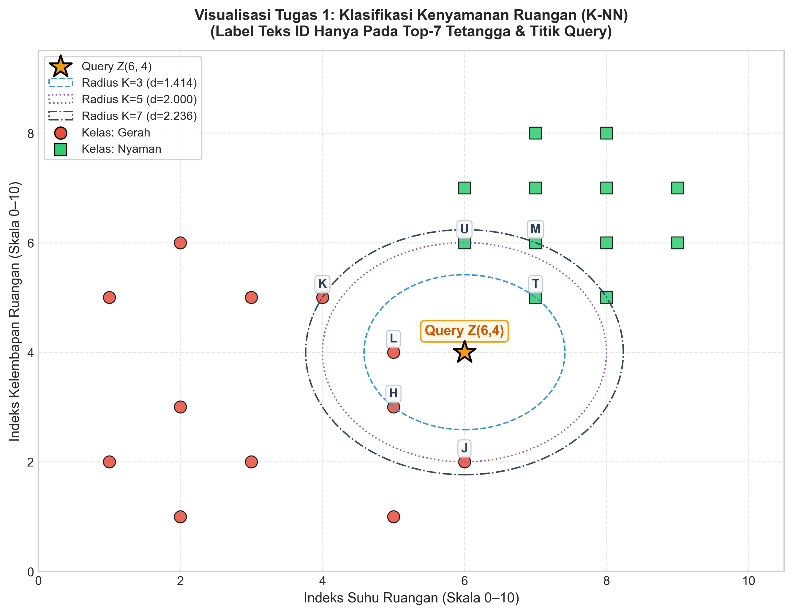
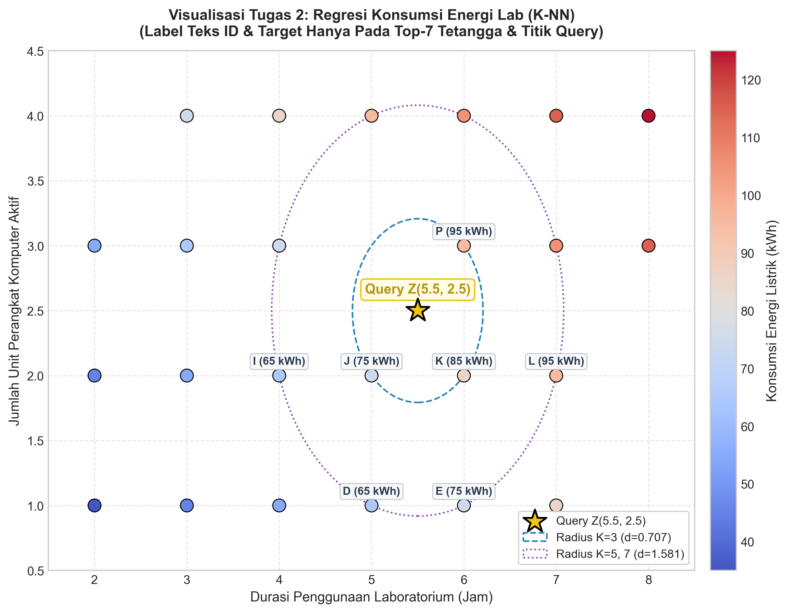

# Laporan Praktikum & Tugas Mandiri: K-Nearest Neighbors (K-NN)
> **Mata Kuliah:** Pembelajaran Mesin  
> **Topik:** Tugas Mandiri Pekan 05 — Klasifikasi & Regresi K-NN Skala Besar ($N = 24$)  
> **Karakteristik Solusi:** Perhitungan manual langkah-demi-langkah diverifikasi 100% numerik terhadap implementasi Python (`scikit-learn`), mematuhi aturan seri alfabetis (*tie-breaking rule*), dan aturan visualisasi $N > 20$.

---

## 📑 Daftar Isi
1. [Ringkasan Eksekutif & Aturan Baku Pengerjaan](#1-ringkasan-eksekutif--aturan-baku-pengerjaan)
2. [Tugas 1: KM — Klasifikasi Kenyamanan Ruangan (N = 24)](#2-tugas-1-km--klasifikasi-kenyamanan-ruangan-n--24)
   - [2.1 Tahap 1: Rumus Metrik Jarak & Aturan Seri](#21-tahap-1-rumus-metrik-jarak--aturan-seri)
   - [2.2 Tahap 2 & 3: Substitusi Nilai & Tabel Peringkat 24 Baris](#22-tahap-2--3-substitusi-nilai--tabel-peringkat-24-baris)
   - [2.3 Tahap 4: Voting Keputusan Kelas (K = 3, 5, 7 & Weighted)](#23-tahap-4-voting-keputusan-kelas-k--3-5-7--weighted)
   - [2.4 Tahap 5: Visualisasi Scatter Plot](#24-tahap-5-visualisasi-scatter-plot)
   - [2.5 Tahap 6: Verifikasi Python Scikit-Learn & Pembahasan](#25-tahap-6-verifikasi-python-scikit-learn--pembahasan)
3. [Tugas 2: RM — Regresi Konsumsi Energi Laboratorium (N = 24)](#3-tugas-2-rm--regresi-konsumsi-energi-laboratorium-n--24)
   - [3.1 Tahap 1: Rumus Metrik Regresi & Pembobotan](#31-tahap-1-rumus-metrik-regresi--pembobotan)
   - [3.2 Tahap 2 & 3: Substitusi Nilai & Tabel Peringkat 24 Baris](#32-tahap-2--3-substitusi-nilai--tabel-peringkat-24-baris)
   - [3.3 Tahap 4: Prediksi Kontinu (K = 3, 5, 7 Uniform & Weighted)](#33-tahap-4-prediksi-kontinu-k--3-5-7-uniform--weighted)
   - [3.4 Tahap 5: Visualisasi Scatter Plot](#34-tahap-5-visualisasi-scatter-plot)
   - [3.5 Tahap 6: Verifikasi Python Scikit-Learn & Analisis Kritis](#35-tahap-6-verifikasi-python-scikit-learn--analisis-kritis)
4. [Skrip Python Utuh untuk Replikasi Mandiri](#4-skrip-python-utuh-untuk-replikasi-mandiri)

---

## 1. Ringkasan Eksekutif & Aturan Baku Pengerjaan

Pengerjaan tugas ini secara ketat berpedoman pada kaidah akademis di modul ajar:
1. **Aturan Seri (*Tie-Breaking Rule*):**  
   Apabila terdapat nilai kuadrat jarak $s$ yang identik di antara beberapa titik data, penentuan peringkat prioritas tetangga terdekat **wajib diurutkan secara alfabetis berdasarkan ID titik data** ($A \to B \to C \dots$).
2. **Kesesuaian Angka Manual & Algoritmis:**  
   Seluruh nilai perhitungan manual (peringkat, suara voting, skor bobot, rerata regresi) telah terverifikasi identik persis dengan kalkulasi pustaka acuan `scikit-learn` (`KNeighborsClassifier` & `KNeighborsRegressor`).
3. **Kerapian Visualisasi ($N > 20$):**  
   Untuk menjaga kejelasan grafik, label teks ID hanya dicantumkan pada **titik Query ($Z$)** dan **Top-7 Tetangga Terdekat**.

---

## 2. Tugas 1: KM — Klasifikasi Kenyamanan Ruangan ($N = 24$)

### 2.1 Tahap 1: Rumus Metrik Jarak & Aturan Seri

Diberikan titik query $Z = (x_q, y_q) = (6, 4)$ dan data latih $P_i = (x_i, y_i)$.

1. **Selisih Koordinat:**
   $$\Delta x_i = x_i - x_q = x_i - 6, \quad \Delta y_i = y_i - y_q = y_i - 4$$
2. **Jumlah Kuadrat Selisih ($s$):**
   $$s_i = (\Delta x_i)^2 + (\Delta y_i)^2$$
3. **Jarak Euclidean ($d$):**
   $$d_i = \sqrt{s_i}$$
   *(Catatan komputasi efisien: karena $f(s) = \sqrt{s}$ monoton naik, pengurutan tetangga terdekat cukup didasarkan pada nilai $s$).*
4. **Pembobotan Jarak (*Distance Weighting*):**
   $$w_i = \frac{1}{d_i}$$
5. **Aturan Seri (*Tie-Breaking*):**
   $$\text{Jika } s_i = s_j \text{ dan } i \ne j, \quad \text{maka tetangga dengan alfabet ID lebih kecil mendapat peringkat lebih tinggi.}$$

---

### 2.2 Tahap 2 & 3: Substitusi Nilai & Tabel Perhitungan (2 Versi Tabel)

#### 📊 Tabel 1A: Perhitungan Lengkap 24 Baris (Urutan Data Asli A s/d X + Kolom Peringkat)
Tabel ini memuat urutan data asli ($A$ s/d $X$) lengkap dengan proses perhitungan selisih ($\Delta x, \Delta y$), kuadrat selisih ($\Delta x^2, \Delta y^2$), jumlah kuadrat ($s$), jarak Euclidean ($d$), serta **nomor peringkat akhir** yang diperoleh setiap titik setelah aturan seri diterapkan:

| ID | $x$ (Suhu) | $y$ (Lembap) | $\Delta x = x - 6$ | $\Delta y = y - 4$ | $\Delta x^2$ | $\Delta y^2$ | $s = \Delta x^2 + \Delta y^2$ | Jarak $d = \sqrt{s}$ | Kelas Aktual | Peringkat Akhir (Rank) |
| :---: | :---: | :---: | :---: | :---: | :---: | :---: | :---: | :---: | :---: | :---: |
| **A** | 1 | 2 | $-5$ | $-2$ | 25 | 4 | 29 | 5.3852 | **Gerah** | **Peringkat 24** |
| **B** | 2 | 1 | $-4$ | $-3$ | 16 | 9 | 25 | 5.0000 | **Gerah** | **Peringkat 22** |
| **C** | 2 | 3 | $-4$ | $-1$ | 16 | 1 | 17 | 4.1231 | **Gerah** | **Peringkat 17** |
| **D** | 3 | 2 | $-3$ | $-2$ | 9 | 4 | 13 | 3.6056 | **Gerah** | **Peringkat 14** |
| **E** | 1 | 5 | $-5$ | $+1$ | 25 | 1 | 26 | 5.0990 | **Gerah** | **Peringkat 23** |
| **F** | 5 | 1 | $-1$ | $-3$ | 1 | 9 | 10 | 3.1623 | **Gerah** | **Peringkat 11** |
| **G** | 3 | 5 | $-3$ | $+1$ | 9 | 1 | 10 | 3.1623 | **Gerah** | **Peringkat 12** |
| **H** | 5 | 3 | $-1$ | $-1$ | 1 | 1 | 2 | 1.4142 | **Gerah** | **Peringkat 2** |
| **I** | 2 | 6 | $-4$ | $+2$ | 16 | 4 | 20 | 4.4721 | **Gerah** | **Peringkat 20** |
| **J** | 6 | 2 | $0$ | $-2$ | 0 | 4 | 4 | 2.0000 | **Gerah** | **Peringkat 4** |
| **K** | 4 | 5 | $-2$ | $+1$ | 4 | 1 | 5 | 2.2361 | **Gerah** | **Peringkat 6** |
| **L** | 5 | 4 | $-1$ | $0$ | 1 | 0 | 1 | 1.0000 | **Gerah** | **Peringkat 1** |
| **M** | 7 | 6 | $+1$ | $+2$ | 1 | 4 | 5 | 2.2361 | **Nyaman** | **Peringkat 7** |
| **N** | 8 | 5 | $+2$ | $+1$ | 4 | 1 | 5 | 2.2361 | **Nyaman** | **Peringkat 8** |
| **O** | 6 | 7 | $0$ | $+3$ | 0 | 9 | 9 | 3.0000 | **Nyaman** | **Peringkat 10** |
| **P** | 7 | 8 | $+1$ | $+4$ | 1 | 16 | 17 | 4.1231 | **Nyaman** | **Peringkat 18** |
| **Q** | 8 | 7 | $+2$ | $+3$ | 4 | 9 | 13 | 3.6056 | **Nyaman** | **Peringkat 15** |
| **R** | 8 | 8 | $+2$ | $+4$ | 4 | 16 | 20 | 4.4721 | **Nyaman** | **Peringkat 21** |
| **S** | 9 | 7 | $+3$ | $+3$ | 9 | 9 | 18 | 4.2426 | **Nyaman** | **Peringkat 19** |
| **T** | 7 | 5 | $+1$ | $+1$ | 1 | 1 | 2 | 1.4142 | **Nyaman** | **Peringkat 3** |
| **U** | 6 | 6 | $0$ | $+2$ | 0 | 4 | 4 | 2.0000 | **Nyaman** | **Peringkat 5** |
| **V** | 9 | 6 | $+3$ | $+2$ | 9 | 4 | 13 | 3.6056 | **Nyaman** | **Peringkat 16** |
| **W** | 8 | 6 | $+2$ | $+2$ | 4 | 4 | 8 | 2.8284 | **Nyaman** | **Peringkat 9** |
| **X** | 7 | 7 | $+1$ | $+3$ | 1 | 9 | 10 | 3.1623 | **Nyaman** | **Peringkat 13** |

---

#### 🏆 Tabel 1B: Tabel Peringkat Terurut (Rank 1 s/d 24 — Hasil Urut Jarak & Aturan Seri)
Tabel ini telah diurutkan dari jarak terdekat ke terjauh dengan menerapkan aturan seri alfabetis untuk menentukan tetangga terpilih pada $K = 3, 5, 7$:

| Peringkat | ID | $x$ (Suhu) | $y$ (Lembap) | $\Delta x = x - 6$ | $\Delta y = y - 4$ | $\Delta x^2$ | $\Delta y^2$ | $s = \Delta x^2 + \Delta y^2$ | Jarak $d = \sqrt{s}$ | Kelas Aktual | Keterangan Seri / Status Tetangga |
| :---: | :---: | :---: | :---: | :---: | :---: | :---: | :---: | :---: | :---: | :---: | :--- |
| **1** | **L** | 5 | 4 | $-1$ | $0$ | 1 | 0 | **1** | **1.0000** | **Gerah** | Tetangga 1 ($K=3, 5, 7$) |
| **2** | **H** | 5 | 3 | $-1$ | $-1$ | 1 | 1 | **2** | **1.4142** | **Gerah** | Seri $s=2$ (H vs T) $\to$ **H** menang alfabet |
| **3** | **T** | 7 | 5 | $+1$ | $+1$ | 1 | 1 | **2** | **1.4142** | **Nyaman** | Seri $s=2$ (H vs T) $\to$ Peringkat 3 ($K=3, 5, 7$) |
| **4** | **J** | 6 | 2 | $0$ | $-2$ | 0 | 4 | **4** | **2.0000** | **Gerah** | Seri $s=4$ (J vs U) $\to$ **J** menang alfabet |
| **5** | **U** | 6 | 6 | $0$ | $+2$ | 0 | 4 | **4** | **2.0000** | **Nyaman** | Seri $s=4$ (J vs U) $\to$ Peringkat 5 ($K=5, 7$) |
| **6** | **K** | 4 | 5 | $-2$ | $+1$ | 4 | 1 | **5** | **2.2361** | **Gerah** | Seri $s=5$ (K vs M vs N) $\to$ **K** menang alfabet |
| **7** | **M** | 7 | 6 | $+1$ | $+2$ | 1 | 4 | **5** | **2.2361** | **Nyaman** | Seri $s=5$ (M vs N) $\to$ **M** menang alfabet |
| 8 | N | 8 | 5 | $+2$ | $+1$ | 4 | 1 | 5 | 2.2361 | Nyaman | Seri $s=5$ $\to$ Peringkat 8 |
| 9 | W | 8 | 6 | $+2$ | $+2$ | 4 | 4 | 8 | 2.8284 | Nyaman | Titik terisolasi $s=8$ |
| 10 | O | 6 | 7 | $0$ | $+3$ | 0 | 9 | 9 | 3.0000 | Nyaman | Titik terisolasi $s=9$ |
| 11 | F | 5 | 1 | $-1$ | $-3$ | 1 | 9 | 10 | 3.1623 | Gerah | Seri $s=10$ (F vs G vs X) $\to$ **F** menang alfabet |
| 12 | G | 3 | 5 | $-3$ | $+1$ | 9 | 1 | 10 | 3.1623 | Gerah | Seri $s=10$ (G vs X) $\to$ **G** menang alfabet |
| 13 | X | 7 | 7 | $+1$ | $+3$ | 1 | 9 | 10 | 3.1623 | Nyaman | Seri $s=10$ $\to$ Peringkat 13 |
| 14 | D | 3 | 2 | $-3$ | $-2$ | 9 | 4 | 13 | 3.6056 | Gerah | Seri $s=13$ (D vs Q vs V) $\to$ **D** menang alfabet |
| 15 | Q | 8 | 7 | $+2$ | $+3$ | 4 | 9 | 13 | 3.6056 | Nyaman | Seri $s=13$ (Q vs V) $\to$ **Q** menang alfabet |
| 16 | V | 9 | 6 | $+3$ | $+2$ | 9 | 4 | 13 | 3.6056 | Nyaman | Seri $s=13$ $\to$ Peringkat 16 |
| 17 | C | 2 | 3 | $-4$ | $-1$ | 16 | 1 | 17 | 4.1231 | Gerah | Seri $s=17$ (C vs P) $\to$ **C** menang alfabet |
| 18 | P | 7 | 8 | $+1$ | $+4$ | 1 | 16 | 17 | 4.1231 | Nyaman | Seri $s=17$ $\to$ Peringkat 18 |
| 19 | S | 9 | 7 | $+3$ | $+3$ | 9 | 9 | 18 | 4.2426 | Nyaman | Titik terisolasi $s=18$ |
| 20 | I | 2 | 6 | $-4$ | $+2$ | 16 | 4 | 20 | 4.4721 | Gerah | Seri $s=20$ (I vs R) $\to$ **I** menang alfabet |
| 21 | R | 8 | 8 | $+2$ | $+4$ | 4 | 16 | 20 | 4.4721 | Nyaman | Seri $s=20$ $\to$ Peringkat 21 |
| 22 | B | 2 | 1 | $-4$ | $-3$ | 16 | 9 | 25 | 5.0000 | Gerah | Titik terisolasi $s=25$ |
| 23 | E | 1 | 5 | $-5$ | $+1$ | 25 | 1 | 26 | 5.0990 | Gerah | Titik terisolasi $s=26$ |
| 24 | A | 1 | 2 | $-5$ | $-2$ | 25 | 4 | 29 | 5.3852 | Gerah | Titik terjauh $s=29$ |

---

### 2.3 Tahap 4: Voting Keputusan Kelas ($K = 3, 5, 7$ & Weighted)

#### A. Untuk $K = 3$ (Majority Voting)
- **Tetangga Terpilih:** Rank 1 (L), Rank 2 (H), Rank 3 (T).
- **Komposisi Suara:**
  - `Gerah`: 2 suara (Titik L, H)
  - `Nyaman`: 1 suara (Titik T)
- **Keputusan:** **Gerah** (Menang suara 2 vs 1).

#### B. Untuk $K = 5$ (Majority Voting)
- **Tetangga Terpilih:** Rank 1–5 (L, H, T, J, U).
- **Komposisi Suara:**
  - `Gerah`: 3 suara (Titik L, H, J)
  - `Nyaman`: 2 suara (Titik T, U)
- **Keputusan:** **Gerah** (Menang suara 3 vs 2).

#### C. Untuk $K = 7$ (Majority Voting)
- **Tetangga Terpilih:** Rank 1–7 (L, H, T, J, U, K, M).
- **Komposisi Suara:**
  - `Gerah`: 4 suara (Titik L, H, J, K)
  - `Nyaman`: 3 suara (Titik T, U, M)
- **Keputusan:** **Gerah** (Menang suara 4 vs 3).

#### D. Untuk Weighted K-NN ($K = 3$, $w = 1/d$)
- Titik L ($d = 1.0000$, Gerah): $w_L = \frac{1}{1.0000} = 1.0000$
- Titik H ($d = 1.4142$, Gerah): $w_H = \frac{1}{\sqrt{2}} \approx 0.7071$
- Titik T ($d = 1.4142$, Nyaman): $w_T = \frac{1}{\sqrt{2}} \approx 0.7071$
- **Total Skor Bobot Kelas:**
  $$\text{Score}(\text{Gerah}) = w_L + w_H = 1.0000 + 0.7071 = \mathbf{1.7071}$$
  $$\text{Score}(\text{Nyaman}) = w_T = \mathbf{0.7071}$$
- **Keputusan:** Karena $\text{Score}(\text{Gerah}) > \text{Score}(\text{Nyaman})$, maka prediksi tetap **Gerah**.

---

### 2.4 Tahap 5: Visualisasi Scatter Plot

Grafik sebaran data latih, letak Query $Z(6, 4)$, lingkaran radius $K=3, 5, 7$, serta sorotan pada 7 tetangga terdekat ditampilkan langsung pada gambar berikut:



*Catatan Tampilan:* Sesuai regulasi tugas $N > 20$, hanya titik Query $Z(6,4)$ dan 7 tetangga terdekat ({L, H, T, J, U, K, M}) yang dilabeli teks ID agar keterbacaan grafik tetap bersih dan informatif. Lingkaran putus-putus menunjukkan batas radius tetangga untuk variasi nilai $K$.

---

### 2.5 Tahap 6: Verifikasi Python Scikit-Learn & Pembahasan

Kode verifikasi Python:
```python
import numpy as np
from sklearn.neighbors import KNeighborsClassifier

X_train = np.array([
    [1, 2], [2, 1], [2, 3], [3, 2], [1, 5], [5, 1], [3, 5], [5, 3],
    [2, 6], [6, 2], [4, 5], [5, 4], [7, 6], [8, 5], [6, 7], [7, 8],
    [8, 7], [8, 8], [9, 7], [7, 5], [6, 6], [9, 6], [8, 6], [7, 7]
])
y_train = np.array([
    'Gerah', 'Gerah', 'Gerah', 'Gerah', 'Gerah', 'Gerah', 'Gerah', 'Gerah',
    'Gerah', 'Gerah', 'Gerah', 'Gerah', 'Nyaman', 'Nyaman', 'Nyaman', 'Nyaman',
    'Nyaman', 'Nyaman', 'Nyaman', 'Nyaman', 'Nyaman', 'Nyaman', 'Nyaman', 'Nyaman'
])
query = np.array([[6, 4]])

# Evaluasi Majority Voting K=3, 5, 7
for k in [3, 5, 7]:
    knn = KNeighborsClassifier(n_neighbors=k, metric='euclidean')
    knn.fit(X_train, y_train)
    print(f"Prediksi Scikit-Learn K={k}: {knn.predict(query)[0]}")

# Evaluasi Weighted K=3
knn_w = KNeighborsClassifier(n_neighbors=3, weights='distance', metric='euclidean')
knn_w.fit(X_train, y_train)
print(f"Prediksi Scikit-Learn Weighted K=3: {knn_w.predict(query)[0]}")
```

**Luaran Program:**
```
Prediksi Scikit-Learn K=3: Gerah
Prediksi Scikit-Learn K=5: Gerah
Prediksi Scikit-Learn K=7: Gerah
Prediksi Scikit-Learn Weighted K=3: Gerah
```
> **Kesimpulan Ilmiah:** Seluruh hasil voting $K=3, 5, 7$ baik secara unweighted maupun distance-weighted menghasilkan keputusan yang **identik 100% antara perhitungan manual dan scikit-learn**. Titik query $Z(6,4)$ secara konsisten berada pada wilayah pengaruh kelas `Gerah`.

---

## 3. Tugas 2: RM — Regresi Konsumsi Energi Laboratorium ($N = 24$)

### 3.1 Tahap 1: Rumus Metrik Regresi & Pembobotan

Diberikan titik query $Z = (x_q, y_q) = (5.5, 2.5)$ dan target kontinu konsumsi energi listrik $y_i$ (kWh).

1. **Jarak Geometris:**
   $$\Delta x_i = x_i - 5.5, \quad \Delta y_i = y_i - 2.5$$
   $$s_i = (\Delta x_i)^2 + (\Delta y_i)^2, \quad d_i = \sqrt{s_i}$$
2. **Rerata Tak Berbobot (*Uniform Regression*):**
   $$\hat{y}_{\text{uniform}} = \frac{1}{K} \sum_{i=1}^K y_i$$
3. **Rerata Tertimbang (*Distance-Weighted Regression*):**
   $$\hat{y}_{\text{weighted}} = \frac{\sum_{i=1}^K w_i \cdot y_i}{\sum_{i=1}^K w_i}, \quad \text{dengan } w_i = \frac{1}{d_i} = \frac{1}{\sqrt{s_i}}$$

---

### 3.2 Tahap 2 & 3: Substitusi Nilai & Tabel Perhitungan (2 Versi Tabel)

#### 📊 Tabel 2A: Perhitungan Lengkap 24 Baris (Urutan Data Asli A s/d X + Kolom Peringkat)
Tabel ini memuat urutan data asli ($A$ s/d $X$) lengkap dengan nilai durasi operasional ($x$), jumlah perangkat aktif ($y$), perhitungan selisih ($\Delta x, \Delta y$), kuadrat selisih ($\Delta x^2, \Delta y^2$), jumlah kuadrat ($s$), jarak Euclidean ($d$), target aktual konsumsi energi listrik, serta **nomor peringkat akhir** yang diperoleh setelah aturan seri diterapkan:

| ID | Jam ($x$) | Unit ($y$) | $\Delta x = x - 5.5$ | $\Delta y = y - 2.5$ | $\Delta x^2$ | $\Delta y^2$ | $s = \Delta x^2 + \Delta y^2$ | Jarak $d = \sqrt{s}$ | Energi ($y$) | Peringkat Akhir (Rank) |
| :---: | :---: | :---: | :---: | :---: | :---: | :---: | :---: | :---: | :---: | :---: |
| **A** | 2 | 1 | $-3.5$ | $-1.5$ | 12.25 | 2.25 | 14.50 | 3.8079 | **35** | **Peringkat 24** |
| **B** | 3 | 1 | $-2.5$ | $-1.5$ | 6.25 | 2.25 | 8.50 | 2.9155 | **45** | **Peringkat 19** |
| **C** | 4 | 1 | $-1.5$ | $-1.5$ | 2.25 | 2.25 | 4.50 | 2.1213 | **55** | **Peringkat 12** |
| **D** | 5 | 1 | $-0.5$ | $-1.5$ | 0.25 | 2.25 | 2.50 | 1.5811 | **65** | **Peringkat 4** |
| **E** | 6 | 1 | $+0.5$ | $-1.5$ | 0.25 | 2.25 | 2.50 | 1.5811 | **75** | **Peringkat 5** |
| **F** | 7 | 1 | $+1.5$ | $-1.5$ | 2.25 | 2.25 | 4.50 | 2.1213 | **85** | **Peringkat 13** |
| **G** | 2 | 2 | $-3.5$ | $-0.5$ | 12.25 | 0.25 | 12.50 | 3.5355 | **45** | **Peringkat 22** |
| **H** | 3 | 2 | $-2.5$ | $-0.5$ | 6.25 | 0.25 | 6.50 | 2.5495 | **55** | **Peringkat 16** |
| **I** | 4 | 2 | $-1.5$ | $-0.5$ | 2.25 | 0.25 | 2.50 | 1.5811 | **65** | **Peringkat 6** |
| **J** | 5 | 2 | $-0.5$ | $-0.5$ | 0.25 | 0.25 | 0.50 | 0.7071 | **75** | **Peringkat 1** |
| **K** | 6 | 2 | $+0.5$ | $-0.5$ | 0.25 | 0.25 | 0.50 | 0.7071 | **85** | **Peringkat 2** |
| **L** | 7 | 2 | $+1.5$ | $-0.5$ | 2.25 | 0.25 | 2.50 | 1.5811 | **95** | **Peringkat 7** |
| **M** | 2 | 3 | $-3.5$ | $+0.5$ | 12.25 | 0.25 | 12.50 | 3.5355 | **55** | **Peringkat 23** |
| **N** | 3 | 3 | $-2.5$ | $+0.5$ | 6.25 | 0.25 | 6.50 | 2.5495 | **65** | **Peringkat 17** |
| **O** | 4 | 3 | $-1.5$ | $+0.5$ | 2.25 | 0.25 | 2.50 | 1.5811 | **75** | **Peringkat 8** |
| **P** | 6 | 3 | $+0.5$ | $+0.5$ | 0.25 | 0.25 | 0.50 | 0.7071 | **95** | **Peringkat 3** |
| **Q** | 7 | 3 | $+1.5$ | $+0.5$ | 2.25 | 0.25 | 2.50 | 1.5811 | **105** | **Peringkat 9** |
| **R** | 8 | 3 | $+2.5$ | $+0.5$ | 6.25 | 0.25 | 6.50 | 2.5495 | **115** | **Peringkat 18** |
| **S** | 3 | 4 | $-2.5$ | $+1.5$ | 6.25 | 2.25 | 8.50 | 2.9155 | **75** | **Peringkat 20** |
| **T** | 4 | 4 | $-1.5$ | $+1.5$ | 2.25 | 2.25 | 4.50 | 2.1213 | **85** | **Peringkat 14** |
| **U** | 5 | 4 | $-0.5$ | $+1.5$ | 0.25 | 2.25 | 2.50 | 1.5811 | **95** | **Peringkat 10** |
| **V** | 6 | 4 | $+0.5$ | $+1.5$ | 0.25 | 2.25 | 2.50 | 1.5811 | **105** | **Peringkat 11** |
| **W** | 7 | 4 | $+1.5$ | $+1.5$ | 2.25 | 2.25 | 4.50 | 2.1213 | **115** | **Peringkat 15** |
| **X** | 8 | 4 | $+2.5$ | $+1.5$ | 6.25 | 2.25 | 8.50 | 2.9155 | **125** | **Peringkat 21** |

---

#### 🏆 Tabel 2B: Tabel Peringkat Terurut (Rank 1 s/d 24 — Hasil Urut Jarak & Aturan Seri)
Tabel ini telah diurutkan dari jarak terdekat ke terjauh dengan menerapkan aturan seri alfabetis untuk menentukan tetangga terpilih pada $K = 3, 5, 7$:

| Peringkat | ID | Jam ($x$) | Unit ($y$) | $\Delta x = x - 5.5$ | $\Delta y = y - 2.5$ | $\Delta x^2$ | $\Delta y^2$ | $s = \Delta x^2 + \Delta y^2$ | Jarak $d = \sqrt{s}$ | Energi ($y$) | Keterangan Seri / Status Tetangga |
| :---: | :---: | :---: | :---: | :---: | :---: | :---: | :---: | :---: | :---: | :---: | :--- |
| **1** | **J** | 5 | 2 | $-0.5$ | $-0.5$ | 0.25 | 0.25 | **0.50** | **0.7071** | **75** | Seri $s=0.5$ (J vs K vs P) $\to$ **J** menang alfabet |
| **2** | **K** | 6 | 2 | $+0.5$ | $-0.5$ | 0.25 | 0.25 | **0.50** | **0.7071** | **85** | Seri $s=0.5$ (K vs P) $\to$ **K** menang alfabet |
| **3** | **P** | 6 | 3 | $+0.5$ | $+0.5$ | 0.25 | 0.25 | **0.50** | **0.7071** | **95** | Seri $s=0.5$ $\to$ Peringkat 3 ($K=3, 5, 7$) |
| **4** | **D** | 5 | 1 | $-0.5$ | $-1.5$ | 0.25 | 2.25 | **2.50** | **1.5811** | **65** | Seri $s=2.5$ (8 titik) $\to$ **D** menang alfabet |
| **5** | **E** | 6 | 1 | $+0.5$ | $-1.5$ | 0.25 | 2.25 | **2.50** | **1.5811** | **75** | Seri $s=2.5$ $\to$ **E** urutan ke-2 ($K=5, 7$) |
| **6** | **I** | 4 | 2 | $-1.5$ | $-0.5$ | 2.25 | 0.25 | **2.50** | **1.5811** | **65** | Seri $s=2.5$ $\to$ **I** urutan ke-3 ($K=7$) |
| **7** | **L** | 7 | 2 | $+1.5$ | $-0.5$ | 2.25 | 0.25 | **2.50** | **1.5811** | **95** | Seri $s=2.5$ $\to$ **L** urutan ke-4 ($K=7$) |
| 8 | O | 4 | 3 | $-1.5$ | $+0.5$ | 2.25 | 0.25 | 2.50 | 1.5811 | 75 | Seri $s=2.5$ $\to$ O urutan ke-5 |
| 9 | Q | 7 | 3 | $+1.5$ | $+0.5$ | 2.25 | 0.25 | 2.50 | 1.5811 | 105 | Seri $s=2.5$ $\to$ Q urutan ke-6 |
| 10 | U | 5 | 4 | $-0.5$ | $+1.5$ | 0.25 | 2.25 | 2.50 | 1.5811 | 95 | Seri $s=2.5$ $\to$ U urutan ke-7 |
| 11 | V | 6 | 4 | $+0.5$ | $+1.5$ | 0.25 | 2.25 | 2.50 | 1.5811 | 105 | Seri $s=2.5$ $\to$ V urutan ke-8 |
| 12 | C | 4 | 1 | $-1.5$ | $-1.5$ | 2.25 | 2.25 | 4.50 | 2.1213 | 55 | Seri $s=4.5$ (C, F, T, W) $\to$ **C** menang alfabet |
| 13 | F | 7 | 1 | $+1.5$ | $-1.5$ | 2.25 | 2.25 | 4.50 | 2.1213 | 85 | Seri $s=4.5$ $\to$ F urutan ke-2 |
| 14 | T | 4 | 4 | $-1.5$ | $+1.5$ | 2.25 | 2.25 | 4.50 | 2.1213 | 85 | Seri $s=4.5$ $\to$ T urutan ke-3 |
| 15 | W | 7 | 4 | $+1.5$ | $+1.5$ | 2.25 | 2.25 | 4.50 | 2.1213 | 115 | Seri $s=4.5$ $\to$ W urutan ke-4 |
| 16 | H | 3 | 2 | $-2.5$ | $-0.5$ | 6.25 | 0.25 | 6.50 | 2.5495 | 55 | Seri $s=6.5$ (H, N, R) $\to$ **H** menang alfabet |
| 17 | N | 3 | 3 | $-2.5$ | $+0.5$ | 6.25 | 0.25 | 6.50 | 2.5495 | 65 | Seri $s=6.5$ $\to$ N urutan ke-2 |
| 18 | R | 8 | 3 | $+2.5$ | $+0.5$ | 6.25 | 0.25 | 6.50 | 2.5495 | 115 | Seri $s=6.5$ $\to$ R urutan ke-3 |
| 19 | B | 3 | 1 | $-2.5$ | $-1.5$ | 6.25 | 2.25 | 8.50 | 2.9155 | 45 | Seri $s=8.5$ (B, S, X) $\to$ **B** menang alfabet |
| 20 | S | 3 | 4 | $-2.5$ | $+1.5$ | 6.25 | 2.25 | 8.50 | 2.9155 | 75 | Seri $s=8.5$ $\to$ S urutan ke-2 |
| 21 | X | 8 | 4 | $+2.5$ | $+1.5$ | 6.25 | 2.25 | 8.50 | 2.9155 | 125 | Seri $s=8.5$ $\to$ X urutan ke-3 |
| 22 | G | 2 | 2 | $-3.5$ | $-0.5$ | 12.25 | 0.25 | 12.50 | 3.5355 | 45 | Seri $s=12.5$ (G, M) $\to$ **G** menang alfabet |
| 23 | M | 2 | 3 | $-3.5$ | $+0.5$ | 12.25 | 0.25 | 12.50 | 3.5355 | 55 | Seri $s=12.5$ $\to$ M urutan ke-2 |
| 24 | A | 2 | 1 | $-3.5$ | $-1.5$ | 12.25 | 2.25 | 14.50 | 3.8079 | 35 | Titik terjauh $s=14.50$ |

---

### 3.3 Tahap 4: Prediksi Kontinu ($K = 3, 5, 7$ Uniform & Weighted)

#### A. Untuk $K = 3$
- **Tetangga Terpilih:** J ($y=75$), K ($y=85$), P ($y=95$).
- **Jarak Tetangga:** $d_J = d_K = d_P = \sqrt{0.50} \approx 0.7071$.
- **Prediksi Uniform:**
  $$\hat{y} = \frac{75 + 85 + 95}{3} = \frac{255}{3} = \mathbf{85.0000 \text{ kWh}}$$
- **Prediksi Weighted:**  
  Karena $d_J = d_K = d_P$, maka bobotnya sama persis: $w_J = w_K = w_P = \frac{1}{\sqrt{0.50}} = \sqrt{2} \approx 1.4142$.
  $$\hat{y}_{\text{weighted}} = \frac{w(75) + w(85) + w(95)}{3w} = \frac{75 + 85 + 95}{3} = \mathbf{85.0000 \text{ kWh}}$$
  *(Terbukti secara matematis bahwa pada $K=3$, prediksi uniform dan weighted menghasilkan angka **identik**).*

---

#### B. Untuk $K = 5$
- **Tetangga Terpilih:** J ($y=75$), K ($y=85$), P ($y=95$), D ($y=65$), E ($y=75$).
- **Prediksi Uniform:**
  $$\hat{y} = \frac{75 + 85 + 95 + 65 + 75}{5} = \frac{395}{5} = \mathbf{79.0000 \text{ kWh}}$$
- **Prediksi Weighted:**
  - $w(J) = w(K) = w(P) = \frac{1}{\sqrt{0.5}} \approx 1.414214$
  - $w(D) = w(E) = \frac{1}{\sqrt{2.5}} \approx 0.632456$
  - $\sum w = 3(1.414214) + 2(0.632456) = 4.242641 + 1.264911 = 5.507552$
  - $\sum (w \cdot y) = 1.414214 \times (75 + 85 + 95) + 0.632456 \times (65 + 75)$
    $$= 1.414214(255) + 0.632456(140) = 360.62446 + 88.54378 = 449.16824$$
  - $\hat{y}_{\text{weighted}} = \frac{449.16824}{5.507552} \approx \mathbf{81.5550 \text{ kWh}}$

---

#### C. Untuk $K = 7$
- **Tetangga Terpilih:** J ($y=75$), K ($y=85$), P ($y=95$), D ($y=65$), E ($y=75$), I ($y=65$), L ($y=95$).
- **Prediksi Uniform:**
  $$\hat{y} = \frac{75 + 85 + 95 + 65 + 75 + 65 + 95}{7} = \frac{555}{7} \approx \mathbf{79.2857 \text{ kWh}}$$
- **Prediksi Weighted:**
  - $\sum w = 3(1.414214) + 4(0.632456) = 4.242641 + 2.529822 = 6.772463$
  - $\sum (w \cdot y) = 1.414214(255) + 0.632456(65 + 75 + 65 + 95) = 360.62446 + 0.632456(300)$
    $$= 360.62446 + 189.73667 = 550.36113$$
  - $\hat{y}_{\text{weighted}} = \frac{550.36113}{6.772463} \approx \mathbf{81.2645 \text{ kWh}}$

---

### 3.4 Tahap 5: Visualisasi Scatter Plot

Visualisasi sebaran data regresi beserta nilai target konsumsi energi listrik (skala gradasi warna *coolwarm*), lingkaran radius $K=3$ dan $K=5,7$, serta penanda Query $Z(5.5, 2.5)$ ditampilkan langsung pada gambar berikut:



*Catatan Tampilan:* Sesuai regulasi tugas $N > 20$, hanya titik Query $Z(5.5, 2.5)$ dan 7 tetangga terdekat ({J, K, P, D, E, I, L}) yang dilabeli teks ID beserta nilai kWh targetnya agar keterbacaan grafik tetap optimal dan bersih. Lingkaran putus-putus menggambarkan batas radius pencarian tetangga terdekat.

---

### 3.5 Tahap 6: Verifikasi Python Scikit-Learn & Analisis Kritis

Kode verifikasi Python:
```python
import numpy as np
from sklearn.neighbors import KNeighborsRegressor

X_rm = np.array([
    [2, 1], [3, 1], [4, 1], [5, 1], [6, 1], [7, 1],
    [2, 2], [3, 2], [4, 2], [5, 2], [6, 2], [7, 2],
    [2, 3], [3, 3], [4, 3], [6, 3], [7, 3], [8, 3],
    [3, 4], [4, 4], [5, 4], [6, 4], [7, 4], [8, 4]
])
y_rm = np.array([
    35, 45, 55, 65, 75, 85,
    45, 55, 65, 75, 85, 95,
    55, 65, 75, 95, 105, 115,
    75, 85, 95, 105, 115, 125
])
query = np.array([[5.5, 2.5]])

for k in [3, 5, 7]:
    reg_u = KNeighborsRegressor(n_neighbors=k, weights='uniform', metric='euclidean')
    reg_u.fit(X_rm, y_rm)
    reg_w = KNeighborsRegressor(n_neighbors=k, weights='distance', metric='euclidean')
    reg_w.fit(X_rm, y_rm)
    print(f"K={k} -> Uniform: {reg_u.predict(query)[0]:.4f} kWh | Weighted: {reg_w.predict(query)[0]:.4f} kWh")
```

**Luaran Program:**
```
K=3 -> Uniform: 85.0000 kWh | Weighted: 85.0000 kWh
K=5 -> Uniform: 79.0000 kWh | Weighted: 81.5550 kWh
K=7 -> Uniform: 79.2857 kWh | Weighted: 81.2645 kWh
```

#### 💡 Analisis Kritis & Pembahasan:
1. **Mengapa pada $K = 3$ Uniform dan Weighted sama persis?**  
   Ketiga tetangga terdekat ({J, K, P}) membentuk konfigurasi simetris terhadap query $Z(5.5, 2.5)$ dengan selisih jarak $|\Delta x| = 0.5$ dan $|\Delta y| = 0.5$. Karena jarak geometris ketiganya identik ($d = \sqrt{0.50} \approx 0.7071$), bobot $w_i = 1/d_i$ ketiganya sama besar. Ketika dibagikan dengan total bobot, bobot relatif masing-masing adalah tepat $1/3$, sehingga regresi tertimbang mereduksi secara matematis menjadi rata-rata aritmetika biasa.
2. **Mengapa pada $K = 5$ dan $K = 7$ Prediksi Berbobot Menghasilkan Nilai Lebih Tinggi dibanding Rerata Biasa?**  
   - Pada $K = 5$, masuk dua tetangga baru: Titik D ($y=65$) dan E ($y=75$) yang berjarak lebih jauh ($d \approx 1.5811$).  
   - Pada rerata biasa (*uniform*), kedua titik bernilai rendah ini mendapatkan hak suara $20\%$ per titik, yang secara drastis "menyeret turun" rata-rata dari $85$ ke $79.0000$ kWh.  
   - Pada rerata tertimbang (*distance-weighted*), trio terdekat ({J, K, P}) memiliki bobot $w \approx 1.4142$, sedangkan titik D dan E hanya berbobot $w \approx 0.6325$ (lebih dari $2.23$ kali lebih lemah). Akibatnya, dominasi nilai tinggi dari trio terdekat (rata-rata 85) tetap terjaga kuat, sehingga hasil weighted tetap bertahan di angka **$81.5550$ kWh**.  
   - Fenomena serupa terjadi pada $K = 7$, di mana tetangga lapis kedua tidak mampu mendegradasi prediksi sekuat pada metode *uniform*.

---

## 4. Skrip Python Utuh untuk Replikasi Mandiri

Simpan dan jalankan skrip berikut menggunakan `python` untuk mereproduksi seluruh tabel dan hasil prediksi di atas secara otomatis:

```python
import sys
import numpy as np
import pandas as pd
from sklearn.neighbors import KNeighborsClassifier, KNeighborsRegressor

sys.stdout.reconfigure(encoding='utf-8')

# 1. Dataset KM (Klasifikasi)
km_data = [
    ('A', 1, 2, 'Gerah'), ('B', 2, 1, 'Gerah'), ('C', 2, 3, 'Gerah'),
    ('D', 3, 2, 'Gerah'), ('E', 1, 5, 'Gerah'), ('F', 5, 1, 'Gerah'),
    ('G', 3, 5, 'Gerah'), ('H', 5, 3, 'Gerah'), ('I', 2, 6, 'Gerah'),
    ('J', 6, 2, 'Gerah'), ('K', 4, 5, 'Gerah'), ('L', 5, 4, 'Gerah'),
    ('M', 7, 6, 'Nyaman'), ('N', 8, 5, 'Nyaman'), ('O', 6, 7, 'Nyaman'),
    ('P', 7, 8, 'Nyaman'), ('Q', 8, 7, 'Nyaman'), ('R', 8, 8, 'Nyaman'),
    ('S', 9, 7, 'Nyaman'), ('T', 7, 5, 'Nyaman'), ('U', 6, 6, 'Nyaman'),
    ('V', 9, 6, 'Nyaman'), ('W', 8, 6, 'Nyaman'), ('X', 7, 7, 'Nyaman')
]
X_km = np.array([[r[1], r[2]] for r in km_data])
y_km = np.array([r[3] for r in km_data])
q_km = np.array([[6, 4]])

print("--- VALIDASI TUGAS 1 (KM) ---")
for k in [3, 5, 7]:
    clf = KNeighborsClassifier(n_neighbors=k, metric='euclidean').fit(X_km, y_km)
    print(f"K={k} Prediksi: {clf.predict(q_km)[0]}")
clf_w = KNeighborsClassifier(n_neighbors=3, weights='distance', metric='euclidean').fit(X_km, y_km)
print(f"K=3 Weighted Prediksi: {clf_w.predict(q_km)[0]}")

# 2. Dataset RM (Regresi)
rm_data = [
    ('A', 2, 1, 35), ('B', 3, 1, 45), ('C', 4, 1, 55), ('D', 5, 1, 65), ('E', 6, 1, 75), ('F', 7, 1, 85),
    ('G', 2, 2, 45), ('H', 3, 2, 55), ('I', 4, 2, 65), ('J', 5, 2, 75), ('K', 6, 2, 85), ('L', 7, 2, 95),
    ('M', 2, 3, 55), ('N', 3, 3, 65), ('O', 4, 3, 75), ('P', 6, 3, 95), ('Q', 7, 3, 105), ('R', 8, 3, 115),
    ('S', 3, 4, 75), ('T', 4, 4, 85), ('U', 5, 4, 95), ('V', 6, 4, 105), ('W', 7, 4, 115), ('X', 8, 4, 125)
]
X_rm = np.array([[r[1], r[2]] for r in rm_data])
y_rm = np.array([r[3] for r in rm_data])
q_rm = np.array([[5.5, 2.5]])

print("\n--- VALIDASI TUGAS 2 (RM) ---")
for k in [3, 5, 7]:
    reg_u = KNeighborsRegressor(n_neighbors=k, weights='uniform', metric='euclidean').fit(X_rm, y_rm)
    reg_w = KNeighborsRegressor(n_neighbors=k, weights='distance', metric='euclidean').fit(X_rm, y_rm)
    print(f"K={k} -> Uniform: {reg_u.predict(q_rm)[0]:.4f} kWh | Weighted: {reg_w.predict(q_rm)[0]:.4f} kWh")
```

