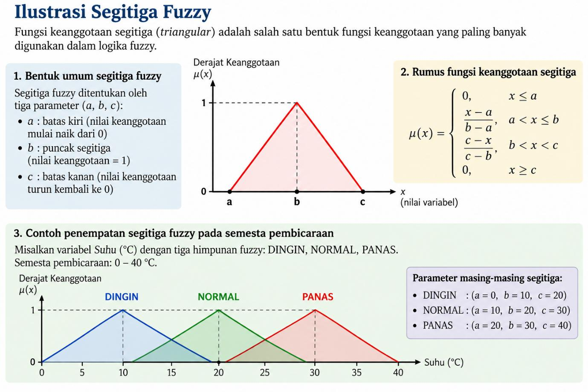
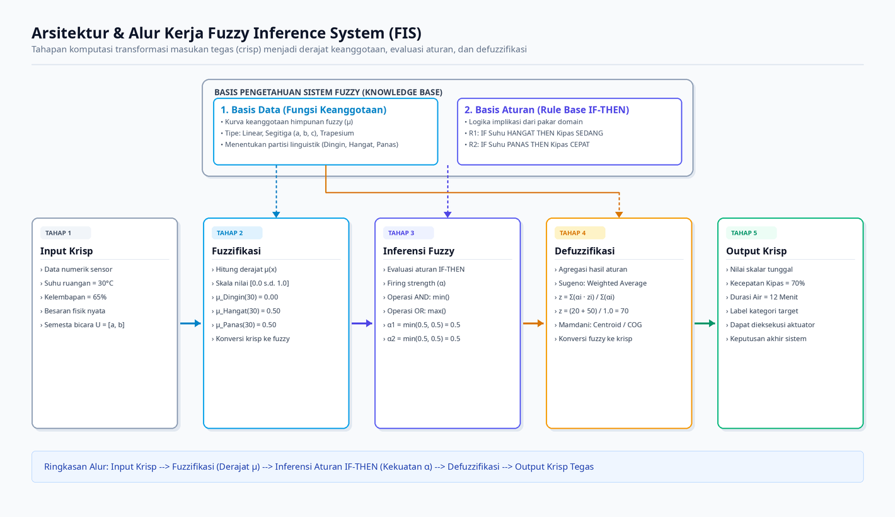
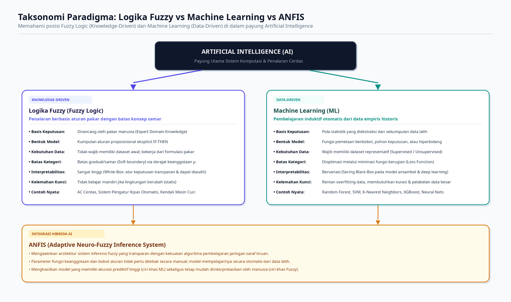

# Modul Pembelajaran: Logika Fuzzy (Fuzzy Logic)
> **Topik:** Konsep Dasar Logika Fuzzy, Himpunan Fuzzy, Fungsi Keanggotaan, Operator Fuzzy, Fuzzy Inference System (FIS), Metode Inferensi (Mamdani, Sugeno, Tsukamoto), Latihan Terbimbing Regresi & Klasifikasi, serta Tugas Mandiri Mahasiswa.  
> **Karakteristik Pembelajaran:** Menyajikan pemodelan konsep batas samar (*soft boundary*), tahapan fuzzifikasi hingga defuzzifikasi, perhitungan manual numerik bertingkat yang terverifikasi, metrik evaluasi (MAE, RMSE, Confusion Matrix, F1-Score), serta soal aplikatif.

---

## 📋 Daftar Isi & Peta Pembelajaran

- [Bagian 1 — Konsep dan Contoh Perhitungan](#bagian-1--konsep-dan-contoh-perhitungan)
  - [1. Mengapa Logika Fuzzy Diperlukan?](#1-mengapa-logika-fuzzy-diperlukan)
    - [1.1 Bagaimana Manusia Mengambil Keputusan?](#11-bagaimana-manusia-mengambil-keputusan)
  - [2. Perbedaan Logika Klasik dan Logika Fuzzy](#2-perbedaan-logika-klasik-dan-logika-fuzzy)
    - [2.1 Logika Klasik (Crisp Logic)](#21-logika-klasik-crisp-logic)
    - [2.2 Logika Fuzzy (Lotfi A. Zadeh, 1965)](#22-logika-fuzzy-lotfi-a-zadeh-1965)
  - [3. Konsep Paling Penting: Himpunan Fuzzy](#3-konsep-paling-penting-himpunan-fuzzy)
    - [3.1 Apa yang Dimaksud Himpunan?](#31-apa-yang-dimaksud-himpunan)
  - [4. Fungsi Keanggotaan (Membership Function)](#4-fungsi-keanggotaan-membership-function)
    - [4.1 Fungsi Keanggotaan Linear Naik](#41-fungsi-keanggotaan-linear-naik)
    - [4.2 Fungsi Keanggotaan Linear Turun](#42-fungsi-keanggotaan-linear-turun)
    - [4.3 Fungsi Keanggotaan Segitiga (Triangular)](#43-fungsi-keanggotaan-segitiga-triangular)
  - [5. Variabel Linguistik dalam Logika Fuzzy](#5-variabel-linguistik-dalam-logika-fuzzy)
  - [6. Operator Dasar Logika Fuzzy](#6-operator-dasar-logika-fuzzy)
    - [6.1 Operator AND (Metode Minimum)](#61-operator-and-metode-minimum)
    - [6.2 Operator OR (Metode Maksimum)](#62-operator-or-metode-maksimum)
    - [6.3 Operator NOT (Metode Komplemen)](#63-operator-not-metode-komplemen)
  - [7. Bagaimana Sistem Fuzzy Bekerja? (Fuzzy Inference System / FIS)](#7-bagaimana-sistem-fuzzy-bekerja-fuzzy-inference-system--fis)
  - [8. Contoh Perhitungan Sistem Fuzzy dari Awal Sampai Akhir](#8-contoh-perhitungan-sistem-fuzzy-dari-awal-sampai-akhir)
    - [8.1 Menentukan Variabel Input](#81-menentukan-variabel-input)
    - [8.2 Menentukan Output dan Basis Aturan](#82-menentukan-output-dan-basis-aturan)
    - [8.3 Nilai Masukan Kasus](#83-nilai-masukan-kasus)
    - [8.4 Langkah 1: Fuzzifikasi](#84-langkah-1-fuzzifikasi)
    - [8.5 Langkah 2: Evaluasi Aturan](#85-langkah-2-evaluasi-aturan)
    - [8.6 Langkah 3: Menghitung Output (Defuzzifikasi Sugeno Orde Nol)](#86-langkah-3-menghitung-output-defuzzifikasi-sugeno-orde-nol)
    - [8.7 Interpretasi Hasil](#87-interpretasi-hasil)
    - [8.8 Analisis Respon Terhadap Perubahan Suhu](#88-analisis-respon-terhadap-perubahan-suhu)
  - [9. Tiga Metode Inferensi Fuzzy yang Populer](#9-tiga-metode-inferensi-fuzzy-yang-populer)
    - [9.1 Metode Mamdani](#91-metode-mamdani)
    - [9.2 Metode Sugeno](#92-metode-sugeno)
    - [9.3 Metode Tsukamoto](#93-metode-tsukamoto)
    - [9.4 Tabel Perbandingan Tiga Metode](#94-tabel-perbandingan-tiga-metode)
  - [10. Apakah Fuzzy Logic Termasuk Machine Learning?](#10-apakah-fuzzy-logic-termasuk-machine-learning)
  - [11. Kelebihan dan Kelemahan Logika Fuzzy](#11-kelebihan-dan-kelemahan-logika-fuzzy)
  - [12. Latihan Perhitungan Manual Mandiri](#12-latihan-perhitungan-manual-mandiri)
  - [13. Rangkuman Konsep Dasar](#13-rangkuman-konsep-dasar)
- [Bagian 2 — Latihan Terbimbing: Fuzzy untuk Regresi dan Klasifikasi](#bagian-2--latihan-terbimbing-fuzzy-untuk-regresi-dan-klasifikasi)
  - [Bagian A: Latihan Terbimbing Fuzzy untuk Regresi (Prediksi Kebutuhan Air)](#bagian-a-latihan-terbimbing-fuzzy-untuk-regresi-prediksi-kebutuhan-air)
    - [1. Deskripsi Soal & Dataset Regresi ($N=15$)](#1-deskripsi-soal--dataset-regresi-n15)
    - [2. Langkah 1: Fungsi Keanggotaan Suhu & Kelembapan](#2-langkah-1-fungsi-keanggotaan-suhu--kelembapan)
    - [3. Langkah 2: Membentuk Basis Aturan Sugeno Orde Nol](#3-langkah-2-membentuk-basis-aturan-sugeno-orde-nol)
    - [4. Langkah 3: Perhitungan Manual Data Nomor 5](#4-langkah-3-perhitungan-manual-data-nomor-5)
    - [5. Langkah 4: Perhitungan Manual Data Nomor 10](#5-langkah-4-perhitungan-manual-data-nomor-10)
    - [6. Tabel Prediksi Lengkap Seluruh Dataset Regresi ($N=15$)](#6-tabel-prediksi-lengkap-seluruh-dataset-regresi-n15)
    - [7. Evaluasi Kinerja Regresi (MAE & RMSE)](#7-evaluasi-kinerja-regresi-mae--rmse)
  - [Bagian B: Latihan Terbimbing Fuzzy untuk Klasifikasi (Risiko Akademik)](#bagian-b-latihan-terbimbing-fuzzy-untuk-klasifikasi-risiko-akademik)
    - [1. Deskripsi Soal & Dataset Klasifikasi ($N=15$)](#1-deskripsi-soal--dataset-klasifikasi-n15)
    - [2. Langkah 1: Fungsi Keanggotaan Nilai Ujian & Kehadiran](#2-langkah-1-fungsi-keanggotaan-nilai-ujian--kehadiran)
    - [3. Langkah 2: Basis Aturan & Mekanisme Agregasi Kelas](#3-langkah-2-basis-aturan--mekanisme-agregasi-kelas)
    - [4. Langkah 3: Perhitungan Manual Data Nomor 6](#4-langkah-3-perhitungan-manual-data-nomor-6)
    - [5. Langkah 4: Perhitungan Manual Data Nomor 9](#5-langkah-4-perhitungan-manual-data-nomor-9)
    - [6. Tabel Klasifikasi Lengkap Seluruh Dataset ($N=15$)](#6-tabel-klasifikasi-lengkap-seluruh-dataset-n15)
    - [7. Confusion Matrix & Metrik Evaluasi Klasifikasi](#7-confusion-matrix--metrik-evaluasi-klasifikasi)
    - [8. Perbandingan Karakteristik Regresi vs Klasifikasi Fuzzy](#8-perbandingan-karakteristik-regresi-vs-klasifikasi-fuzzy)
- [Bagian 3 — Tugas Mandiri Mahasiswa](#bagian-3--tugas-mandiri-mahasiswa)
  - [Soal 1: Fuzzy untuk Regresi — Prediksi Lama Penyiraman Tanaman ($N=20$)](#soal-1-fuzzy-untuk-regresi--prediksi-lama-penyiraman-tanaman-n20)
  - [Soal 2: Fuzzy untuk Klasifikasi — Klasifikasi Risiko Kredit Nasabah ($N=20$)](#soal-2-fuzzy-untuk-klasifikasi--klasifikasi-risiko-kredit-nasabah-n20)

---

# BAGIAN 1 — KONSEP DAN CONTOH PERHITUNGAN

Logika Fuzzy (*Fuzzy Logic*) merupakan salah satu pilar fundamental dalam bidang Artificial Intelligence (AI), Machine Learning, sistem kendali cerdas (*smart control systems*), dan sistem pendukung keputusan (*decision support systems*). 

Untuk memahaminya, kita tidak perlu langsung berhadapan dengan rumus matematika abstrak. Pendekatan fuzzy berakar langsung dari pola penalaran manusia dalam kehidupan sehari-hari, kemudian secara terstruktur diformalkan menjadi pemodelan matematika bertingkat.

---

## 1. Mengapa Logika Fuzzy Diperlukan?

### 1.1 Bagaimana Manusia Mengambil Keputusan?

Bayangkan kita berada di sebuah ruangan dengan suhu terukur $29^\circ\text{C}$. Seseorang bertanya: *"Apakah ruangan ini panas?"*

Jawaban manusia di dunia nyata umumnya tidak hitam-putih, melainkan:
- "Lumayan panas."
- "Agak panas."
- "Tidak terlalu panas."
- "Sedikit hangat."
- "Cukup panas."

Manusia tidak membatasi persepsinya ke dalam dua status biner ekstrem (*panas* atau *tidak panas*). Manusia memiliki kapabilitas kognitif untuk memberikan **penilaian bertingkat (gradual)**.

| Suhu | Penilaian Manusia |
| :---: | :--- |
| $20^\circ\text{C}$ | Dingin |
| $26^\circ\text{C}$ | Agak panas |
| $29^\circ\text{C}$ | Cukup panas |
| $35^\circ\text{C}$ | Sangat panas |

**Tantangan Komputasi:**  
Bagaimana mesin komputasi berbasis digital dapat menangani konsep linguistik seperti *"agak panas"*, *"cukup panas"*, atau *"sangat panas"*?  
Komputer standar hanya memproses representasi biner. Di sinilah **Logika Fuzzy** berperan: menjembatani bahasa kualitatif manusia yang memiliki batas tidak tegas (*vague / soft boundaries*)—seperti dingin, hangat, panas, murah, mahal, cepat, lambat, tinggi—ke dalam sistem numerik yang terdefinisi secara presisi.

---

## 2. Perbedaan Logika Klasik dan Logika Fuzzy

### 2.1 Logika Klasik (Crisp Logic)

Logika klasik (Aristotelian / *crisp logic*) hanya mengenal dua nilai kebenaran mutlak (Bivalen):
- $0 = \text{Salah (False / Tidak Termasuk)}$
- $1 = \text{Benar (True / Termasuk)}$

Misalkan didefinisikan aturan tegas: *Jika suhu $\ge 30^\circ\text{C}$, maka ruangan PANAS.*  
Secara matematis, fungsi karakteristik keanggotaan crisp dinyatakan:

$$Panas(x) = \begin{cases} 0, & x < 30 \\ 1, & x \ge 30 \end{cases}$$

*Di mana:*
- $x$ = suhu ruangan dalam satuan $^\circ\text{C}$.
- $0$ = tidak termasuk kategori panas.
- $1$ = sepenuhnya termasuk kategori panas.

Jika dievaluasi pada berbagai suhu:

| Suhu ($x$) | Kategori Panas | Nilai ($Panas(x)$) |
| :---: | :---: | :---: |
| $25^\circ\text{C}$ | Tidak | $0$ |
| $28^\circ\text{C}$ | Tidak | $0$ |
| $29^\circ\text{C}$ | Tidak | $0$ |
| $29{,}9^\circ\text{C}$ | Tidak | $0$ |
| $30^\circ\text{C}$ | Ya | $1$ |
| $31^\circ\text{C}$ | Ya | $1$ |
| $35^\circ\text{C}$ | Ya | $1$ |

> [!WARNING]
> **Kelemahan Logika Klasik:**  
> - Suhu $29{,}9^\circ\text{C}$ diberi label $0$ (Tidak Panas).  
> - Suhu $30{,}0^\circ\text{C}$ diberi label $1$ (Panas).  
> 
> Selisih hanya $0{,}1^\circ\text{C}$ memicu lompatan diskontinu yang drastis. Pada realitas fisik, persepsi kenyamanan termal manusia tidak berubah secara radikal hanya karena perbedaan $0{,}1^\circ\text{C}$. Logika klasik memaksakan batas diskret (*hard boundary*), sementara fenomena alamiah bersifat kontinu.

---

### 2.2 Logika Fuzzy (Lotfi A. Zadeh, 1965)

Logika fuzzy diperkenalkan secara ilmiah oleh **Prof. Lotfi A. Zadeh** pada tahun 1965 melalui publikasi seminal *"Fuzzy Sets"*. Berbeda dengan logika klasik, logika fuzzy menggunakan rentang **derajat keanggotaan (*degree of membership*) kontinu** antara $0$ hingga $1$:

$$0 \le \mu_A(x) \le 1$$

*Keterangan notasi:*
- $\mu$ (huruf Yunani *mu* / miu) = derajat keanggotaan.
- $A$ = himpunan fuzzy (misalnya: $\text{PANAS}$).
- $x$ = nilai skalar yang diamati (misalnya: suhu dalam $^\circ\text{C}$).
- $\mu_A(x)$ = derajat keanggotaan nilai $x$ di dalam himpunan fuzzy $A$.

#### Interpretasi Semantik Derajat Keanggotaan:

| Nilai Keanggotaan ($\mu$) | Interpretasi Makna Kualitatif |
| :---: | :--- |
| $0$ | Sama sekali bukan anggota (*non-membership*) |
| $0{,}2$ | Keanggotaan derajat rendah |
| $0{,}5$ | Keanggotaan derajat sedang / peralihan |
| $0{,}8$ | Keanggotaan derajat tinggi |
| $1$ | Keanggotaan penuh (*full membership*) |

Sebagai contoh, jika dirancang suatu fungsi keanggotaan fuzzy untuk kategori $\text{PANAS}$:

| Suhu ($x$) | Derajat Keanggotaan ($\mu_{\text{PANAS}}(x)$) |
| :---: | :---: |
| $20^\circ\text{C}$ | $0$ |
| $25^\circ\text{C}$ | $0$ |
| $27^\circ\text{C}$ | $0{,}2$ |
| $29^\circ\text{C}$ | $0{,}4$ |
| $30^\circ\text{C}$ | $0{,}5$ |
| $33^\circ\text{C}$ | $0{,}8$ |
| $35^\circ\text{C}$ | $1{,}0$ |

Perbandingan perlakuan terhadap suhu $29^\circ\text{C}$:
- Pada logika klasik: $Panas(29) = 0$
- Pada logika fuzzy: $\mu_{\text{PANAS}}(29) = 0{,}4$

Artinya, suhu $29^\circ\text{C}$ memiliki derajat keanggotaan sebesar $0{,}4$ dalam himpunan $\text{PANAS}$.

> [!IMPORTANT]
> **Distingsi Kritis: Derajat Keanggotaan vs. Probabilitas**  
> Nilai $\mu = 0{,}4$ **bukan** berarti peluang/probabilitas 40% bahwa suhu itu panas. Derajat keanggotaan mengukur *tingkat kesesuaian / kedekatan konsep* terhadap definisi himpunan yang dirancang, bukan frekuensi kejadian acak (*random event*).

---

## 3. Konsep Paling Penting: Himpunan Fuzzy

### 3.1 Apa yang Dimaksud Himpunan?

Dalam teori himpunan klasik, sebuah himpunan adalah kumpulan objek dengan keanggotaan biner mutlak:
$$A = \{1, 2, 3, 4, 5\}$$
Angka $3 \in A$, sedangkan $7 \notin A$.

Dalam logika fuzzy, sebuah nilai skalar dapat memiliki keanggotaan parsial pada beberapa himpunan sekaligus. Misalkan semesta variabel suhu dibagi menjadi tiga himpunan fuzzy:
$$Suhu = \{Dingin, Hangat, Panas\}$$

Jika suhu ruangan berada pada $28^\circ\text{C}$, sistem fuzzy dapat menetapkan:
$$\mu_{Dingin}(28) = 0$$
$$\mu_{Hangat}(28) = 0{,}7$$
$$\mu_{Panas}(28) = 0{,}3$$

*Makna fisis:*
- Suhu $28^\circ\text{C}$ sama sekali tidak tergolong *Dingin*.
- Suhu $28^\circ\text{C}$ secara dominan tergolong *Hangat* ($\mu = 0{,}7$).
- Namun pada saat yang sama, suhu tersebut sudah mulai memiliki karakteristik *Panas* ($\mu = 0{,}3$).

> [!NOTE]
> Satu nilai dapat menjadi anggota dari lebih dari satu himpunan fuzzy secara simultan. Jumlah total derajat keanggotaan antarhimpunan pada suatu titik **tidak harus selalu sama dengan 1**, bergantung pada rancangan dan jenis fungsi keanggotaan yang diimplementasikan.

---

## 4. Fungsi Keanggotaan (Membership Function)

Derajat keanggotaan dihitung secara matematis menggunakan **Fungsi Keanggotaan (*Membership Function*)**, yang memetakan elemen masukan dari semesta pembicaraan (*universe of discourse*) ke dalam selang real $[0, 1]$.

| No | Tipe Fungsi Keanggotaan | Karakteristik Utama |
| :---: | :--- | :--- |
| 1 | **Linear Naik** | Derajat keanggotaan meningkat linier dari 0 ke 1 |
| 2 | **Linear Turun** | Derajat keanggotaan menurun linier dari 1 ke 0 |
| 3 | **Segitiga (*Triangular*)** | Memiliki satu titik puncak tunggal ($\mu=1$) diapit dua lereng linear |
| 4 | **Trapesium (*Trapezoidal*)** | Memiliki interval datar berpuncak penuh ($\mu=1$) sebelum menurun |
| 5 | **Gaussian** | Kurva kontinu berbentuk lonceng simetris (*smooth bell-curve*) |
| 6 | **Sigmoid** | Kurva berbentuk kurva nonlinier S (asimtotik) |

---

### 4.1 Fungsi Keanggotaan Linear Naik

Fungsi ini digunakan untuk memodelkan atribut yang derajat keanggotaannya semakin menguat seiring bertambahnya nilai masukan (misalnya himpunan $\text{PANAS}$).

Ketentuan parameter:
- $x \le 25^\circ\text{C}$: Tidak panas ($\mu = 0$).
- $x \ge 35^\circ\text{C}$: Sepenuhnya panas ($\mu = 1$).
- $25 < x < 35^\circ\text{C}$: Keanggotaan bertambah linear.

Formulasi matematis:

$$\mu_{Panas}(x) = \begin{cases} 0, & x \le 25 \\ \dfrac{x - 25}{35 - 25}, & 25 < x < 35 \\ 1, & x \ge 35 \end{cases}$$

#### Contoh Perhitungan Bertingkat:

1. **Untuk Suhu $x = 27^\circ\text{C}$:**
   $$\mu_{Panas}(27) = \frac{27 - 25}{35 - 25} = \frac{2}{10} = 0{,}2$$
   *Interpretasi:* Suhu $27^\circ\text{C}$ memiliki derajat keanggotaan $0{,}2$ pada himpunan $\text{PANAS}$.

2. **Untuk Suhu $x = 30^\circ\text{C}$:**
   $$\mu_{Panas}(30) = \frac{30 - 25}{35 - 25} = \frac{5}{10} = 0{,}5$$
   *Interpretasi:* Suhu $30^\circ\text{C}$ memiliki derajat keanggotaan $0{,}5$ pada himpunan $\text{PANAS}$.

3. **Untuk Suhu $x = 33^\circ\text{C}$:**
   $$\mu_{Panas}(33) = \frac{33 - 25}{35 - 25} = \frac{8}{10} = 0{,}8$$
   *Interpretasi:* Suhu $33^\circ\text{C}$ memiliki derajat keanggotaan $0{,}8$ pada himpunan $\text{PANAS}$.

#### Rekapitulasi Respon Linear Naik:
| Suhu ($x$) | Komputasi Numerik | Derajat Keanggotaan ($\mu_{Panas}$) |
| :---: | :---: | :---: |
| $25^\circ\text{C}$ | Batas Bawah | $0{,}0$ |
| $27^\circ\text{C}$ | $\frac{2}{10}$ | $0{,}2$ |
| $29^\circ\text{C}$ | $\frac{4}{10}$ | $0{,}4$ |
| $30^\circ\text{C}$ | $\frac{5}{10}$ | $0{,}5$ |
| $33^\circ\text{C}$ | $\frac{8}{10}$ | $0{,}8$ |
| $35^\circ\text{C}$ | Batas Atas | $1{,}0$ |

---

### 4.2 Fungsi Keanggotaan Linear Turun

Fungsi ini memodelkan atribut yang derajat keanggotaannya melemah seiring naiknya variabel masukan (misalnya himpunan $\text{DINGIN}$).

Ketentuan parameter:
- $x \le 20^\circ\text{C}$: Sepenuhnya dingin ($\mu = 1$).
- $x \ge 30^\circ\text{C}$: Tidak dingin ($\mu = 0$).
- $20 < x < 30^\circ\text{C}$: Keanggotaan menurun secara linear.

Formulasi matematis:

$$\mu_{Dingin}(x) = \begin{cases} 1, & x \le 20 \\ \dfrac{30 - x}{30 - 20}, & 20 < x < 30 \\ 0, & x \ge 30 \end{cases}$$

#### Contoh Perhitungan:
- **Suhu $x = 24^\circ\text{C}$:**
  $$\mu_{Dingin}(24) = \frac{30 - 24}{30 - 20} = \frac{6}{10} = 0{,}6$$
- **Suhu $x = 28^\circ\text{C}$:**
  $$\mu_{Dingin}(28) = \frac{30 - 28}{30 - 20} = \frac{2}{10} = 0{,}2$$

---

### 4.3 Fungsi Keanggotaan Segitiga (Triangular)

Fungsi keanggotaan segitiga ditentukan oleh tiga parameter matematis triplet $(a, b, c)$:
- $a$ = batas kiri (titik awal di mana keanggotaan mulai naik dari $0$).
- $b$ = puncak segitiga (*modal value / core*, di mana keanggotaan mencapai nilai puncak $1$).
- $c$ = batas kanan (titik akhir di mana keanggotaan kembali turun menjadi $0$).

Formulasi umum:

$$\mu_A(x) = \begin{cases} 0, & x \le a \\ \dfrac{x - a}{b - a}, & a < x \le b \\ \dfrac{c - x}{c - b}, & b < x < c \\ 0, & x \ge c \end{cases}$$

#### Contoh Penempatan Parameter:
Misalkan dirancang himpunan $\text{HANGAT}$ dengan parameter triplet $(a, b, c) = (20, 25, 30)$:
- Pada suhu $20^\circ\text{C}$: $\mu_{Hangat} = 0$.
- Pada suhu $25^\circ\text{C}$: $\mu_{Hangat} = 1$ (puncak representasi hangat).
- Pada suhu $30^\circ\text{C}$: $\mu_{Hangat} = 0$.

#### Evaluasi Numerik:
1. **Untuk Suhu $x = 23^\circ\text{C}$ (Rentang Kiri: $20 < 23 \le 25$):**
   $$\mu_{Hangat}(23) = \frac{23 - 20}{25 - 20} = \frac{3}{5} = 0{,}6$$
2. **Untuk Suhu $x = 28^\circ\text{C}$ (Rentang Kanan: $25 < 28 < 30$):**
   $$\mu_{Hangat}(28) = \frac{30 - 28}{30 - 25} = \frac{2}{5} = 0{,}4$$

#### Rekapitulasi Respon Segitiga HANGAT:
| Suhu ($x$) | Posisi Evaluasi | Derajat Keanggotaan ($\mu_{Hangat}$) |
| :---: | :---: | :---: |
| $20^\circ\text{C}$ | Batas Kiri ($a$) | $0{,}0$ |
| $22^\circ\text{C}$ | Lereng Kiri | $0{,}4$ |
| $23^\circ\text{C}$ | Lereng Kiri | $0{,}6$ |
| $25^\circ\text{C}$ | Puncak Segitiga ($b$) | $1{,}0$ |
| $27^\circ\text{C}$ | Lereng Kanan | $0{,}6$ |
| $28^\circ\text{C}$ | Lereng Kanan | $0{,}4$ |
| $30^\circ\text{C}$ | Batas Kanan ($c$) | $0{,}0$ |

---

## 5. Variabel Linguistik dalam Logika Fuzzy

Dalam sistem fuzzy, kita mengenal konsep **Variabel Linguistik (*Linguistic Variable*)**, yaitu variabel yang nilainya tidak hanya direpresentasikan oleh besaran numerik, tetapi juga oleh kata-kata (*terms*) dalam bahasa manusia.

| Variabel Linguistik | Domain / Konteks | Himpunan Nilai Linguistik (*Terms*) |
| :--- | :--- | :--- |
| **Suhu** | Pengatur suhu ruangan / AC | *Dingin, Normal / Hangat, Panas* |
| **Kecepatan** | Sistem kendali kendaraan | *Lambat, Sedang, Cepat* |
| **Harga** | Penilaian kelayakan produk | *Murah, Terjangkau, Mahal* |
| **Nilai Ujian** | Evaluasi akademik | *Rendah, Sedang, Tinggi* |
| **Usia** | Profil demografi | *Muda, Paruh Baya, Tua* |
| **Risiko Kredit** | Penilaian finansial perbankan | *Rendah, Moderat, Tinggi* |

Setiap variabel linguistik didefinisikan oleh komponen formal:
1. **Semesta Pembicaraan (*Universe of Discourse, $U$*):** Batas rentang operasional nilai numerik yang valid (misal: $U = [0, 40]^\circ\text{C}$).
2. **Himpunan Fuzzy ($A$):** Koleksi label linguistik (misal: $A = \{Dingin, Hangat, Panas\}$).
3. **Fungsi Keanggotaan ($\mu$):** Fungsi matematis yang menghubungkan semesta pembicaraan $U$ ke derajat keanggotaan $[0, 1]$.

---

## 6. Operator Dasar Logika Fuzzy

Ketika suatu keputusan didasarkan pada kombinasi beberapa variabel masukan, diperlukan operator logika fuzzy untuk mengevaluasi kondisi majemuk. Tiga operator standar Zadeh:

### 6.1 Operator AND (Metode Minimum)
Operator AND (interseksi himpunan fuzzy) merefleksikan konjungsi matematis. Standar Zadeh menggunakan fungsi minimum:

$$\mu_{A \cap B}(x) = \min(\mu_A(x), \mu_B(x))$$

*Contoh Perhitungan:*  
Kondisi sensor:
$$\mu_{Panas} = 0{,}8$$
$$\mu_{Lembap} = 0{,}6$$
Aturan: `IF suhu PANAS AND kelembapan TINGGI THEN kipas CEPAT`  
Tingkat aktivasi aturan (*firing strength*, disimbolkan $\alpha$):
$$\alpha = \min(0{,}8, 0{,}6) = 0{,}6$$

---

### 6.2 Operator OR (Metode Maksimum)
Operator OR (union himpunan fuzzy) merefleksikan disjungsi matematis, standar menggunakan fungsi maksimum:

$$\mu_{A \cup B}(x) = \max(\mu_A(x), \mu_B(x))$$

*Contoh Perhitungan:*  
Aturan: `IF suhu PANAS OR kelembapan TINGGI THEN kipas CEPAT`  
$$\alpha = \max(0{,}8, 0{,}6) = 0{,}8$$

---

### 6.3 Operator NOT (Metode Komplemen)
Operator NOT (negasi) merefleksikan kebalikan dari derajat keanggotaan:

$$\mu_{\neg A}(x) = 1 - \mu_A(x)$$

*Contoh Perhitungan:*  
Jika $\mu_{Panas} = 0{,}8$, maka:
$$\mu_{\text{Tidak Panas}} = 1 - 0{,}8 = 0{,}2$$

#### Ringkasan Operator Fuzzy:
| Operator | Nama Operasi | Formulasi Matematika | Contoh Kasus ($\mu_A=0{,}8; \mu_B=0{,}6$) | Hasil Aktivasi ($\alpha$) |
| :---: | :---: | :---: | :---: | :---: |
| **AND** | Interseksi (t-norm) | $\min(\mu_A, \mu_B)$ | $\min(0{,}8; 0{,}6)$ | $0{,}6$ |
| **OR** | Union (s-norm) | $\max(\mu_A, \mu_B)$ | $\max(0{,}8; 0{,}6)$ | $0{,}8$ |
| **NOT** | Komplemen | $1 - \mu_A$ | $1 - 0{,}8$ | $0{,}2$ |

---

## 7. Bagaimana Sistem Fuzzy Bekerja? (Fuzzy Inference System / FIS)

Sistem Inferensi Fuzzy (*Fuzzy Inference System - FIS*) adalah kerangka komputasi yang memetakan masukan tegas (*crisp input*) menjadi keluaran tegas (*crisp output*) melalui tahapan inferensi berbasis pengetahuan:

### Penjelasan 5 Tahapan Utama:

1. **Input Numerik (Crisp Input):** Data masukan skalar dari sensor atau sistem (misalnya: $\text{Suhu} = 30^\circ\text{C}$).
2. **Fuzzifikasi:** Proses konversi nilai numerik tegas menjadi derajat keanggotaan $[0, 1]$ pada setiap himpunan fuzzy yang relevan berdasarkan fungsi keanggotaan.
3. **Basis Aturan (Rule Base):** Kumpulan aturan implikasi logis yang dirumuskan dalam format:  
   $$\text{IF } (\text{anteseden / kondisi}) \text{ THEN } (\text{konsekuen / keputusan})$$
4. **Mesin Inferensi (Inference Engine):** Menghitung derajat penyalaan (*firing strength* $\alpha$) tiap aturan dan menerapkan operasi penalaran fuzzy untuk memperoleh representasi luaran gabungan.
5. **Defuzzifikasi:** Proses transformasi luaran fuzzy kembali menjadi nilai numerik tegas (*crisp output*) yang dapat dieksekusi oleh aktuator mesin (misal: Kecepatan motor kipas $= 70\%$).

---

## 8. Contoh Perhitungan Sistem Fuzzy dari Awal Sampai Akhir

Mari kita telusuri simulasi komputasi lengkap untuk **Sistem Pengatur Kecepatan Kipas Otomatis** menggunakan metode **Fuzzy Sugeno Orde Nol** (keluaran berupa konstanta skalar).

### 8.1 Menentukan Variabel Input
- **Variabel:** Suhu ruangan ($x$)
- **Domain:** $20^\circ\text{C} \le x \le 40^\circ\text{C}$
- **Himpunan Fuzzy:** $\text{HANGAT}$ dan $\text{PANAS}$

**Fungsi Keanggotaan HANGAT:**
$$\mu_{Hangat}(x) = \begin{cases} 1, & x \le 25 \\ \dfrac{35 - x}{10}, & 25 < x < 35 \\ 0, & x \ge 35 \end{cases}$$

**Fungsi Keanggotaan PANAS:**
$$\mu_{Panas}(x) = \begin{cases} 0, & x \le 25 \\ \dfrac{x - 25}{10}, & 25 < x < 35 \\ 1, & x \ge 35 \end{cases}$$

---

### 8.2 Menentukan Output dan Basis Aturan
Keluaran sistem adalah persentase kecepatan putaran kipas:
- **Aturan 1 ($R_1$):** `IF suhu HANGAT THEN kecepatan kipas SEDANG` ($z_1 = 40\%$)
- **Aturan 2 ($R_2$):** `IF suhu PANAS THEN kecepatan kipas CEPAT` ($z_2 = 100\%$)

---

### 8.3 Nilai Masukan Kasus
Diketahui suhu terukur:
$$x = 30^\circ\text{C}$$

---

### 8.4 Langkah 1: Fuzzifikasi
Substitusikan $x = 30$ ke dalam kedua fungsi keanggotaan:

$$\mu_{Hangat}(30) = \frac{35 - 30}{10} = \frac{5}{10} = 0{,}5$$

$$\mu_{Panas}(30) = \frac{30 - 25}{10} = \frac{5}{10} = 0{,}5$$

---

### 8.5 Langkah 2: Evaluasi Aturan
- Evaluasi kekuatan aturan $R_1$:
  $$\alpha_1 = \mu_{Hangat}(30) = 0{,}5$$
- Evaluasi kekuatan aturan $R_2$:
  $$\alpha_2 = \mu_{Panas}(30) = 0{,}5$$

---

### 8.6 Langkah 3: Menghitung Output (Defuzzifikasi Sugeno Orde Nol)
Pada Sugeno orde nol, defuzzifikasi dilakukan melalui **rata-rata terbobot (*Weighted Average*)**:

$$z = \frac{\sum_{i=1}^n \alpha_i z_i}{\sum_{i=1}^n \alpha_i}$$

Substitusi nilai:
$$z = \frac{(\alpha_1 \cdot z_1) + (\alpha_2 \cdot z_2)}{\alpha_1 + \alpha_2} = \frac{(0{,}5 \times 40) + (0{,}5 \times 100)}{0{,}5 + 0{,}5}$$

$$z = \frac{20 + 50}{1{,}0} = \frac{70}{1} = 70\%$$

---

### 8.7 Interpretasi Hasil
Pada suhu $30^\circ\text{C}$, sistem menghasilkan kendali kecepatan kipas sebesar **$70\%$**.  
Sistem tidak melompat secara kaku ke $40\%$ atau $100\%$, melainkan menghasilkan kompromi yang proporsional sesuai derajat aktivasi dari kedua kondisi yang aktif bersamaan.

---

### 8.8 Analisis Respon Terhadap Perubahan Suhu
Jika suhu ruangan bergerak dari $25^\circ\text{C}$ hingga $35^\circ\text{C}$:

| Suhu Ruangan ($x$) | $\mu_{Hangat}$ | $\mu_{Panas}$ | Formula Komputasi Output | Output Kecepatan ($z$) |
| :---: | :---: | :---: | :---: | :---: |
| $25^\circ\text{C}$ | $1{,}0$ | $0{,}0$ | $\frac{(1{,}0 \times 40) + (0{,}0 \times 100)}{1{,}0}$ | **$40\%$** |
| $27^\circ\text{C}$ | $0{,}8$ | $0{,}2$ | $\frac{(0{,}8 \times 40) + (0{,}2 \times 100)}{0{,}8 + 0{,}2} = \frac{32 + 20}{1{,}0}$ | **$52\%$** |
| $29^\circ\text{C}$ | $0{,}6$ | $0{,}4$ | $\frac{(0{,}6 \times 40) + (0{,}4 \times 100)}{0{,}6 + 0{,}4} = \frac{24 + 40}{1{,}0}$ | **$64\%$** |
| $30^\circ\text{C}$ | $0{,}5$ | $0{,}5$ | $\frac{(0{,}5 \times 40) + (0{,}5 \times 100)}{0{,}5 + 0{,}5} = \frac{20 + 50}{1{,}0}$ | **$70\%$** |
| $31^\circ\text{C}$ | $0{,}4$ | $0{,}6$ | $\frac{(0{,}4 \times 40) + (0{,}6 \times 100)}{0{,}4 + 0{,}6} = \frac{16 + 60}{1{,}0}$ | **$76\%$** |
| $33^\circ\text{C}$ | $0{,}2$ | $0{,}8$ | $\frac{(0{,}2 \times 40) + (0{,}8 \times 100)}{0{,}2 + 0{,}8} = \frac{8 + 80}{1{,}0}$ | **$88\%$** |
| $35^\circ\text{C}$ | $0{,}0$ | $1{,}0$ | $\frac{(0{,}0 \times 40) + (1{,}0 \times 100)}{1{,}0}$ | **$100\%$** |

Perubahan keluaran berlangsung mulus (*smooth transition*), mencegah osilasi aktuator yang umum terjadi pada sistem kontrol konvensional *on-off*.

---

## 9. Tiga Metode Inferensi Fuzzy yang Populer

Dalam literatur dan aplikasi rekayasa, terdapat tiga arsitektur sistem inferensi fuzzy yang paling mapan:

### 9.1 Metode Mamdani
- **Ciri Khas:** Konsekuen aturan berupa **himpunan fuzzy**.
  *Contoh:* `IF suhu PANAS THEN kecepatan kipas CEPAT` (di mana *CEPAT* memiliki kurva keanggotaan).
- **Mekanisme Inferensi:** Luaran tiap aturan dipotong (*clipping*) atau diskalakan (*scaling*) setinggi kekuatan aktivasi $\alpha$, diagregasikan menggunakan operasi max / union, lalu didefuzzifikasi menggunakan metode numerik geometris seperti **Centroid (Center of Gravity / COG)** atau **Bisector**.
- **Kelebihan:** Sangat intuitif, representasi linguistik menyerupai pola pikir manusia alami.

---

### 9.2 Metode Sugeno (Takagi-Sugeno-Kang / TSK)
- **Ciri Khas:** Konsekuen aturan berupa **konstanta numerik skalar** (Orde Nol) atau **persamaan fungsi linear** dari variabel input (Orde Satu).
  *Contoh Orde Nol:* `IF suhu PANAS THEN kecepatan = 100%`
  *Contoh Orde Satu:* `IF suhu PANAS THEN kecepatan = 2 * suhu + 10`
- **Mekanisme Inferensi:** Defuzzifikasi menggunakan perhitungan **rata-rata terbobot (*Weighted Average*)**.
- **Kelebihan:** Sangat efisien secara komputasi, mudah dioptimasi secara analitis, ideal untuk sistem kontrol adaptif.

---

### 9.3 Metode Tsukamoto
- **Ciri Khas:** Konsekuen aturan berupa himpunan fuzzy yang fungsi keanggotaannya **monoton ketat** (selalu naik atau selalu turun).
- **Mekanisme Inferensi:** Setiap aturan langsung menghasilkan nilai crisp individual ($z_i$) melalui *inversi fungsi keanggotaan* setinggi $\alpha_i$, kemudian hasil akhir diagregasikan melalui rata-rata terbobot.
- **Kelebihan:** Menghindari integrasi area kontinu Mamdani yang kompleks sembari mempertahankan konsekuen berbentuk kurva fuzzy.

---

### 9.4 Tabel Perbandingan Tiga Metode

| Dimensi Perbandingan | Mamdani | Sugeno | Tsukamoto |
| :--- | :--- | :--- | :--- |
| **Bentuk Konsekuen** | Himpunan fuzzy arbitrer | Konstanta skalar / fungsi linear | Himpunan fuzzy monoton ketat |
| **Luaran Tiap Aturan** | Area fuzzy terpotong | Nilai numerik crisp ($z_i$) | Nilai numerik crisp ($z_i$) via inversi |
| **Metode Defuzzifikasi** | Integrasi luas area (Centroid / COG) | Rata-rata terbobot (*Weighted Average*) | Rata-rata terbobot (*Weighted Average*) |
| **Interpretasi Linguistik** | Sangat Tinggi (Alami) | Cukup Baik (Teknikal) | Baik |
| **Beban Komputasi Manual** | Relatif panjang & rumit | Sangat ringkas & sederhana (Orde 0) | Moderat |
| **Domain Aplikasi Dominan** | Sistem pakar, kendali non-linier intuitif | Kontrol kecepatan tinggi, optimasi, neuro-fuzzy | Kendali otomatis dan pendukung keputusan |

---

## 10. Apakah Fuzzy Logic Termasuk Machine Learning?

Logika fuzzy **bukan secara serta-merta merupakan algoritma Machine Learning**, meskipun keduanya bernaung di bawah payung Artificial Intelligence.

### Perbedaan Paradigma:
- **Machine Learning (Data-Driven):** Model mempelajari struktur pola, relasi, dan bobot secara otomatis dari sekumpulan data latih historis (*training dataset*). Contoh: Random Forest, Support Vector Machine, Neural Networks.
- **Fuzzy Logic Murni (Knowledge-Driven):** Bekerja berdasarkan formulasi eksplisit aturan *IF-THEN* dan kurva keanggotaan yang didefinisikan secara apriori oleh **pakar manusia (*expert domain*)**, tanpa keharusan memiliki dataset awal.

### Integrasi Hibrida: ANFIS
Kedua paradigma dapat digabungkan dalam arsitektur **Adaptive Neuro-Fuzzy Inference System (ANFIS)**:
- Struktur sistem berbasis aturan fuzzy yang transparan dan dapat dibaca manusia (*interpretable*).
- Parameter fungsi keanggotaan dan konsekuen dioptimasi serta dipelajari secara otomatis menggunakan algoritma pembelajaran jaringan saraf (*backpropagation* / *least squares*).

---

## 11. Kelebihan dan Kelemahan Logika Fuzzy

### Kelebihan:
1. **Transparansi & Kemudahan Interpretasi:** Berbasis aturan proposisional *IF-THEN* yang mudah dipahami oleh praktisi non-teknis.
2. **Penanganan Konsep Ambigu:** Sangat andal memodelkan data atau lingkungan yang sarat ketidakpastian (*imprecision*).
3. **Pemanfaatan Pengetahuan Pakar:** Dapat beroperasi langsung dari intuisi seorang pakar tanpa menuntut data latih skala besar.
4. **Respon Kontrol Halus:** Menghasilkan transisi keluaran yang gradual dan mulus bagi sistem mekanikal.

### Kelemahan:
1. **Perancangan Subjektif:** Penetapan batas parameter $(a, b, c)$ fungsi keanggotaan sangat subjektif; perancangan yang keliru menghasilkan keluaran bias.
2. **Ledakan Kombinatorial (*Curse of Dimensionality*):** Jika sistem memiliki $m$ variabel masukan dengan masing-masing $k$ himpunan linguistik, jumlah aturan potensial melonjak eksponensial ($k^m$).
3. **Tidak Belajar Otomatis (Non-Adaptif):** Sistem fuzzy konvensional tidak dapat memperbarui dirinya sendiri jika dinamika lingkungan berubah drastis (kecuali digabung dengan ML seperti ANFIS).
4. **Validasi Empiris Tetap Diperlukan:** Model harus tetap diuji secara ketat menggunakan metrik validasi data riil.

---

## 12. Latihan Perhitungan Manual Mandiri

### Latihan 1 — Dasar (Fungsi Linear Naik)
Sebuah sistem menentukan derajat keanggotaan suhu $\text{PANAS}$ dengan fungsi linear naik pada semesta $[20^\circ\text{C}, 40^\circ\text{C}]$, di mana $a = 20$ dan $b = 40$.  
Rumus: $\mu(x) = \frac{x - a}{b - a}$ untuk $a < x < b$.

Hitung derajat keanggotaan $\text{PANAS}$ untuk:
- a. Suhu $25^\circ\text{C} \implies \mu = \frac{25 - 20}{40 - 20} = \frac{5}{20} = \mathbf{0{,}25}$
- b. Suhu $30^\circ\text{C} \implies \mu = \frac{30 - 20}{40 - 20} = \frac{10}{20} = \mathbf{0{,}50}$
- c. Suhu $35^\circ\text{C} \implies \mu = \frac{35 - 20}{40 - 20} = \frac{15}{20} = \mathbf{0{,}75}$

---

### Latihan 2 — Menengah (Evaluasi Operator Logika)
Kondisi sistem: $\mu_{\text{SuhuTinggi}} = 0{,}7$ dan $\mu_{\text{KelembapanTinggi}} = 0{,}4$.  
Tentukan kekuatan aktivasi:
- a. `IF suhu TINGGI AND kelembapan TINGGI` $\implies \alpha = \min(0{,}7; 0{,}4) = \mathbf{0{,}4}$
- b. `IF suhu TINGGI OR kelembapan TINGGI` $\implies \alpha = \max(0{,}7; 0{,}4) = \mathbf{0{,}7}$
- c. `NOT suhu TINGGI` $\implies \mu = 1 - 0{,}7 = \mathbf{0{,}3}$

---

### Latihan 3 — Lanjutan (Fuzzy Sugeno Durasi Penyiraman)
Sistem Sugeno orde nol untuk durasi penyiraman:
- Aturan 1 ($R_1$): Aktivasi $\alpha_1 = 0{,}3$, Luaran $z_1 = 5$ detik.
- Aturan 2 ($R_2$): Aktivasi $\alpha_2 = 0{,}7$, Luaran $z_2 = 15$ detik.

Perhitungan rata-rata terbobot:
$$z = \frac{\alpha_1 z_1 + \alpha_2 z_2}{\alpha_1 + \alpha_2} = \frac{(0{,}3 \times 5) + (0{,}7 \times 15)}{0{,}3 + 0{,}7} = \frac{1{,}5 + 10{,}5}{1{,}0} = \mathbf{12\text{ detik}}$$

---

## 13. Rangkuman Konsep Dasar

| No | Konsep Kunci | Inti Pemahaman Akademis |
| :---: | :--- | :--- |
| 1 | **Logika Klasik** | Keanggotaan biner diskret ($0$ atau $1$) dengan batas mutlak (*hard boundary*). |
| 2 | **Logika Fuzzy** | Derajat keanggotaan kontinu pada rentang $[0, 1]$ dengan batas samar (*soft boundary*). |
| 3 | **Himpunan Fuzzy** | Kategori linguistik yang memungkinkan keanggotaan parsial simultan. |
| 4 | **Fungsi Keanggotaan** | Formulasi matematis pengubah nilai masukan menjadi derajat keanggotaan. |
| 5 | **Fuzzifikasi** | Pemetaan nilai masukan numerik skalar (*crisp*) ke dalam derajat keanggotaan fuzzy. |
| 6 | **Inferensi Fuzzy** | Komputasi evaluasi aturan IF-THEN majemuk untuk menghasilkan representasi keputusan. |
| 7 | **Defuzzifikasi** | Transformasi luaran penalaran fuzzy kembali menjadi nilai skalar tegas operasional. |

---

# BAGIAN 2 — LATIHAN TERBIMBING: FUZZY UNTUK REGRESI DAN KLASIFIKASI

Materi ini menyajikan dua studi kasus bertingkat terstruktur dengan masing-masing **15 instance data sintetis dua-fitur**, dirancang khusus untuk verifikasi perhitungan manual langkah demi langkah, evaluasi performa, dan validasi numerik.

---

## Bagian A: Latihan Terbimbing Fuzzy untuk Regresi (Prediksi Kebutuhan Air)

### 1. Deskripsi Soal & Dataset Regresi ($N=15$)

Sebuah sistem irigasi cerdas otomatis mengukur dua variabel lingkungan:
1. **Suhu Udara ($x$)** dalam satuan $^\circ\text{C}$.
2. **Kelembapan Udara ($h$)** dalam persentase ($\%$).

Sistem harus memprediksi jumlah **Kebutuhan Air Aktual ($y$)** yang dibutuhkan tanaman dalam satuan Liter menggunakan **Fuzzy Sugeno Orde Nol**.

#### Tabel 1. Dataset Regresi Kebutuhan Air Tanaman ($N=15$)
| No | Suhu ($x$, $^\circ\text{C}$) | Kelembapan ($h$, $\%$) | Kebutuhan Air Aktual ($y$, Liter) |
| :---: | :---: | :---: | :---: |
| 1 | 22 | 85 | 4 |
| 2 | 24 | 80 | 5 |
| 3 | 26 | 75 | 6 |
| 4 | 28 | 70 | 8 |
| 5 | 30 | 65 | 10 |
| 6 | 32 | 60 | 12 |
| 7 | 34 | 55 | 14 |
| 8 | 36 | 50 | 16 |
| 9 | 38 | 45 | 18 |
| 10 | 25 | 60 | 9 |
| 11 | 29 | 85 | 7 |
| 12 | 33 | 75 | 11 |
| 13 | 37 | 65 | 15 |
| 14 | 27 | 50 | 12 |
| 15 | 35 | 90 | 10 |

---

### 2. Langkah 1: Fungsi Keanggotaan Suhu & Kelembapan

#### A. Fitur Suhu ($x$) pada domain $[20, 40]^\circ\text{C}$
- **Himpunan DINGIN ($\mu_D$):**
  $$\mu_D(x) = \begin{cases} 1, & x \le 20 \\ \dfrac{40 - x}{20}, & 20 < x < 40 \\ 0, & x \ge 40 \end{cases}$$
- **Himpunan PANAS ($\mu_P$):**
  $$\mu_P(x) = \begin{cases} 0, & x \le 20 \\ \dfrac{x - 20}{20}, & 20 < x < 40 \\ 1, & x \ge 40 \end{cases}$$

#### B. Fitur Kelembapan ($h$) pada domain $[40, 90]\%$
- **Himpunan RENDAH ($\mu_{KR}$):**
  $$\mu_{KR}(h) = \begin{cases} 1, & h \le 40 \\ \dfrac{90 - h}{50}, & 40 < h < 90 \\ 0, & h \ge 90 \end{cases}$$
- **Himpunan TINGGI ($\mu_{KT}$):**
  $$\mu_{KT}(h) = \begin{cases} 0, & h \le 40 \\ \dfrac{h - 40}{50}, & 40 < h < 90 \\ 1, & h \ge 90 \end{cases}$$

---

### 3. Langkah 2: Membentuk Basis Aturan Sugeno Orde Nol

Empat aturan implikasi fuzzy ditetapkan sebagai berikut:

| Aturan | Kondisi Suhu | Kondisi Kelembapan | Luaran Sugeno ($z_i$) |
| :---: | :---: | :---: | :---: |
| **$R_1$** | Dingin | Tinggi | $z_1 = 4\text{ Liter}$ |
| **$R_2$** | Dingin | Rendah | $z_2 = 9\text{ Liter}$ |
| **$R_3$** | Panas | Tinggi | $z_3 = 12\text{ Liter}$ |
| **$R_4$** | Panas | Rendah | $z_4 = 18\text{ Liter}$ |

Operator AND dihitung dengan fungsi minimum:
$$\alpha_i = \min(\mu_{Suhu}, \mu_{Kelembapan})$$

Prediksi akhir dihitung dengan rata-rata terbobot:
$$\hat{y} = \frac{\sum_{i=1}^4 \alpha_i z_i}{\sum_{i=1}^4 \alpha_i}$$

---

### 4. Langkah 3: Perhitungan Manual Data Nomor 5

**Data Uji 5:** Suhu $x = 30^\circ\text{C}$, Kelembapan $h = 65\%$, Aktual $y = 10\text{ Liter}$.

1. **Fuzzifikasi Suhu ($x=30$):**
   $$\mu_D(30) = \frac{40 - 30}{20} = \frac{10}{20} = 0{,}5$$
   $$\mu_P(30) = \frac{30 - 20}{20} = \frac{10}{20} = 0{,}5$$

2. **Fuzzifikasi Kelembapan ($h=65$):**
   $$\mu_{KR}(65) = \frac{90 - 65}{50} = \frac{25}{50} = 0{,}5$$
   $$\mu_{KT}(65) = \frac{65 - 40}{50} = \frac{25}{50} = 0{,}5$$

3. **Evaluasi Kekuatan Aktivasi 4 Aturan:**
   - $\alpha_1 = \min(\mu_D, \mu_{KT}) = \min(0{,}5; 0{,}5) = 0{,}5$
   - $\alpha_2 = \min(\mu_D, \mu_{KR}) = \min(0{,}5; 0{,}5) = 0{,}5$
   - $\alpha_3 = \min(\mu_P, \mu_{KT}) = \min(0{,}5; 0{,}5) = 0{,}5$
   - $\alpha_4 = \min(\mu_P, \mu_{KR}) = \min(0{,}5; 0{,}5) = 0{,}5$

4. **Defuzzifikasi Rata-Rata Terbobot:**
   $$\hat{y} = \frac{(0{,}5 \times 4) + (0{,}5 \times 9) + (0{,}5 \times 12) + (0{,}5 \times 18)}{0{,}5 + 0{,}5 + 0{,}5 + 0{,}5}$$
   $$\hat{y} = \frac{2 + 4{,}5 + 6 + 9}{2{,}0} = \frac{21{,}5}{2{,}0} = \mathbf{10{,}75\text{ Liter}}$$

**Evaluasi Galat:**  
Galat absolut $|y - \hat{y}| = |10 - 10{,}75| = 0{,}75\text{ Liter}$.

---

### 5. Langkah 4: Perhitungan Manual Data Nomor 10

**Data Uji 10:** Suhu $x = 25^\circ\text{C}$, Kelembapan $h = 60\%$, Aktual $y = 9\text{ Liter}$.

1. **Fuzzifikasi Suhu ($x=25$):**
   $$\mu_D(25) = \frac{40 - 25}{20} = \frac{15}{20} = 0{,}75$$
   $$\mu_P(25) = \frac{25 - 20}{20} = \frac{5}{20} = 0{,}25$$

2. **Fuzzifikasi Kelembapan ($h=60$):**
   $$\mu_{KR}(60) = \frac{90 - 60}{50} = \frac{30}{50} = 0{,}60$$
   $$\mu_{KT}(60) = \frac{60 - 40}{50} = \frac{20}{50} = 0{,}40$$

3. **Evaluasi Kekuatan Aktivasi 4 Aturan:**
   - $\alpha_1 = \min(\mu_D, \mu_{KT}) = \min(0{,}75; 0{,}40) = 0{,}40$
   - $\alpha_2 = \min(\mu_D, \mu_{KR}) = \min(0{,}75; 0{,}60) = 0{,}60$
   - $\alpha_3 = \min(\mu_P, \mu_{KT}) = \min(0{,}25; 0{,}40) = 0{,}25$
   - $\alpha_4 = \min(\mu_P, \mu_{KR}) = \min(0{,}25; 0{,}60) = 0{,}25$

4. **Defuzzifikasi Rata-Rata Terbobot:**
   $$\text{Pembilang} = (0{,}40 \times 4) + (0{,}60 \times 9) + (0{,}25 \times 12) + (0{,}25 \times 18)$$
   $$\text{Pembilang} = 1{,}60 + 5{,}40 + 3{,}00 + 4{,}50 = 14{,}50$$
   $$\text{Penyebut} = 0{,}40 + 0{,}60 + 0{,}25 + 0{,}25 = 1{,}50$$
   $$\hat{y} = \frac{14{,}50}{1{,}50} \approx \mathbf{9{,}67\text{ Liter}}$$

**Evaluasi Galat:**  
Galat absolut $|y - \hat{y}| = |9 - 9{,}6667| \approx 0{,}67\text{ Liter}$.

---

### 6. Tabel Prediksi Lengkap Seluruh Dataset Regresi ($N=15$)

Untuk menghitung seluruh dataset, mahasiswa mengulangi proses fuzzifikasi, evaluasi 4 aturan, dan perhitungan Sugeno orde nol. Berikut hasil prediksi dan evaluasi galat yang diperoleh secara terstruktur:

#### Tabel 1.1 Hasil Prediksi dan Evaluasi Galat ($N=15$)
| No | Suhu ($x$, $^\circ\text{C}$) | Kelembapan ($h$, $\%$) | Aktual ($y$) | Prediksi Fuzzy ($\hat{y}$) | Galat Absolut ($\lvert y - \hat{y} \rvert$) | Galat Kuadrat ($(y - \hat{y})^2$) |
| :---: | :---: | :---: | :---: | :---: | :---: | :---: |
| 1 | 22 | 85 | 4 | 7,08 | 3,08 | 9,4864 |
| 2 | 24 | 80 | 5 | 8,06 | 3,06 | 9,3636 |
| 3 | 26 | 75 | 6 | 9,03 | 3,03 | 9,1809 |
| 4 | 28 | 70 | 8 | 10,02 | 2,02 | 4,0804 |
| 5 | 30 | 65 | 10 | 10,75 | 0,75 | 0,5625 |
| 6 | 32 | 60 | 12 | 11,54 | 0,46 | 0,2116 |
| 7 | 34 | 55 | 14 | 12,52 | 1,48 | 2,1904 |
| 8 | 36 | 50 | 16 | 13,56 | 2,44 | 5,9536 |
| 9 | 38 | 45 | 18 | 14,58 | 3,42 | 11,6964 |
| 10 | 25 | 60 | 9 | 9,67 | 0,67 | 0,4489 |
| 11 | 29 | 85 | 7 | 9,07 | 2,07 | 4,2849 |
| 12 | 33 | 75 | 11 | 10,94 | 0,06 | 0,0036 |
| 13 | 37 | 65 | 15 | 12,08 | 2,92 | 8,5264 |
| 14 | 27 | 50 | 12 | 10,47 | 1,53 | 2,3409 |
| 15 | 35 | 90 | 10 | 10,00 | 0,00 | 0,0000 |
| **Total** | — | — | — | — | **26,99** | **68,3305** |

> [!NOTE]
> *Catatan Diktat:* Tabel di atas merupakan ringkasan luaran sesuai modul acuan. Untuk laporan praktikum, mahasiswa menghitung kembali setiap baris berdasarkan fungsi dan aturan yang ditetapkan; pembulatan dilakukan setelah komputasi prediksi akhir.

#### Tabel 1.2 Rincian Fuzzifikasi dan Kekuatan Aturan ($\alpha$) Seluruh Data ($N=15$)
Sebagai panduan verifikasi perhitungan mandiri, berikut adalah nilai derajat keanggotaan dan kekuatan aktivasi 4 aturan untuk masing-masing baris:

| No | Suhu ($x$) | Kelembapan ($h$) | $\mu_D(x)$ | $\mu_P(x)$ | $\mu_{KR}(h)$ | $\mu_{KT}(h)$ | $\alpha_1$ (D, KT) | $\alpha_2$ (D, KR) | $\alpha_3$ (P, KT) | $\alpha_4$ (P, KR) |
| :---: | :---: | :---: | :---: | :---: | :---: | :---: | :---: | :---: | :---: | :---: |
| 1 | 22 | 85 | 0,90 | 0,10 | 0,10 | 0,90 | 0,90 | 0,10 | 0,10 | 0,10 |
| 2 | 24 | 80 | 0,80 | 0,20 | 0,20 | 0,80 | 0,80 | 0,20 | 0,20 | 0,20 |
| 3 | 26 | 75 | 0,70 | 0,30 | 0,30 | 0,70 | 0,70 | 0,30 | 0,30 | 0,30 |
| 4 | 28 | 70 | 0,60 | 0,40 | 0,40 | 0,60 | 0,60 | 0,40 | 0,40 | 0,40 |
| 5 | 30 | 65 | 0,50 | 0,50 | 0,50 | 0,50 | 0,50 | 0,50 | 0,50 | 0,50 |
| 6 | 32 | 60 | 0,40 | 0,60 | 0,60 | 0,40 | 0,40 | 0,40 | 0,40 | 0,60 |
| 7 | 34 | 55 | 0,30 | 0,70 | 0,70 | 0,30 | 0,30 | 0,30 | 0,30 | 0,70 |
| 8 | 36 | 50 | 0,20 | 0,80 | 0,80 | 0,20 | 0,20 | 0,20 | 0,20 | 0,80 |
| 9 | 38 | 45 | 0,10 | 0,90 | 0,90 | 0,10 | 0,10 | 0,10 | 0,10 | 0,90 |
| 10 | 25 | 60 | 0,75 | 0,25 | 0,60 | 0,40 | 0,40 | 0,60 | 0,25 | 0,25 |
| 11 | 29 | 85 | 0,55 | 0,45 | 0,10 | 0,90 | 0,55 | 0,10 | 0,45 | 0,10 |
| 12 | 33 | 75 | 0,35 | 0,65 | 0,30 | 0,70 | 0,35 | 0,30 | 0,65 | 0,30 |
| 13 | 37 | 65 | 0,15 | 0,85 | 0,50 | 0,50 | 0,15 | 0,15 | 0,50 | 0,50 |
| 14 | 27 | 50 | 0,65 | 0,35 | 0,80 | 0,20 | 0,20 | 0,65 | 0,20 | 0,35 |
| 15 | 35 | 90 | 0,25 | 0,75 | 0,00 | 1,00 | 0,25 | 0,00 | 0,75 | 0,00 |

---

### 7. Evaluasi Kinerja Regresi (MAE & RMSE)

#### A. Mean Absolute Error (MAE):
$$MAE = \frac{1}{n} \sum_{i=1}^n |y_i - \hat{y}_i| = \frac{26{,}99}{15} \approx \mathbf{1{,}80\text{ Liter}}$$

#### B. Root Mean Squared Error (RMSE):
$$RMSE = \sqrt{\frac{1}{n} \sum_{i=1}^n (y_i - \hat{y}_i)^2} = \sqrt{\frac{68{,}3305}{15}} = \sqrt{4{,}5554} \approx \mathbf{2{,}13\text{ Liter}}$$

> [!NOTE]
> **Interpretasi Evaluasi Regresi:**  
> Rata-rata deviasi prediksi terhadap kebutuhan air aktual adalah $\sim 1{,}80\text{ Liter}$. Nilai RMSE ($2{,}13$) yang lebih besar dari MAE merefleksikan sensitivitas metrik kuadrat terhadap galat ekstrem (seperti pada data 1, 2, dan 9 yang berada di ujung semesta pembicaraan).

---

## Bagian B: Latihan Terbimbing Fuzzy untuk Klasifikasi (Risiko Akademik)

### 1. Deskripsi Soal & Dataset Klasifikasi ($N=15$)

Sebuah institusi pendidikan mengklasifikasikan tingkat **Risiko Akademik Mahasiswa** ke dalam dua kategori biner:
- **RISIKO TINGGI**
- **RISIKO RENDAH**

Variabel penentu:
1. **Nilai Ujian ($x$)** (skala 0–100).
2. **Persentase Kehadiran ($h$)** (skala 0–100%).

#### Tabel 2. Dataset Klasifikasi Risiko Akademik ($N=15$)
| No | Nilai Ujian ($x$) | Kehadiran ($h$, $\%$) | Risiko Aktual |
| :---: | :---: | :---: | :---: |
| 1 | 35 | 45 | Tinggi |
| 2 | 40 | 70 | Tinggi |
| 3 | 45 | 90 | Tinggi |
| 4 | 50 | 55 | Tinggi |
| 5 | 55 | 80 | Tinggi |
| 6 | 60 | 65 | Tinggi |
| 7 | 65 | 95 | Rendah |
| 8 | 70 | 50 | Tinggi |
| 9 | 75 | 75 | Rendah |
| 10 | 80 | 85 | Rendah |
| 11 | 85 | 60 | Tinggi |
| 12 | 90 | 90 | Rendah |
| 13 | 95 | 100 | Rendah |
| 14 | 68 | 72 | Tinggi |
| 15 | 78 | 68 | Tinggi |

---

### 2. Langkah 1: Fungsi Keanggotaan Nilai Ujian & Kehadiran

#### A. Nilai Ujian ($x$) pada domain $[40, 80]$
- **Himpunan RENDAH ($\mu_{NR}$):**
  $$\mu_{NR}(x) = \begin{cases} 1, & x \le 40 \\ \dfrac{80 - x}{40}, & 40 < x < 80 \\ 0, & x \ge 80 \end{cases}$$
- **Himpunan TINGGI ($\mu_{NT}$):**
  $$\mu_{NT}(x) = \begin{cases} 0, & x \le 40 \\ \dfrac{x - 40}{40}, & 40 < x < 80 \\ 1, & x \ge 80 \end{cases}$$

#### B. Kehadiran ($h$) pada domain $[50, 90]\%$
- **Himpunan RENDAH ($\mu_{HR}$):**
  $$\mu_{HR}(h) = \begin{cases} 1, & h \le 50 \\ \dfrac{90 - h}{40}, & 50 < h < 90 \\ 0, & h \ge 90 \end{cases}$$
- **Himpunan TINGGI ($\mu_{HT}$):**
  $$\mu_{HT}(h) = \begin{cases} 0, & h \le 50 \\ \dfrac{h - 50}{40}, & 50 < h < 90 \\ 1, & h \ge 90 \end{cases}$$

---

### 3. Langkah 2: Basis Aturan & Mekanisme Agregasi Kelas

Empat aturan klasifikasi inferensi:
- **$R_1$:** `IF Nilai RENDAH AND Kehadiran RENDAH THEN Risiko TINGGI`
- **$R_2$:** `IF Nilai RENDAH AND Kehadiran TINGGI THEN Risiko TINGGI`
- **$R_3$:** `IF Nilai TINGGI AND Kehadiran RENDAH THEN Risiko TINGGI`
- **$R_4$:** `IF Nilai TINGGI AND Kehadiran TINGGI THEN Risiko RENDAH`

Operator AND menggunakan nilai minimum:
$$\alpha_i = \min(\mu_A, \mu_B)$$

**Agregasi Skor Kelas:**
$$S_{\text{Tinggi}} = \max(\alpha_1, \alpha_2, \alpha_3)$$
$$S_{\text{Rendah}} = \alpha_4$$

**Keputusan Klasifikasi Akhir:**
$$\hat{y} = \begin{cases} \text{Risiko Tinggi}, & S_{\text{Tinggi}} \ge S_{\text{Rendah}} \\ \text{Risiko Rendah}, & S_{\text{Tinggi}} < S_{\text{Rendah}} \end{cases}$$

> [!IMPORTANT]
> **Kebijakan Tie-Breaking Konservatif:**  
> Apabila terjadi nilai seri ($S_{\text{Tinggi}} = S_{\text{Rendah}}$), sistem secara konservatif menetapkan status **Risiko Tinggi** untuk mengantisipasi potensi kegagalan akademik secara dini.

---

### 4. Langkah 3: Perhitungan Manual Data Nomor 6

**Data Uji 6:** Nilai $x = 60$, Kehadiran $h = 65\%$, Aktual = **Tinggi**.

1. **Fuzzifikasi Nilai Ujian ($x=60$):**
   $$\mu_{NR}(60) = \frac{80 - 60}{40} = \frac{20}{40} = 0{,}50$$
   $$\mu_{NT}(60) = \frac{60 - 40}{40} = \frac{20}{40} = 0{,}50$$

2. **Fuzzifikasi Kehadiran ($h=65$):**
   $$\mu_{HR}(65) = \frac{90 - 65}{40} = \frac{25}{40} = 0{,}625$$
   $$\mu_{HT}(65) = \frac{65 - 50}{40} = \frac{15}{40} = 0{,}375$$

3. **Evaluasi Aturan:**
   - $\alpha_1 = \min(\mu_{NR}, \mu_{HR}) = \min(0{,}500; 0{,}625) = 0{,}500$
   - $\alpha_2 = \min(\mu_{NR}, \mu_{HT}) = \min(0{,}500; 0{,}375) = 0{,}375$
   - $\alpha_3 = \min(\mu_{NT}, \mu_{HR}) = \min(0{,}500; 0{,}625) = 0{,}500$
   - $\alpha_4 = \min(\mu_{NT}, \mu_{HT}) = \min(0{,}500; 0{,}375) = 0{,}375$

4. **Agregasi Skor & Keputusan:**
   $$S_{\text{Tinggi}} = \max(0{,}500; 0{,}375; 0{,}500) = 0{,}500$$
   $$S_{\text{Rendah}} = \alpha_4 = 0{,}375$$
   Karena $S_{\text{Tinggi}} (0{,}500) > S_{\text{Rendah}} (0{,}375)$, maka:
   $$\hat{y} = \mathbf{Risiko\ Tinggi}\quad (\text{Identik dengan aktual})$$

---

### 5. Langkah 4: Perhitungan Manual Data Nomor 9

**Data Uji 9:** Nilai $x = 75$, Kehadiran $h = 75\%$, Aktual = **Rendah**.

1. **Fuzzifikasi Nilai Ujian ($x=75$):**
   $$\mu_{NR}(75) = \frac{80 - 75}{40} = \frac{5}{40} = 0{,}125$$
   $$\mu_{NT}(75) = \frac{75 - 40}{40} = \frac{35}{40} = 0{,}875$$

2. **Fuzzifikasi Kehadiran ($h=75$):**
   $$\mu_{HR}(75) = \frac{90 - 75}{40} = \frac{15}{40} = 0{,}375$$
   $$\mu_{HT}(75) = \frac{75 - 50}{40} = \frac{25}{40} = 0{,}625$$

3. **Evaluasi Aturan:**
   - $\alpha_1 = \min(0{,}125; 0{,}375) = 0{,}125$
   - $\alpha_2 = \min(0{,}125; 0{,}625) = 0{,}125$
   - $\alpha_3 = \min(0{,}875; 0{,}375) = 0{,}375$
   - $\alpha_4 = \min(0{,}875; 0{,}625) = 0{,}625$

4. **Agregasi Skor & Keputusan:**
   $$S_{\text{Tinggi}} = \max(0{,}125; 0{,}125; 0{,}375) = 0{,}375$$
   $$S_{\text{Rendah}} = \alpha_4 = 0{,}625$$
   Karena $S_{\text{Rendah}} (0{,}625) > S_{\text{Tinggi}} (0{,}375)$, maka:
   $$\hat{y} = \mathbf{Risiko\ Rendah}\quad (\text{Identik dengan aktual})$$

---

### 6. Tabel Klasifikasi Lengkap Seluruh Dataset ($N=15$)

| No | Nilai ($x$) | Kehadiran ($h$) | Risiko Aktual | Prediksi Fuzzy ($\hat{y}$) | Status Evaluasi |
| :---: | :---: | :---: | :---: | :---: | :---: |
| 1 | 35 | 45 | Tinggi | Tinggi | Benar |
| 2 | 40 | 70 | Tinggi | Tinggi | Benar |
| 3 | 45 | 90 | Tinggi | Tinggi | Benar |
| 4 | 50 | 55 | Tinggi | Tinggi | Benar |
| 5 | 55 | 80 | Tinggi | Tinggi | Benar |
| 6 | 60 | 65 | Tinggi | Tinggi | Benar |
| 7 | 65 | 95 | Rendah | Rendah | Benar |
| 8 | 70 | 50 | Tinggi | Tinggi | Benar |
| 9 | 75 | 75 | Rendah | Rendah | Benar |
| 10 | 80 | 85 | Rendah | Rendah | Benar |
| 11 | 85 | 60 | Tinggi | Tinggi | Benar |
| 12 | 90 | 90 | Rendah | Rendah | Benar |
| 13 | 95 | 100 | Rendah | Rendah | Benar |
| 14 | 68 | 72 | Tinggi | Tinggi | Benar |
| 15 | 78 | 68 | Tinggi | Tinggi | Benar |

---

### 7. Confusion Matrix & Metrik Evaluasi Klasifikasi

Dengan menetapkan **RISIKO TINGGI** sebagai Kelas Positif:
- **True Positive ($TP$):** $10$
- **True Negative ($TN$):** $5$
- **False Positive ($FP$):** $0$
- **False Negative ($FN$):** $0$

#### Tabel Confusion Matrix:
| Aktual \ Prediksi | Prediksi: Tinggi | Prediksi: Rendah | Total Aktual |
| :---: | :---: | :---: | :---: |
| **Aktual: Tinggi** | **$10$ ($TP$)** | **$0$ ($FN$)** | $10$ |
| **Aktual: Rendah** | **$0$ ($FP$)** | **$5$ ($TN$)** | $5$ |
| **Total Prediksi** | $10$ | $5$ | **$N=15$** |

#### Komputasi Metrik Evaluasi:
1. **Accuracy:**
   $$\text{Accuracy} = \frac{TP + TN}{TP + TN + FP + FN} = \frac{10 + 5}{15} = \frac{15}{15} = \mathbf{100\%}$$
2. **Precision:**
   $$\text{Precision} = \frac{TP}{TP + FP} = \frac{10}{10 + 0} = \mathbf{100\%}$$
3. **Recall (Sensitivity):**
   $$\text{Recall} = \frac{TP}{TP + FN} = \frac{10}{10 + 0} = \mathbf{100\%}$$
4. **F1-Score:**
   $$\text{F1-Score} = 2 \times \frac{\text{Precision} \times \text{Recall}}{\text{Precision} + \text{Recall}} = 2 \times \frac{1 \times 1}{1 + 1} = \mathbf{100\%}$$

> [!NOTE]
> **Catatan Metodologi:**  
> Skor akurasi 100% pada dataset latihan terbimbing ini diperoleh karena batas-batas partisi fuzzy dirancang selaras dengan pola sebaran data latihan sintetis. Pada penerapan dunia nyata, model wajib diuji pada *independent test set* atau menggunakan *cross-validation* guna mendeteksi *overfitting*.

---

### 8. Perbandingan Karakteristik Regresi vs Klasifikasi Fuzzy

| Dimensi | Regresi Fuzzy (Studi Kasus Irigasi) | Klasifikasi Fuzzy (Studi Kasus Akademik) |
| :--- | :--- | :--- |
| **Banyak Instance ($N$)** | 15 data | 15 data |
| **Jumlah Variabel Input** | 2 variabel (Suhu, Kelembapan) | 2 variabel (Nilai, Kehadiran) |
| **Kuantitas Aturan** | 4 aturan implikasi | 4 aturan implikasi |
| **Metode Inferensi** | Sugeno Orde Nol | Fuzzy Rule-Based Classification |
| **Tipe Luaran** | Numerik kontinu ($\hat{y} \in \mathbb{R}$, Liter) | Kategori diskret ($\text{Tinggi / Rendah}$) |
| **Mekanisme Agregasi** | Rata-rata terbobot (*Weighted Average*) | Dukungan skor kelas maksimum ($\max$) |
| **Metrik Evaluasi** | MAE ($1{,}80$) dan RMSE ($2{,}13$) | Accuracy, Precision, Recall, F1 ($100\%$) |

---

# BAGIAN 3 — TUGAS MANDIRI MAHASISWA
> **Implementasi Logika Fuzzy untuk Regresi dan Klasifikasi**  
> Setiap mahasiswa wajib menyelesaikan perhitungan sistematis, menyusun fungsi keanggotaan, mengevaluasi aturan implikasi, dan memverifikasi hasil luaran numerik sesuai format berikut.

---

## Soal 1: Fuzzy untuk Regresi — Prediksi Lama Penyiraman Tanaman ($N=20$)

### A. Deskripsi Kasus
Sebuah perusahaan pertanian berbasis *smart greenhouse* mengembangkan sistem penyiraman terautomasi. Sistem membaca data dari dua buah sensor:
1. **Suhu Udara ($^\circ\text{C}$)**
2. **Kelembapan Tanah ($\%$)**

Sistem ditugaskan memprediksi durasi operasional **Lama Penyiraman Aktual** dalam satuan **Menit** menggunakan metode **Fuzzy Sugeno Orde Nol**. Hubungan domain menetapkan bahwa semakin tinggi suhu udara dan semakin rendah kelembapan tanah, maka volume dan durasi penyiraman yang dibutuhkan semakin besar.

### B. Dataset Tugas 1 ($N=20$)
| No | Suhu Udara ($^\circ\text{C}$) | Kelembapan Tanah ($\%$) | Lama Penyiraman Aktual (Menit) |
| :---: | :---: | :---: | :---: |
| 1 | 22 | 82 | 4 |
| 2 | 25 | 70 | 7 |
| 3 | 28 | 60 | 10 |
| 4 | 30 | 50 | 14 |
| 5 | 34 | 40 | 19 |
| 6 | 38 | 25 | 26 |
| 7 | 24 | 35 | 15 |
| 8 | 36 | 80 | 10 |
| 9 | 32 | 65 | 12 |
| 10 | 27 | 45 | 14 |
| 11 | 39 | 55 | 20 |
| 12 | 21 | 90 | 3 |
| 13 | 35 | 30 | 23 |
| 14 | 29 | 85 | 6 |
| 15 | 33 | 75 | 10 |
| 16 | 26 | 25 | 18 |
| 17 | 37 | 45 | 21 |
| 18 | 23 | 55 | 10 |
| 19 | 31 | 35 | 18 |
| 20 | 40 | 20 | 28 |

---

## Soal 2: Fuzzy untuk Klasifikasi — Klasifikasi Risiko Kredit Nasabah ($N=20$)

### A. Deskripsi Kasus
Sebuah institusi finansial mengembangkan sistem penunjang keputusan cerdas untuk mengklasifikasikan tingkat kelayakan dan **Risiko Kredit Nasabah**. Evaluasi dilakukan berdasarkan dua variabel input:
1. **Rasio Cicilan terhadap Pendapatan Bulanan ($\%$)**
2. **Skor Kelayakan Kredit (Credit Score, skala 0–100)**

Logika domain finansial:
- Semakin tinggi rasio cicilan, semakin berat beban tanggungan nasabah $\implies$ potensi risiko meningkat.
- Semakin tinggi skor kelayakan kredit, semakin tinggi rekam jejak kepatuhan $\implies$ potensi risiko menurun.

Mahasiswa diminta membangun sistem **Fuzzy Rule-Based Classifier** untuk memprediksi dua kelas target:
- **RISIKO RENDAH**
- **RISIKO TINGGI**

### B. Dataset Tugas 2 ($N=20$)
| No | Rasio Cicilan ($\%$) | Skor Kredit (0–100) | Risiko Aktual |
| :---: | :---: | :---: | :---: |
| 1 | 15 | 90 | Rendah |
| 2 | 20 | 85 | Rendah |
| 3 | 25 | 75 | Rendah |
| 4 | 30 | 70 | Rendah |
| 5 | 35 | 65 | Tinggi |
| 6 | 40 | 60 | Tinggi |
| 7 | 45 | 55 | Tinggi |
| 8 | 50 | 50 | Tinggi |
| 9 | 55 | 45 | Tinggi |
| 10 | 60 | 40 | Tinggi |
| 11 | 18 | 55 | Tinggi |
| 12 | 22 | 95 | Rendah |
| 13 | 28 | 60 | Rendah |
| 14 | 33 | 80 | Rendah |
| 15 | 38 | 90 | Rendah |
| 16 | 42 | 75 | Tinggi |
| 17 | 48 | 85 | Tinggi |
| 18 | 52 | 65 | Tinggi |
| 19 | 27 | 45 | Tinggi |
| 20 | 58 | 95 | Tinggi |

---

> [!TIP]
> **Petunjuk Penyelesaian Mandiri:**
> 1. Tetapkan semesta pembicaraan dan kurva fungsi keanggotaan linear/segitiga untuk masing-masing variabel input.
> 2. Susun tabel basis aturan logika $IF-THEN$ yang merefleksikan domain logika kasus.
> 3. Hitung kekuatan aktivasi $\alpha$ menggunakan operator $\min$, terapkan defuzzifikasi rata-rata terbobot untuk Soal 1, dan agregasi skor kelas maksimum untuk Soal 2.
> 4. Hitung metrik evaluasi akhir (MAE & RMSE untuk Soal 1; Confusion Matrix, Accuracy, Precision, Recall, F1 untuk Soal 2).

